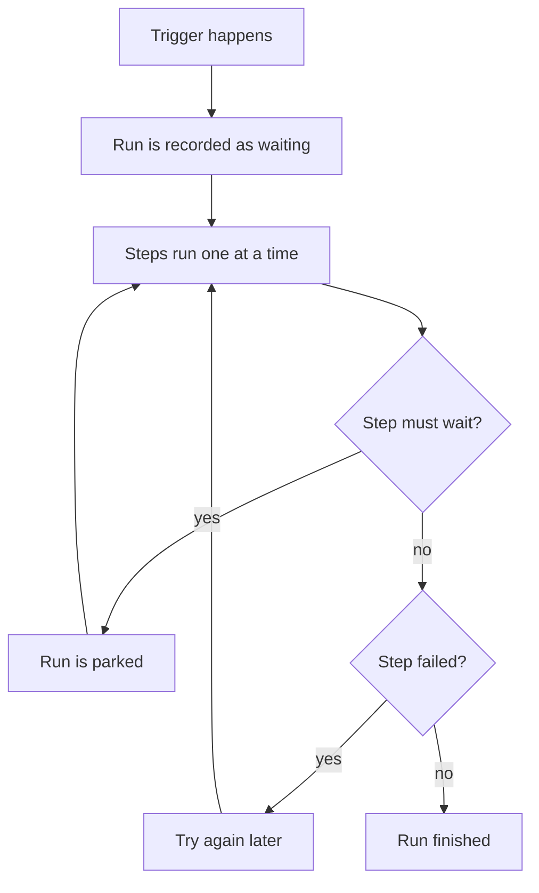

# Flows

**A draft for discussion. Nothing in it is decided, and nothing is built.**

`BIG-PICTURE.md` says what a Table is. `APPS-AND-SHARING.md` says what an app is. Neither designs
automation: the second only has "check before a save" and "react after a save". This document proposes
what a Flow is, shows where it touches what is already agreed, and lists the questions that are the
owner's to answer.

Drafted by Claude on 20 November 2026 from the owner's old vision (`docs/VISION.md` on `main`) and what
he said about it that day. All examples are made up.

## 0. How to read this

- **"Carried"** marks something already agreed elsewhere that a Flow must respect. It is not reopened
  here.
- **"Proposed"** marks my draft. It is there to be argued with.
- **"Open"** marks a question for the owner. Every one is collected in section 12 with a number
  (F1, F2, ...), options, and my leaning where I have one. A leaning is not a decision.
- Sections 1 to 3 are the idea. Sections 4 to 10 are the detail. Section 12 is the list to work
  through, one question at a time.

## 1. What the owner asked for

On 20 November, about the old vision:

> "Most of the ideas there like Flows, Table definitions portable JSON, AI chat like Claude Code
> generating tables and apps and everything, plus humans also doing it manually as equal and valid
> ways. Yes, developer and non-technical users are equal citizens. So we need to keep this in mind."

What the old vision says about Flows, in its own words:

- The old system had a "fragmented automation story (five doctypes, five condition syntaxes, five log
  locations)". It is "replaced by one Flow object" with three kinds of step: **Action, Loop,
  Condition**, "on a durable execution substrate".
- "Developer-facing-only logs" are "replaced by builder-facing run history with inspectable per-step
  payloads".
- "Table metadata and flow definitions are portable JSON documents... These are the crown jewels."
- The gaps it wanted to close in other builders: "no retries/error handling in workflows, no
  versioning... and no testing story".
- The loop for anything an AI makes: generate, validate, apply to a throwaway site, run tests, preview,
  approve, commit.

So four things must hold together:

1. **One automation idea.** A person learns Flows once.
2. **A Flow is a document,** the same whoever made it.
3. **Four equal ways in:** a chat, a screen, a file in a package, and an agent through MCP.
4. **Two equal kinds of maker:** a developer and someone who has never written code.

## 2. A Flow in one page (proposed)

**A Flow says: when this happens, do these steps.**

It has one **trigger** and a list of **steps**. There are three kinds of step.

- **Action.** Do one thing: change a row, send a message, call another system.
- **Loop.** Do the steps inside once for each row in a list.
- **Condition.** Do the steps inside only if something is true, with an optional "otherwise".

Every time a Flow starts, that is a **run**. A run is kept, step by step, with what went in and what
came out, so the person who built the Flow can see what happened without asking a developer.

### An example in words

> **When** an Asset is saved with status "Needs repair"
> 1. **Create a Task:** title "Repair" plus the asset's name, assigned to the asset's keeper.
> 2. **If** the asset's value is over 50,000
>    - **Send a message** to the keeper's manager.

This is what the screen would show, and what the chat would read back before a person approves it.

### The same Flow as a document

A sketch only. The real shape is question F6.

```json
{
  "name": "Open a repair task",
  "when": {
    "table": "assets",
    "on": "saved",
    "if": "status = 'Needs repair'"
  },
  "steps": [
    {
      "do": "create row",
      "table": "tasks",
      "set": {
        "title": "Repair {{asset.name}}",
        "assigned_to": "{{asset.keeper}}"
      }
    },
    {
      "if": "asset.value > 50000",
      "steps": [
        {
          "do": "send message",
          "to": "{{asset.keeper.manager}}",
          "text": "{{asset.name}} needs repair"
        }
      ]
    }
  ]
}
```

### The same Flow, four ways in

- **Chat.** "When an asset needs repair, open a task for its keeper, and tell their manager if it is
  worth more than 50,000." The chat writes the document and shows the words above.
- **Screen.** A person picks the Table, the trigger and each step from lists.
- **File.** A developer writes it in a package, and it arrives on install.
- **Agent.** Claude Code creates it through MCP.

All four produce the same document, and the same check accepts or refuses it. After that, nothing can
tell which way it came in.

## 3. More examples, to test the idea against

Each one stretches the idea in a different direction. All made up.

**A. On a schedule.**
> **Every** morning at 8
> 1. **For each** Task that is past its due date and not done
>    - **Send a message** to the person it is assigned to.

No person triggered this one. Who is it acting as? (F16)

**B. Waiting for a person.**
> **When** a Leave Request is created
> 1. **Ask** the employee's manager to approve.
> 2. **If** approved, **set** status to "Approved". **Otherwise** set it to "Refused".

This run may last three days. It must survive a restart. (F2, F11, F22)

**C. A button.**
> **When** someone presses "Mark as returned" on an Asset
> 1. **Set** the asset's keeper to empty and its status to "In store".
> 2. **Create** a row in Asset History.

The old vision calls this "UI actions and backend automations as one continuum". (F5)

**D. Refusing a save.**
> **When** an Employee is about to be saved
> 1. **If** the leaving date is before the joining date, **refuse** with "Leaving date is before
>    joining date".

This one runs inside the save. It cannot wait or call another system. Is it a Flow at all, or a rule
on the Table? (F1, F10)

**E. After an import.**
> **When** an import into Employees finishes
> 1. **For each** new row with no department
>    - **Create** an Issue "Department is missing".

One import can bring 5,000 rows. One run, or 5,000? (F15)

**F. Another system.**
> **When** an Item is created
> 1. **Send** it to the source system.
> 2. **Save** the id the source returns as an Identifier.

`BIG-PICTURE.md` already describes this as a detached send with its own retry. Is that sender a Flow
underneath, or its own machinery? (F23)

## 4. What is already agreed that a Flow must respect (carried)

**Every write goes through the one save.** A step that changes a row is an ordinary save. The Table's
checks run, the gate is asked, the history is written. A Flow has no back door. (The old system's
workflow, assignment rules and escalation job each wrote rows around the save; the review of it lists
them.)

**The one gate.** Every read and write asks "who is this, and may they?" (answered on 19 November). A
Flow's steps ask the same question, so a Flow needs an answer to "who". (F16)

**Checks before a save, reactions after it** (`APPS-AND-SHARING.md`, decision 9). A check runs inside
the transaction and may refuse. A reaction is queued, retried, and has a log an admin can read and
replay. A Flow that starts from a saved row is very close to a reaction.

**A save commits only in Featherbase's Postgres** (`BIG-PICTURE.md`, point 1). Anything sent elsewhere
is recorded as "to be sent" in the same transaction and delivered afterwards. Any step that reaches
outside follows the same rule.

**Everything a package does is declared** (decision 14): every Table, write, event and outside site.
A Flow that ships in a package is part of that declaration, and the instance check (decision 4) reads
it.

**An owner can close a Table** to "write through my actions only" (decision 8). A Flow from another
package obeys that like any other writer.

**Approvals are built on workflow states** (decision 27). How those relate to a Flow is F22.

**Things that need something to run them later.** Refreshing a copied Table (19 November), Tasker's
scheduled jobs, the email a ticket sends, the sender to source systems. Each needs a queue, a clock
and a retry. A Flow needs exactly the same. Building that once is the strongest practical argument
for Flows. (F23)

## 5. Triggers (proposed)

What can start a Flow. A first list, to cut or extend:

- **A row is saved.** Created, changed or removed, in one Table, optionally only when a condition
  holds ("status became Needs repair").
- **A row is about to be saved.** Inside the save, may refuse. Example D. Only if F1 says so.
- **A time.** Every day at 8, every Monday, or a date on a row ("three days before the due date").
- **A person presses a button** on a row or a list. Example C.
- **Something Featherbase did finishes.** An import, a refresh of a copied Table.
- **A call from outside.** Another system calls an address that belongs to the Flow.
- **Another Flow** calls it. (F4)

"Changed" needs care. A person usually means "this Column went from one value to another", not "the
row was saved". The trigger should let them say that plainly.

## 6. Steps (proposed)

### Actions

A first catalogue, small on purpose:

- **Rows:** create a row, change a row, remove a row, find rows.
- **People:** send a message, ask for a decision (example B).
- **Time:** wait until a date or for a length of time.
- **Outside:** call another system.
- **Packages:** run an action a package offers (decision 8 already lets an owner offer actions).
- **Stop:** end the run, or refuse the save when inside one.

A package can add its own actions to the catalogue. That is how a developer extends what a
non-technical person can build: the developer writes "Post to the accounts system" once, and it
appears in everyone's list of actions.

### Loop

"For each row in a list": rows found by a filter, or the rows that link to the trigger row. It needs a
ceiling so a mistake cannot write a million rows. (F4)

### Condition

"If this is true, do these, otherwise do those."

### How a step names a value

A step needs to say "the asset's keeper's manager" or "the task created in step 1". That is a small
language. The old system ended up with five filter compilers and four lists of operators. The gate's
"only for certain rows", a list filter, a computed Column and a Flow condition all say the same kind
of thing. Whether they share one language is F3, and it reaches well beyond Flows.

## 7. One document, four ways in (proposed)

**The rule that makes the four ways equal:** there is one definition, one check that accepts or
refuses it, and one place it is stored. The chat, the screen, the file and MCP are four editors of
the same thing. None of them can make something the others cannot open.

What follows from that rule:

- **The screen can open a Flow that came from a package file,** and show it in words.
- **A Flow made on the screen can be taken out as a file** and put in a package, with no change in
  what it does. The old vision calls this promotion, and makes "promotion never moves data" an
  invariant.
- **The chat never has a private format.** It writes the same document a person could have built by
  hand, and a person can carry on by hand from where the chat stopped.
- **Anything a Flow can express, the screen must be able to show.** This is a real limit on how clever
  the document is allowed to become. If a developer needs more, they write an action in code and the
  Flow calls it.

**The same rule for Tables.** The owner asked for Table definitions as portable JSON in the same
breath. A Flow names Tables and Columns, so a Flow is only portable if the Tables it names are. The
two formats should be designed together. (F7)

**A tension to settle.** `APPS-AND-SHARING.md` section 10 says "the owner prefers readable code to
large JSON". The vision says the JSON documents are "the crown jewels". These can both be true if the
document is what is stored and exchanged and a readable file is one way of writing it, but that is
the owner's call. (F6)

**The proposal screen.** The import already has the pattern: Featherbase proposes, a person reads it
and confirms. A Flow from the chat should go through the same kind of screen, in words, with a trial
run on a real row before it is switched on. (F19, F21)

## 8. Running a Flow (proposed)



- **Recorded with the save.** When a saved row starts a Flow, the run is written down in the same
  transaction as the row. If the save is undone, so is the run. If the save stands, the run cannot be
  lost. This is the "to be sent" pattern from `BIG-PICTURE.md`.
- **One step at a time, each recorded.** What went in, what came out, how long it took, and any error.
- **A failed step is tried again,** a few times, further apart. After that the run stops and someone
  is told. (F12)
- **A step may run twice.** If the server stops between doing a step and recording it, the step is
  repeated. So actions must be safe to repeat: "create a task for this asset's repair" must not make
  two. This is the hard part of any such system, and it should be solved once in the platform, not by
  each person who builds a Flow.
- **A run can wait** for a date or for a person, for days. It holds no connection while it waits.
- **A person can open a run** and see each step, and run it again from the step that failed.
- **A Flow's own changes are ordinary saves,** so they can start other Flows. That needs a guard
  against two Flows starting each other for ever. (F13)

What does the running: a queue kept in Postgres, or a library made for this. (F11)

## 9. Who a Flow acts as, and who may make one (open)

This is the part I am least willing to guess, because access is being designed slowly and carefully
in the main thread right now.

**Who it acts as.** Example A runs at 8 in the morning with nobody there. Example C runs because a
person pressed a button. The candidates: the person whose action started it, the person who made the
Flow, or a named identity that belongs to the Flow with its own role. Each has a known failure. If it
acts as the person who started it, the Flow breaks for anyone who cannot do one of its steps. If it
acts as its maker, a person can do through the Flow what they could not do by hand, and it breaks
when the maker leaves. (F16)

**Who may make one.** "Non-technical users are equal citizens" suggests anyone can make a Flow on
their own Tables in their work area. A Flow on a shared Table is different: it acts on everyone's
rows. (F17)

**Reaching outside.** A step that calls another system needs an address and often a secret. Decision
14 says a package declares every outside site. The old system removed its encrypted store. (F18)

## 10. Where a Flow lives (proposed)

By the same three kinds of place a Table has:

- **In a package.** It ships with the app, is reviewed with it, and is upgraded by comparison
  (decision 19): the definition in the file is compared with what is installed.
- **In the instance.** An administrator made it on the screen for this client.
- **In a person's work area.** Their own, on their own Tables.

Two questions come straight out of this. If an administrator edits a Flow that a package shipped, does
the next upgrade overwrite the edit? The same question was answered for access sentences on 20
November: hand edits survive. (F9) And if a Flow reacts to another package's Table, that is decision
9's reaction, so it must be declared for the instance check. A Flow made on the screen is not in any
package's declaration. Does the instance check read those too? (F17)

In the folder map, the engine would be a foundation (`features/foundations/flows/`) and making a Flow
would be a feature a person can demo (`features/automating-work/` or similar). Names are F26.

## 11. What a Flow is not (proposed boundaries)

Each of these is a place the idea could spread until it becomes a programming language. I propose
saying no to each, and each is open.

- **Not a computed Column.** "Full name is first name plus last name" is a value, always true. It is
  not something that happens.
- **Not an access rule.** Who may see a row is the gate's sentences, never a Flow that hides rows.
- **Not the import.** Reading a file, proposing a Table and cleaning rows are their own features. A
  Flow can start when an import finishes.
- **Not a place for code.** No scripts typed into a box inside a Flow. The old system had Server
  Scripts. A developer who needs code writes an action in a package.
- **Not a diagram.** The screen shows a short list of sentences, not boxes and arrows. It reads on a
  tablet, and it is what the chat reads back.

## 12. Open questions for the owner

To be taken one at a time. The first three shape everything else, so I would start there.

### Ask first

**F1. Is a Flow the only automation idea, or the top layer of two?**
Decision 9 gives packages a check before a save and a reaction after it, written in code.
- **A. Everything is a Flow.** A check and a reaction are both Flows. Package code only supplies
  actions. *For:* one idea, as the vision says. *Against:* a check inside a save must be fast and can
  never wait, so it would be a Flow with most of Flows switched off.
- **B. Reactions are Flows, checks are not.** Anything after a save, on a clock or from a button is a
  Flow. A rule that refuses a save belongs to the Table. *For:* each thing does one job. *Against:*
  two ideas to learn, and "refuse this save" is something non-technical people want too.
- **C. Flows on top, code hooks underneath.** Packages keep decision 9 in code. People build Flows.
  *For:* nothing agreed changes. *Against:* the same reaction can be written two ways, with two logs.
  That is the old system's problem again.

Leaning: B, with Table rules made easy to state by hand.

**F6. What form is the definition kept and moved in?**
- **A. JSON is the form everywhere,** in the database and in a package's files. *For:* one form.
  The chat, the screen and MCP all write it natively. *Against:* the owner has said he prefers
  readable code to large JSON, and a long Flow in JSON is hard to review in a pull request.
- **B. JSON is stored and exchanged. A package may write it as a short readable file** that produces
  the same document. *For:* both of the owner's statements hold. *Against:* two spellings, and the
  round trip (screen to file and back) has to be exact and tested.
- **C. Code is the form. JSON is only an export.** *For:* best for developers. *Against:* the screen
  and the chat cannot edit code safely, so the ways in stop being equal.

Leaning: B.

**F25. When do Flows enter the build order, and what is the first one built?**
Section 10 of `APPS-AND-SHARING.md` has no place for them. Something that runs work later (a queue, a
clock, a retry) is needed anyway for refreshing a copied Table. Candidates for the smallest useful
first Flow: "when a row is saved, create a row in another Table", or "every night, refresh this
copied Table".

### The shape of a Flow

**F2. Are three kinds of step enough?** "Wait", "ask a person" and "refuse" are drafted here as
Actions. Missing on purpose: steps that run side by side, and "if this step fails, do that instead".
Add them now, later, or never?

**F3. One language for conditions everywhere?** A Flow condition, a list filter, the gate's "only for
certain rows" and a computed Column all compare values. One shared language, or one each? This is
larger than Flows and may belong in the Table discussion.

**F4. Can a Flow call another Flow, and what is the ceiling on a loop?**

**F5. Is a button on a row a Flow?** The vision says yes ("one continuum"). Decision 18 already has
"commands" as a kind of contribution. Is a command simply a Flow whose trigger is a button?

### The definition

**F7. Table definitions as portable JSON.** Is it the same answer as F6? What does a Table's document
hold: Columns, links, what makes a row unique, Choices, what it belongs to, its access sentences? Does
it ever carry rows?

**F8. Changing a Flow that has runs in flight.** Does a waiting run finish on the old definition or
the new one? Is there a draft that is edited and a live copy that runs? Is every past version kept?

**F9. Does a hand edit to a package's Flow survive an upgrade?** The matching answer for access
sentences was yes.

### Running

**F10. Inside the save, or after it?** Follows from F1. If a Flow can run inside a save, which
actions are allowed there?

**F11. What runs the Flows?** A queue we build in Postgres, or a library made for durable runs. This
needs a short evaluation before anyone chooses, like the owner's stack evaluation. What must it
promise?

**F12. When a run fails for good:** how many tries, who is told, and how long is run history kept?

**F13. Two Flows that start each other.** Stop at a depth, refuse at the time the second Flow is
made, or both?

**F14. Order.** When three Flows start from one save, does order matter? Decision 9 says checks run
in install order. For Flows that run after the save, I propose no promised order.

**F15. An import of 5,000 rows:** one run that is handed the rows, or 5,000 runs?

### Access

**F16. Who does a Flow act as?** The person who started it, its maker, or an identity of its own.
See section 9. Best settled after the "where" walk-through in the main thread.

**F17. Who may make a Flow, and on which Tables?** Anyone in their own work area? Who may switch on a
Flow over a shared Table, and is there a review first, like promoting a Table? Does the instance
check read Flows made on the screen?

**F18. Outside systems.** Where are addresses and secrets kept, and who may add one? This joins
question 18 in `APPS-AND-SHARING.md`.

### The ways in

**F19. Where is the chat?** Inside Featherbase as its own screen, outside it as Claude Code through
MCP, or both? The third journey on this branch already has Claude Code doing an import through MCP.
Whichever it is, does what the chat makes always pass through a proposal a person confirms?

**F20. What is the screen for building by hand?** I propose a list of sentences with pick lists, not
a canvas. Server-rendered pages may not be enough for it, and the stack rule says that is decided and
recorded each time.

**F21. How is a Flow tested?** The vision's loop is: validate, apply to a throwaway site, run tests,
preview, approve. Proposed: every Flow carries at least one example ("given this row, these things
happen") that is shown as the preview and kept as its test. Does a trial run really send messages?

### Fit with the rest

**F22. Approvals and workflow states.** Is an approval a step that waits for a person (example B), a
set of states on the Table with Flows on the moves between them, or both? Decision 27 says approvals
use workflow states.

**F23. Which planned machinery becomes a Flow underneath?** The sender to source systems, the refresh
of a copied Table, scheduled jobs, emails. If all of them, Flows come early in the build. If none,
there are again several queues and several logs.

**F24. Other instances.** May a Flow read or write a Table that lives in another instance, inside the
Connection's ceiling? I propose: not at first.

**F26. The words.** Flow, trigger, step, action, loop, condition, run. None is approved, and
"action" is already used in `APPS-AND-SHARING.md` for what a package offers.

## 13. What I checked, and what I did not

- Read in full: `BIG-PICTURE.md`, `APPS-AND-SHARING.md`, `docs/VISION.md` on `main`, and the owner's
  answers of 19 and 20 November in the planning thread.
- Read in part: the old-system review and the capabilities ledger, for workflow, jobs and
  notifications only.
- **Not checked:** the old vision's claims about Glide. I have not read Glide's own documentation, so
  "three kinds of step" is taken from the vision, not from the source.
- **Not done:** any comparison of libraries for durable runs (F11), and any reading of how other
  builders test automations (F21). Both are worth a short piece of research before those questions
  are asked.
