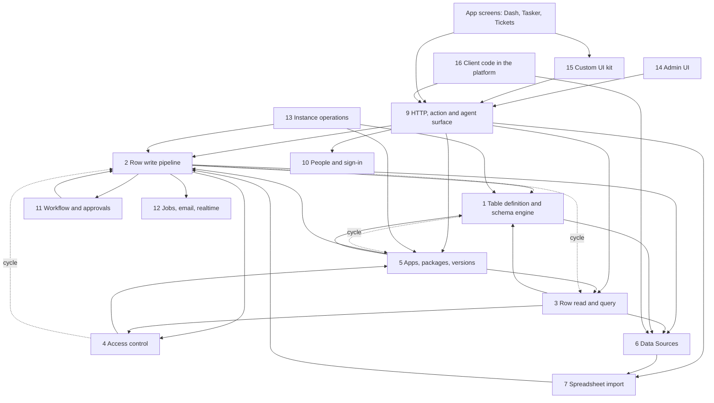

# Review of the old Featherbase

Analysis and planning only. Nothing in the repository was changed apart from this file, which is uncommitted.
Written 15-Nov-2026 against `main` at `0e7ac3e`.

**How to read the evidence.** `S/` means `apps/server/src/`. Every claim carries a `file:line` or a command.
The scan was split across seven read-only agents; I re-ran the checks marked ✔ myself. Items I could not
verify are listed in [What was not verified](#what-was-not-verified). No test suite was run (the session has no
database), so behaviour claims come from reading code, not from executing it.

**Limits of the history.** The clone is shallow: 518 commits, 09-Nov to 12-Nov-2026
(`git rev-parse --is-shallow-repository` → `true`). Churn figures describe those four days only.

> The owner has since decided to rebuild from scratch on a new branch, on Bun and ElysiaJS. This review of the
> old system stays as background. The design that replaced its recommendations is in `BIG-PICTURE.md`. Sections
> 3 to 5 below (decisions, sequence, first modules) are superseded.

## Contents

1. [Module map](#1-module-map-of-the-current-system)
2. [Design assessment per module](#2-design-assessment-per-module)
3. [Decisions the owner must make](#3-decisions-the-owner-must-make)
4. [Rebuild sequence](#4-rebuild-sequence)
5. [The first three modules in detail](#5-the-first-three-modules-in-detail)
6. [Test suite triage](#6-test-suite-triage)
7. [Framework checkpoint](#7-framework-checkpoint)
8. [Quick wins](#8-quick-wins-that-dont-wait-for-the-rebuild)
9. [Summary](#summary)

---

## 1. Module map of the current system

Sizes: server source is 42,588 lines in 221 files; server tests are 350 `*.test.ts` files, 83,395 lines;
web source is 33,484 lines; web tests are 324 files, 55,316 lines. Source lines per module are `wc -l` over the
files named. Test lines per module are **approximate**: they are matched by test file name, and many test files
cross modules. Spec counts are requirements / scenarios from `openspec/specs/<name>/spec.md`.

| # | Module (what it does) | Main files | Src lines | Test lines (approx) | Specs (req / scen) | Depended on by |
|---|---|---|---|---|---|---|
| 1 | **Table definition and schema engine**: holds what a Table is, turns it into DDL, renames, archives, views, overlays | `S/table-engine.ts` 1,289, `S/meta.ts` 466, `S/table-rename.ts` 316, `S/views.ts`, `S/custom-fields.ts`, `S/customizations.ts`, `S/platform-schema.ts`, `S/table-def-routes.ts` | 2,742 | 4,800 | tables-and-fields 57/101, naming-and-numbering 13/18, table-views 8/11, table-deletion 8/14, table-addresses 5/7, metadata-override-validation 3/10 | Everything. `meta.ts` has 72 non-test importers, `table-engine.ts` 38 |
| 2 | **Row write pipeline**: validate, id, permission, triggers, sub-table rows, history, submit/cancel/amend, retire, rename, delete, purge | `S/document.ts` 2,297, `S/controllers.ts` + `S/controllers/*` (26 files), `S/action-transaction.ts`, `S/purge.ts` 524, `S/db.ts` 250 | 5,180 | 3,400 | row-deletion 15/19, row-retirement 13/16, comments-and-history 5/13, files-and-sharing 10/19, assignments-tags-and-rules 7/19 | Import, apps, workflow, CLI, MCP, jobs, instance settings. `document.ts` has 42 non-test importers |
| 3 | **Row read and query engine**: scoped list, count, group, sum, search, reports | `S/query.ts` 676, `S/search.ts`, `S/saved-views.ts`, `S/reports/*`, `S/script-report.ts` | 1,120 | 1,300 | list-view 30/51 (server part), search-and-explore 20/36, reports-and-charts 15/24, saved-views 5/9 | Admin UI, apps (`documents.list`), MCP, search, titles |
| 4 | **Access control**: roles, grants, own rows, Data Scope, Shares, Tier, mandatory policy, app access | `S/permissions.ts` 454, `S/mandatory-access.ts`, `S/security-tables.ts`, `S/person-scope.ts`, `S/app-access.ts`, `S/app-role-bindings.ts`, `S/access-explanation.ts` | 1,651 | 6,000 | permissions-and-roles 22/45, app-roles-store-access 12/27, mandatory-work-privacy 3/3, access-explanation 6/15 | Modules 2, 3, 5, 6, 9; check functions are called from 39 files |
| 5 | **Apps, packages and versions**: discover, install, upgrade, disable, deliver, app actions/reads, app jobs, datasets | `S/runtime-packages.ts` 1,013, `S/apps.ts` 860, `S/runtime-migrations.ts` 624, `S/runtime-actions.ts`, `S/app-lifecycle.ts`, `S/app-delivery.ts`, `S/app-datasets.ts` 639, `S/app-jobs.ts`, `S/sample-apps/*` | 6,260 | 12,650 | trusted-runtime-packages 42/69, transactional-runtime-actions 12/24, app-management 5/16, app-navigation 2/4, glossary 8/10 | Dash, Tasker, Tickets, Equipment; every `/api/*` request (lifecycle lock) |
| 6 | **Data Sources**: connect Postgres, DuckDB, MotherDuck, CSV folder; reflect; bound Tables; copies | `S/sources/*` (15 files, 3,101), `S/copy-refresh.ts`, `S/master-sync.ts` 435, `S/motherduck-*.ts` | 3,850 | 6,350 | external-data-sources 51/83, master-data-sync 4/5 | Dash datasets, Admin source browser, modules 1–3 (about 90 fork sites) |
| 7 | **Spreadsheet import**: map, match, dry run, keyed upsert, conflicts, undo | `S/actions/collection-import.ts` 608, `S/actions/collection-import-revert.ts`, `S/import-corrections.ts`, `S/import-batches.ts`, `packages/shared/src/import.ts` 695, `apps/web/src/pages/ImportWizard.tsx` 2,516 | 2,070 (+2,516 web) | 3,280 (`test/import/`) | spreadsheet-import 31/63, import-history-and-undo 12/19, table-merge 5/5 | Table copy, MCP import tool |
| 8 | **Seeds**: no module; at least eight mechanisms | `S/seed-packs.ts`, `S/preview-seed.ts`, `S/apps.ts:341-361` (fixtures), `apps/server/migrations/0001_baseline.sql`, `tools/seed-*.mjs`, app scripts | — | — | none | — |
| 9 | **HTTP, action and agent surface**: routes, action registry, MCP, errors, rate limits, files | `S/index.ts` 1,931, `S/actions.ts` 121, `S/actions/*` 1,565, `S/mcp*.ts`, `S/people-routes.ts`, `S/app-routes.ts` | 3,900 | 1,800 | agent-access 21/32, running-an-instance 38/69 (part), access-tokens 15/24 | Admin UI (about 90 distinct `/api` paths from 95 web files), app UIs, agents |
| 10 | **People, sign-in and identity** | `S/auth.ts`, `S/sign-in.ts`, `S/oauth.ts`, `S/identities.ts` 740, `S/person-identifiers.ts` 635, `S/delegated-login.ts`, `S/roster-*.ts`, `S/leaver-check.ts` | 6,180 | 8,970 | sign-in-and-accounts 60/147 | Every request |
| 11 | **Workflow and approvals**: state machine, Change Proposals, assignment, SLA, Server Scripts | `S/workflow.ts` 369, `S/change-proposals.ts` 542, `S/assignment-rules.ts`, `S/sla.ts`, `S/server-scripts.ts` | 1,260 | 2,770 | workflow-and-approvals 16/40, checklists 7/14 | Module 2 calls it by name; Dash uses Change Proposals |
| 12 | **Jobs, email, notifications, realtime** | `S/jobs.ts` 485, `S/jobs/*`, `S/email.ts`, `S/email-rules.ts`, `S/realtime.ts` | 2,100 | 3,260 | background-and-scheduled-jobs 19/30, notifications-email-and-webhooks 14/24 | Modules 2, 5, 6 |
| 13 | **Instance operations**: CLI, migrations, release, deploy, settings, health | `S/cli.ts` 705, `S/migrate.ts`, `S/release-preflight.ts`, `S/deploy-instance.ts`, `S/instance-settings.ts` 762, `S/instance-health.ts`, `S/env.ts` | 4,570 | 6,060 | running-an-instance 38/69, instance-settings 13/19, instance-health 8/22 | Deploys, Dash instance |
| 14 | **Admin UI**: one list, one form, table builder, source browser | `apps/web/src/components/ListView.tsx` 1,144, `FormView.tsx` 1,067, `FieldControl.tsx`, `router.tsx` 1,066, `lib/api.ts`, `lib/meta.ts` | 33,484 | 55,316 | core-forms 31/47, list-view 30/51, record-workspace 7/17, admin-ui-feedback 16/33, dashboards-and-home-pages 16/23, 6 more | Operators |
| 15 | **Custom UI kit**: components, theme, bar and sidebar contract | `packages/shop-floor` (about 4,360), `apps/web/src/bar/*`, `S/runtime-shell.ts` | 4,570 | covered by web tests | native-prototype-library 4/5, trusted-runtime-packages (screens) | Dash, Tasker, Tickets, Equipment |
| 16 | **Client code living in the platform** | `S/sales-target.ts` 696, `S/sales-target-report.ts` 332, `S/datasets/sales-target-mtd.ts`, `apps/web/src/pages/SalesTarget.tsx` 668, `S/landing.ts:48` | 1,275 (+668 web) | 1,620 | sales-target-report 28/50 | Used only when Dash is not installed (`S/landing.ts:48` ✔) |

App and client specs (34 of the 84) are not platform modules: 19 `tasker-*`, 5 `tickets-*`, 6 asset specs, and
`dash-reports`, `feather-dash-people`, `my-sections`, `sales-target-report`.



The dotted edges are real import cycles: `S/permissions.ts:7` ↔ `S/mandatory-access.ts:5`,
`S/document.ts:12` ↔ `S/purge.ts:11`, `S/document.ts:24` ↔ `S/workflow.ts:9`, and `S/apps.ts` ↔
`S/runtime-packages.ts` patched with seven dynamic `import()` calls (`S/apps.ts:613, 622, 624, 777, 816, 826, 839`).

**Churn (four days of history).** Command:
`git log --no-merges --name-only --format= | awk -F/ '{print $1"/"$2"/"$3}' | sort | uniq -c | sort -rn`.
Lines changed by path: `openspec/changes` 14,841, `apps/server/test` 5,687, `apps/web/test` 4,695,
`apps/server/src` 3,286, `apps/web/src` 2,419. The most-touched server file is `S/runtime-packages.ts`
(12 commits; next are `index.ts`, `change-proposals.ts` at 6). Tests and planning artifacts change about three
times as much as source.

---

## 2. Design assessment per module

Verdicts: **keep** (leave alone), **reshape** (same idea, cleaner seams), **rebuild** (new design, decisions needed first).

### 2.1 Table definition and schema engine — rebuild the model, keep the DDL mechanics

**Sound.**
- Schema sync is non-destructive: removal must be named (`S/table-engine.ts:606-634`), rename is its own
  operation (`S/table-rename.ts`), type change is a whitelist (`S/table-engine.ts:72-80`).
- SQL safety: DML uses tagged templates; DDL goes through `quoteIdent` and a strict name regex
  (`S/sql-identifier.ts:4-12`). 55 `.unsafe(` calls in 14 files, 19 of them in `table-engine.ts` ✔.
- Decisions that already left Frappe: `row_id` key (ADR 0009), `kind` enum, Views as metadata, retirement (ADR 0019).
- App Tables get their own Postgres schema (`S/table-engine.ts:1043-1048`).

**Inherited or accidental.**
- `varchar(140)` for Data and Reference (`S/table-engine.ts:49, 59`); Section Break and Column Break as column
  types (`S/meta.ts:27-28`); Settings Tables in an EAV store (`S/document.ts:2200-2297`); `submission_status` on
  every table (`S/table-engine.ts:29, 417`).
- No NOT NULL, no foreign keys, no indexes beyond the key: `reqd` and Reference integrity live only in
  application code (`S/document.ts:300-361`).
- A SELECT-only row-level security policy is created per table (`S/table-engine.ts:447-462`), but nothing in
  `S/` sets `app.user` (`grep -rn "app\.user" apps/server/src` is empty ✔). It is not enforcement.

**Tangles.**
- **Where a Table lives is implicit.** It is inferred from four unrelated column groups on `table_def`: `kind`;
  `data_source` + `external_*`; `owner_app` + `physical_schema` + `physical_relation`; `system`,
  `system_written`, `custom` (`apps/server/migrations/0001_baseline.sql:1587-1618`). Nothing can say
  "outside, but managed by us". `tableStorageIdentity()` already computes a unified answer
  (`S/table-engine.ts:373-389` ✔) and is the seed of an explicit descriptor.
- **The Table type exists four times**: `S/meta.ts:32,101`, `apps/web/src/lib/meta.ts:6,41`,
  `packages/shared/src/schema.ts:18`, `S/mcp-common.ts:31`. `TableDef` is a fifth, inferred from zod at
  `S/table-engine.ts:143-213`. A `column_def` row is assembled by hand in four places
  (`S/table-engine.ts:659-674`, `:1059-1077`, `S/custom-fields.ts:62-75`, `S/workflow.ts:155-163`).
- `getMeta` does unrelated work: app availability, tombstone wording from `access_log`, source enrichment
  (`S/meta.ts:357-426`).
- Unqualified SQL is schema-qualified by a regex rewrite of SQL text (`S/platform-schema.ts:59-66` ✔).
- `updateTable` has no ownership guard: `owner_app` appears in `table-engine.ts` only at lines 368, 1045,
  1123-1124 ✔. A System Manager can apparently reshape an app's Table through `PUT /api/table_def/...`, and the
  next app upgrade compares manifests, not the live database (`S/runtime-packages.ts:650-652`). Not exercised.

### 2.2 Row write pipeline — rebuild

**Sound.** `for update` plus an `updated_at` check; a fixed lock order (`S/row-lock-order.ts`); after-commit
effects that drop with a rolled-back savepoint (`S/action-transaction.ts:27-47`); validation generated from
metadata into zod and shared with the client (`packages/shared/src/schema.ts:113`); a small hook registry
(`S/controllers.ts`, 122 lines); purge plans, then re-plans under lock (`S/purge.ts:360-386`).

**Inherited.** Fifteen Frappe hook events (`S/controllers.ts:28-55`); submit/cancel/amend
(`S/document.ts:1500-1618`); Sub-table rows with `parent`/`parenttype`/`parentfield` and replace-all saving
(`S/document.ts:721-786`); id patterns `PREFIX-.###`, `hash`, `prompt`, `field:` (`S/document.ts:120-206`).

**Tangles.**
- `document.ts` does at least nine jobs: ids, validation, Reference integrity, Sub-tables, history, lifecycle,
  a second write path for bound Tables, the Settings store, and UI capability advice (`S/document.ts:2054-2125`).
- **The lifecycle is hand-copied seven times with differences**: `writeDoc`, `updateDoc`, `saveBoundDoc`,
  `updateBoundDoc`, `setStatus`, `setRetirement`, `renameDocImpl`. `setStatus` runs no validate hooks and writes
  no Version (`S/document.ts:1517-1565`); rename writes no Version (`:1987-2043`); the bound path has no
  Server Scripts, no Version and no deferred effects (`:1109-1170` ✔).
- **Invariant 2 does not hold today.** Writes that skip the chain: workflow action (`S/workflow.ts:263-266` ✔),
  assignment rule (`S/assignment-rules.ts:74`), SLA job (`S/jobs/sla-escalation.ts:49`),
  `S/runtime-actions.ts:181`, table-delete pointer sweep (`S/table-engine.ts:1182-1200`). Bound-Table writes run
  hooks in the platform database while the write is one un-transacted statement at the source.
- Side-effect subsystems are called by name, not registered: SLA, workflow, email rules, assignment rules,
  webhooks (`S/document.ts:1014-1023, 1098-1105`).
- The generic save knows specific Tables: `Person.enabled` (`S/document.ts:643-668`), `File.file_url`
  (`:898-914`), `Permission` revoke (`:1643-1645`), `Workflow` in the error mapper (`:278`),
  `System Settings.everyone_roles` (`:2242-2248`).
- Transaction carriage is mixed: `document.ts` uses explicit `tx` from `sql.begin`, while helpers called inside
  use the global `sql`, which joins the transaction only under an outer `withTransaction`
  (`S/db.ts:44-52` ✔). I read this, I did not run it.

### 2.3 Row read and query engine — reshape

**Sound.** One scoped WHERE builder (`S/query.ts:101-372`) reused by list, count, group, sum, search and titles,
so list and aggregate cannot disagree about visibility. `related` filters recurse into the target's own scope.

**Tangles.**
- Bound Tables are refused by the compiler (`S/query.ts:121-128` ✔) and handled by a **second implementation**:
  `S/sources/dispatch.ts` re-does filter mapping (`:216-267`), Data Scope (`:291-308`) and limits
  (`:331-353`), and each driver has its own WHERE builder (`S/sources/postgres-driver.ts:81-146`,
  `S/sources/duckdb-driver.ts:189-…`, in-memory at `S/sources/csv-driver.ts:157-…`). That is four filter
  compilers.
- List arguments are Frappe's wire shape: `filters` triples, `limit_start`, `limit_page_length`, `order_by`
  (`S/query.ts:19-27`; `apps/web/src/lib/api.ts:200-229`). The same shape is the app SDK contract
  (`packages/shared/src/runtime-actions.ts:4`). This conflicts with invariant 4.
- Rules for `File`, `Comment`, `Version` and a `Table` tombstone sit inside the generic builder
  (`S/query.ts:171, 192-198, 439`).

### 2.4 Access control — rebuild behind one decision point

**Sound.** After #917 a Permission is one row per Table, role and operation with an explicit column rule and
fail-closed prerequisites (`S/permissions.ts:97-123`); an unpermitted column change is refused, not dropped
(`:430-447`); `scopedWhere` puts the same predicate on every read.

**Inherited.** Role matrix, own rows, Data Scope (Frappe's User Permission, including "every Reference to a
scoped Table narrows", `S/permissions.ts:295-297`), Share, Tier; submit/cancel/amend as permission operations.

**Tangles.**
- **At least nine mechanisms decide access**, in different files: role grants, own rows, Tier, Data Scope,
  Share (`S/permissions.ts`); mandatory access policy that binds administrators too
  (`S/mandatory-access.ts:58-112`); security Tables (`S/security-tables.ts`); system-written and archived gates
  (`S/system-written.ts`); app access with `policy.kind` `table | stores | person_scope` and scope providers
  (`S/app-access.ts:211-240`); plus View and bound-source gates.
- **Enforcement is by convention.** Each operation calls the primitives in its own order: `document.ts` has 92
  check lines, `index.ts` 22, and 39 files in all call them. `rowCapabilities` re-implements the write checks
  to advise the UI (`S/document.ts:2054-2125`).
- **Bypasses**: `user = 'Administrator'` as a default parameter on ten functions in `document.ts` and five in
  `query.ts`; `skipPermissions` (`S/document.ts:897`); `saveSystemRow` (`:937`); `runAsSystemActor`.
- **The platform's security list names one client's Tables**: `Sales Target Assignment`,
  `Employee Section Map`, `Section Ownership`, `Store Manager` (`S/security-tables.ts:32-37` ✔).
- **Specs contradict each other on the administrator.** `permissions-and-roles:11` "A System Manager can do
  anything on any table" versus `mandatory-work-privacy:9` "no administrator exception" and
  `app-roles-store-access:13`. Own rows on connected Tables: `permissions-and-roles:64` says it holds
  everywhere; `external-data-sources:242` says every read through it is refused.
- No ADR covers the permission model; it exists only in specs and `CONTEXT.md`.

### 2.5 Apps, packages and versions — rebuild the model, keep the upgrade safety

**Sound.** Strict zod manifest; app-qualified Table names; reviewed upgrade plans with a `planId` and loss
counting in a rolled-back transaction (`S/runtime-packages.ts:704-712`); upgrades may only narrow permissions
(`:653-692`); atomic install; secrets as named environment variables; the app action pipeline (idempotency key,
authorisation, one transaction, replay: `S/runtime-actions.ts:230-274`), which is the best-designed boundary
in the server.

**Tangles.**
- **Three app models share one ledger**: runtime packages (`S/runtime-packages.ts:332-355`), in-process
  `AppManifest` objects registered at boot (`S/index.ts:117-122` ✔, `S/apps.ts:91-123`), and a declarative JSON
  body to `POST /api/install_app` (`S/apps.ts:683-726`). Only the two legacy models can ship fixture rows or
  uninstall; `apps.ts` branches on `runtime_package` at ten sites.
- **Definitions are large JSON.** `client-apps/jeyarama/dash/featherbase.json` is 2,257 lines;
  `example-apps/tasker/featherbase.json` is 2,085 and repeats `tasker.issue` in full at line 601 (inside a
  migration) and line 1576 (in `tables`). The manifest has about 25 top-level keys
  (`S/runtime-packages.ts:103-155`), most added for one app.
- **No source of truth between files and the database.** After install the engine reads `table_def`; the stored
  manifest is used only for upgrade comparison. There is no export of a Table definition to a file; only
  Custom Fields and Metadata Overrides export (`S/customizations.ts:34`).
- **Every `/api/*` request takes a global advisory lock** on a second connection pool, with path-string
  exemptions in middleware (`S/index.ts:644-660` ✔; `S/app-lifecycle.ts:68-80`). Deploys need a 20×15 s retry
  loop (`S/app-lifecycle.ts:101-151`).
- **In-memory registries must agree with the database**: `available`, `wired`, `packages`, `artifacts`,
  `activeApps`, `sources`, `preparations`. Listing installed apps wires them as a side effect
  (`S/apps.ts:811-827`).
- **The layer rule is broken in platform source.** `if (app === 'dash' …)` (`S/landing.ts:48` ✔);
  `INTERIM_APPS.dash` (`packages/shared/src/app-routes.ts:37-38`); `S/sales-target.ts` cites
  `JeyaramaGroup/data-warehouse#3755`; `S/leaver-check.ts:199-205` hard-codes the client's HR system;
  `apps/server/seeds/jeyarama/`; `S/master-sync.ts:19, 47` calls an action on the Tickets app by name;
  `S/sample-apps/helpdesk.ts` and `checklists.ts` are apps inside platform source.
  `check:platform-imports` catches imports only (`tools/check-platform-imports.mjs:27-44`), and the one test for
  names is pinned as a known failure (`apps/server/test/platform-names-no-app.test.ts:35`, #550).
- A legacy permission shape is still accepted (`S/apps.ts:637`), against the "no shims" rule.

### 2.6 Data Sources — reshape the seam, rebuild the model it plugs into

**Sound.** The `SourceDriver` interface (`S/sources/types.ts:143-177` ✔); credentials as the name of an
environment variable; an allowlist enforced on every query (`S/sources/dispatch.ts:75`); a guard that a source
is not the platform's own database (`S/sources/platform-guard.ts:25-66`); reflection that is independent of
foreign-key order (`S/sources/reflect.ts:403-447`); "copy = one import run" (`S/sources/table-copy.ts:214-217`).

**Tangles.**
- **Two engines, not one Table model.** `isBound` or `.data_source` is tested on 90 lines in 21 files outside
  `sources/` ✔ (`grep -rnE "isBound|\.data_source" apps/server/src | grep -v "/sources/" | wc -l`). A bound Table
  cannot do sums, most `related` filters, history, Sub-tables, submit, own rows, import, retirement, Views,
  mandatory access, app ownership, rename or Change Proposals.
- **No path to take-over.** The driver has no DDL, no transaction handle and no bulk write. The binding is
  immutable and a local Table cannot become bound (`S/table-engine.ts:545-552` ✔). Reflection reads no unique,
  check, composite key, index or default value. The spec promises "never creates, changes or drops anything at
  the other end" (`external-data-sources:203-209`), and ADR 0007 decides "no DDL on foreign sources".
- Copy bypasses the seam: `S/sources/table-copy.ts:20` imports the DuckDB driver directly, so copies work only
  for DuckDB and MotherDuck.
- Nine MotherDuck actions sit on the generic every-Table action registry (`S/actions/motherduck-actions.ts`).

### 2.7 Spreadsheet import — keep the engine, build the missing first half

**Sound and reusable.** Shared pure inference and coercion (`packages/shared/src/import.ts`); keyed upsert with
dry run (`S/actions/collection-import.ts:60-151, 365-443`); protection of a person's corrections on re-import
with recorded conflicts (`S/import-corrections.ts:36-147`); run and batch log; undo by run
(`S/actions/collection-import-revert.ts`).

**Missing against the owner's lifecycle.**

| Stage | Today |
|---|---|
| Raw upload kept (bronze) | **Missing.** The file is parsed in the browser (`apps/web/src/lib/parse-file.ts:205-253`); the server never receives it. The only copy of raw rows is browser `sessionStorage`, allowed to fail for large workbooks (`apps/web/src/lib/import-session.ts:9-25`) |
| Data-quality issues | Per row and column at dry run and run, but ephemeral: the response plus a 20-line sample in the Import Log (`S/actions/collection-import.ts:563-607`). Rejected rows' values are stored nowhere |
| Correct them | Only by fixing the file, or by editing the saved row afterwards |
| Cleaned Table (silver) | Exists: the import target |
| Re-import | Strong |

**Limits.** 10,000 rows per request (`S/actions/collection-import.ts:26, 271` ✔); each row goes through
`saveDoc` one at a time; bound Tables are refused (`:280-284` ✔). Provenance is split across `import_log.touched`,
`import_source`, `import_conflict`, `version.data.import_run` and `table_copy`. The wizard is one 2,516-line
component.

### 2.8 Seeds — no design exists; needs a decision, then a small build

Eight mechanisms and no common format: the generated baseline (511 inserts), later migrations, `cli seed`,
seed packs hard-coded to three keys (`S/seed-packs.ts:31-36`), legacy app fixtures (`S/apps.ts:341-361`), the
instance settings file, demo scripts over HTTP, the preview seed. Runtime packages cannot ship rows at all: the
manifest schema has no `fixtures` key. Nothing writes a UI edit back to a seed file except the CSV-folder
source. There is no seed spec.

### 2.9 HTTP, action and agent surface — reshape into one command boundary

**Sound.** MCP is a thin layer that calls the HTTP API in-process (`S/mcp.ts:185-193`, ADR 0021); one error
shape; the app action and read routes.

**Tangles.**
- **Nine boundaries, no shared command layer**: generic Table REST; colon-suffix platform actions
  (`/api/table/:table:action`, about 42 actions); about 45 ad-hoc snake_case RPC routes in `index.ts`; app
  actions and reads; MCP; the CLI, which calls `saveDoc` and SQL directly as actor `cli` (`S/cli.ts:73-82`);
  Server Script methods; jobs; `/deliver/app`. About 155 route registrations in five files.
- Platform actions have no input schema (`S/actions.ts:41-43`), no per-Table applicability (`:77-80`), and leave
  authorisation to each handler.
- `index.ts` holds business logic inline: 25 `sql` uses, including a 125-line activity feed (`:897-1022`) and
  the permission matrix writer (`:1367-1412`). It also boots the server at import time (`:110-126`).
- No spec states the HTTP contract: `/api/` occurs zero times in the 84 specs.

### 2.10 People, sign-in and identity — keep; move the client-specific parts out

Largest spec (60 requirements) and the largest module by lines, but not a design problem for the core model.
Client-specific pieces to move with module 16: `S/leaver-check.ts`, the `stylehr-*` constants
(`S/person-identifiers.ts:422`), `apps/server/seeds/jeyarama/`. `person-resolution` is an active change
(12/31 tasks); let it finish before touching this.

### 2.11 Workflow and approvals — reshape after the write pipeline

`workflow.ts` runs DDL, inserts `column_def` rows by hand, writes rows with direct SQL and composes email
(`S/workflow.ts:137-165, 263-266, 325-369`). It becomes a registered stage of the new pipeline. Change Proposals
(`S/change-proposals.ts`) were built for Dash and work; they embed effective dating and an `Asia/Kolkata` date
format (`:243`) in a platform module. Keep until the pipeline exists, then reshape.

### 2.12 Jobs, email, notifications, realtime — keep

Not in the owner's list of problems; no structural finding. Only change: side effects become registered
after-commit stages when the write pipeline is rebuilt.

### 2.13 Instance operations — keep; fix migration numbering now

The migration runner's safety rails are sound (environment stamp, rehearsal, refusal of unknown objects). The
numbering is a quick win (section 8). The CLI should call the command boundary once it exists.

### 2.14 Admin UI — keep; change only what the server contract forces

The metadata-driven trio (`ListView`, `FormView`, `FieldControl`) is sound and generic: no app name appears in
`apps/web/src` apart from the interim Dash code. Weak points: API paths as strings in 95 files and about 90
distinct paths; a 1,066-line router that also holds page components; its own copy of the Table type.

### 2.15 Custom UI kit — reshape (add the missing data SDK)

The component kit and the bar/sidebar contract work. **There is no web SDK**: each app writes its own fetch
wrapper (`client-apps/jeyarama/dash/src/api.ts:9-18`), and an app screen cannot use the generic list or form.
Tasker and Equipment call the generic row API with hand-built paths.

### 2.16 Client code in the platform — remove

About 1,950 lines (server and web) that exist for one client and are used only when Dash is not installed.

---

## 3. Decisions the owner must make

Each decision becomes a new ADR. I give a recommendation, **not a decision**. D1 to D4 block the first modules.

### D1. Where a Table lives and who owns its schema

**Question.** What are the ownership modes, and how is "taken over" realised?

| Option | What it means | Trade-offs in this codebase |
|---|---|---|
| A. One explicit storage descriptor with three modes | Every Table has `storage = { store, schemaOwner: platform or outside, access: read-write or read-only }`. Managed = platform store, platform-owned. Taken over = outside Postgres store, platform-owned. Read-only = outside store, outside-owned | Replaces four implicit column groups (2.1). Makes the 90 fork sites a lookup on one field. Requires deciding what take-over does to transactions (below) |
| B. Take-over means "copy in, then cut over" | Rows move into the platform's Postgres; the outside table is left or dropped by the owner | Cheapest: reuses `table-copy` and the import engine; keeps ADR 0007 intact. But it is not what the owner described: other programs that read the outside table stop seeing changes |
| C. Take-over in place, with a platform sidecar in that database | The taken-over database becomes a second managed store. The platform creates its own schema there for history and an outbox, so a row write, its Version row and its after-commit work commit in **one transaction in that database** | Keeps invariant 2 true per store. Needs DDL rights on that database, a mutable binding, and reflection of constraints. Supersedes ADR 0007 decisions "no DDL on foreign sources" and "no cross-source atomicity" for this mode only |

Sub-question to answer either way: today a connected Postgres or CSV-folder Table can be **row-writable without
being schema-owned** (`S/sources/postgres-driver.ts:334-397`, `S/sources/csv-driver.ts`). Keep, drop or ask: it
is a fourth mode the owner did not list, and it is where invariant 2 breaks today.

**Recommendation.** A for the model, C for take-over, B offered as the first step of C (a taken-over table can
start as a copy while the in-place path is built). Drop row-writable-but-not-owned unless a real case needs it.
**Supersedes:** ADR 0007 (parts), and amends the spec `external-data-sources`.

### D2. Static and dynamic Tables: one representation, one source of truth

**Question.** When a Table exists both in a definition file and in the database, which wins, and how does one
become the other?

| Option | Trade-offs |
|---|---|
| A. The database is always what runs; a file is how an app-owned definition is delivered. Each Table has one owner (platform, an app, or the instance). Only the owner's channel may change the base definition; others add an overlay. "Promote" writes a UI-built Table to a file and changes its owner without moving data | Matches ADR 0011 principle 6 and `docs/VISION.md:30,45` ("promotion never moves data"). Needs the missing ownership guard in `updateTable`, an export, and one overlay mechanism replacing Custom Field plus Metadata Override |
| B. Files are always the truth; the UI edits files | Simple model, good for developers. Does not work on a hosted instance where no checkout exists |
| C. Both are editable; the platform detects drift and offers a merge | Most flexible, most code. Upgrade today already compares stored manifest to target manifest; adding a three-way merge is second-system scope |

**Recommendation.** A. **Supersedes:** nothing directly (no ADR covers this); it realises ADR 0011 principle 6.
It changes specs `tables-and-fields:438-464` and `trusted-runtime-packages:269`.

### D3. The Excel lifecycle stages

**Question.** What are the stages, where does each live, and what is a correction?

| Sub-question | Options | Recommendation |
|---|---|---|
| Where the raw upload lives | (a) file bytes only, re-parsed on demand; (b) file bytes plus raw rows as a **Table** with all-text Columns and a row number, browsable in the generic list; (c) file bytes plus raw rows as JSON in a platform table with its own screen | (b), using a storage mode from D1 that is append-only and exempt from the trigger chain. It makes bronze a Table like any other, which is the owner's "one Table model". (c) is quicker but creates a second kind of grid |
| Where parsing happens | Browser (today) or server | Server. The server cannot keep what it never receives. `packages/shared/src/import.ts` moves over unchanged |
| What an issue is | Ephemeral response (today) or stored rows: upload, row, column, rule, message, state | Stored. Issues are data the person works through |
| What a correction is | (a) edit the bronze cell; (b) a correction recorded beside bronze (row key, column, new value) and applied at promote; (c) a recorded, replayable transform recipe | (b) first, plus a few column-level rules (trim, value map, type). Raw stays immutable. (c) is second-system scope: do not build a transform language before a real case demands it |
| Re-import | New upload version of the same sheet; corrections re-apply by key and column; today's conflict protection stays | Keep today's `planImport` semantics (`S/import-corrections.ts:36-81`) |
| Promote | Bronze plus corrections into silver through the row write pipeline | Yes; it is today's `importRows` with a different input |

**Supersedes:** ADR 0009 §3–4 only where the Check step moves server-side. Changes spec `spreadsheet-import`.

### D4. Tests and coverage rules for rebuilt modules

**Question.** What gate applies to new modules, given that the target is 100% through boundary tests?

| Option | Trade-offs |
|---|---|
| A. New modules live under one directory with their own gate: 100% lines, functions, statements **and branches**, reached only by tests that import nothing from `src/`. Unreachable code is deleted. Legacy code keeps today's gate until removed | Restores ADR 0012's original rule. Needs a per-directory threshold and a check that boundary tests have no `src` imports. ADR 0023's mock-then-ignore procedure does not apply inside the new directory |
| B. Keep one global gate as today | No config work, but a new module can hide behind legacy coverage, and internal-call tests keep counting |
| C. Drop line coverage for new modules; gate on bound spec scenarios only | Aligns with behaviour, but 1,314 of 1,858 scenarios are prose with no test, so the gate would be weak today |

**Recommendation.** A. **Supersedes:** ADR 0023 (procedure) and ADR 0024 (no branch gate) for the new directory;
tightens ADR 0012's "HTTP or an exported function" to "the public boundary"; ADR 0017 baselines shrink as legacy
is deleted.

### D5. The permission model

**Question.** Which concepts survive, and where is access decided?

| Option | Trade-offs |
|---|---|
| A. Keep every mechanism; put them behind one decision point that returns a verdict for one row and a predicate for many | Lowest risk for Dash. Leaves nine mechanisms and the administrator contradiction in place |
| B. Reduce to three concepts: **grant** (role × Table × operation × Columns), **row rule** (one predicate form that covers own rows, Data Scope, scope providers and mandatory policy), **share** (one row to one principal). App roles map to instance roles through bindings as today. One explicit statement of what an administrator can and cannot see | Needs a migration of Data Scope and `access_policy` into row rules, and an owner ruling on the administrator. Removes the contradictions listed in 2.4 |
| C. Enforce in Postgres with row-level security, setting the principal per transaction | Strongest guarantee for managed stores. Does not cover read-only warehouses; policies exist today but are inert. Large change to connection handling |

Also decide: is the inert per-table policy **kept, dropped or made real** (2.1)?

**Recommendation.** A as the seam (it is needed for any option), then B. Drop the inert policy unless C is chosen.
**Supersedes:** none exists; this would be the first permission ADR. Amends ADR 0018b's wording on
administrators.

### D6. Apps, layers and what an instance owns

| Question | Options | Recommendation |
|---|---|---|
| How many app models | Keep three; or one (the package), with legacy `AppManifest` and declarative install removed | One. Move `S/sample-apps/*` to `example-apps/` |
| Client code in the platform | Leave until Dash is "done"; or move sales target, leaver check and the seed pack into Dash now | Move now; `feather-dash-installed-app` (21/47 tasks) already plans it |
| What the instance layer may change | Anything (today, by omission); or overlays, settings, seeds and role bindings only | The second |
| The per-request global lock | Keep; or scope the lock to requests that touch a given app | Scope it, after the command boundary exists |

**Supersedes:** amends ADR 0011 and ADR 0013.

### D7. The definition-file format

**Question.** What does a developer read and write?

| Option | Trade-offs |
|---|---|
| A. Keep one JSON manifest per app | No work. 2,000-line files; definitions repeated inside migrations; no comments |
| B. One small file per Table, as data (JSON or YAML), plus a short app file | Round-trips trivially with the UI. YAML reads better than JSON; neither is type-checked in the editor |
| C. One small TypeScript file per Table: `export default defineTable({ … })`, restricted to a plain literal so the platform can load it and the UI can write it | Typed, commentable, readable. Needs a check that the export is a literal, and a writer for "promote". Upgrade steps derive from the difference between two definitions where safe, with explicit steps only for renames and data moves |

**Recommendation.** C. Whatever the format, stop embedding whole definitions in migration steps.
**Supersedes:** none (no ADR specifies the format).

### D8. How the engine generates queries

Evidence: four filter compilers (2.3); DDL by string concatenation with 55 `.unsafe` calls; three target
dialects (Postgres, DuckDB, in-memory CSV).

| Option | Trade-offs |
|---|---|
| A. Keep postgres.js fragments; add a small internal query description (filters, sort, page, aggregate) that each store compiles | `ListSpec` and `SourceFilter` already exist (`S/sources/types.ts`). Removes the second engine without a new dependency. DDL stays hand-built |
| B. Adopt a query builder such as Kysely for Postgres, for both queries and schema changes | Typed builder and a schema builder. Tables here are dynamic, so most static typing is lost; needs a postgres.js dialect and a DuckDB dialect whose maturity I have **not verified** |
| C. A for the description, with a builder as the compile target for one store, decided by a spike | Keeps the choice reversible |

**Recommendation.** A, with a one-session spike of B's schema builder during module 1 to give evidence.
**Supersedes:** none.

### D9. One command boundary

**Question.** Is every operation one named, schema-validated action that HTTP, MCP, the CLI and jobs all call?

| Option | Trade-offs |
|---|---|
| A. Yes: an action has a name, a zod input, the Tables it applies to and a declared authorisation. REST Table routes are sugar over it. The Frappe list arguments are renamed | Removes nine boundaries. Touches 95 web files over time and the app context contract Dash uses |
| B. Keep REST plus actions; only add input schemas | Less churn; leaves the CLI and the 45 RPC routes outside |

**Recommendation.** A, migrated route by route. **Supersedes:** extends ADR 0006 ("one action registry") and
ADR 0021.

### D10. Inherited features: keep, drop or ask

These are behaviours found in the code and specs. None is ratified here.

| Feature | Evidence | Used by Dash | Suggested call |
|---|---|---|---|
| Submit / cancel / amend | `S/document.ts:1500-1618`; `tables-and-fields:306-326` | No | Ask. Checklists and Tasker closure may use it |
| Settings Table in an EAV store | `S/document.ts:2200-2297` | Indirectly (System Settings) | Reshape: one row in an ordinary table |
| Sub-table replace-all saving | `S/document.ts:721-786` | No | Ask |
| Server and Client Scripts | `S/server-scripts.ts` (`node:vm`) | No | Ask; it is also a Bun risk |
| Section Break as a column type | `S/meta.ts:27-28` | — | Reshape into layout metadata |
| Row-writable outside Tables | 2.6 | No | Drop (see D1) |
| Kanban, calendar, timeline, Web Forms, Portal, print formats | specs listed in section 1 | No | Keep as they are; out of the rebuild's scope |

### D11. Invariant 2 needs rewording (an explicit argument to change an invariant)

"Every mutation runs the full trigger chain in one transaction" is false today for five write paths and for all
bound-Table writes (2.2), and bronze rows should not run it at all (D3). Proposed wording for the owner to
accept or reject: *"Every mutation of a platform-owned Table goes through the row write pipeline, in one
transaction in the store where the row lives. Stores the platform does not own are read-only. Raw import rows
are append-only and outside the pipeline."*

---

## 4. Rebuild sequence

**The seam for every step.** New code goes in `apps/server/src/core/<module>/`. Rules, each enforced by a check:
1. `core/` imports nothing from legacy files; legacy may import `core/`.
2. Tests for `core/` live in `apps/server/test/boundary/` and import only the boundary kit, never `src/`.
3. `core/` has its own coverage gate (D4).
4. A step ends by deleting the legacy code it replaced and the tests that only tested that code.

**Sizes** are agent sessions (one session = one issue-sized piece of work, done and verified). They are
estimates from line counts and coupling, not measurements.

| Step | Module | Replaces | Needs | Ends with | Size |
|---|---|---|---|---|---|
| 0 | Groundwork | — | D4 | Boundary kit, checks, quick wins | 3–4 |
| 1 | Table definition and storage descriptor | Type copies; implicit location | D1, D2 (ownership part) | One Table type; `storage` and `owner` on every Table; ownership guard | 5–7 |
| 2 | Spreadsheet intake: bronze, issues, corrections, promote | Browser-only parse; ephemeral errors | D3; step 1 | A real spreadsheet cleaned end to end | 8–10 |
| 3 | Row write pipeline | `document.ts` lifecycle copies | D10, D11; step 1 | One pipeline; five bypass paths closed | 10–14 |
| 4 | Read engine over stores | `query.ts` + `sources/dispatch.ts` + driver WHERE builders | D8; steps 1, 3 | One filter compiler; warehouse browse on the same path | 6–8 |
| 5 | Access decision point, then the model | Scattered checks; nine mechanisms | D5; steps 3, 4 | One place that decides; contradictions resolved | 8–12 |
| 6 | Definition files and one app model | Three app models; JSON manifests | D2, D6, D7; step 1 | Apps as small files; promote and export | 10–14 |
| 7 | Take-over of an outside Postgres table | Immutable binding | D1; steps 1, 3, 4 | One real table taken over | 8–10 |
| 8 | Seeds | Eight mechanisms | step 6 | Seeds as rows an app ships and people edit | 3–5 |
| 9 | Command boundary and web data SDK | Nine boundaries; hand-built fetches | D9; steps 3–5 | One action catalogue; typed client | 8–12 |

Steps 0–2 can start as soon as D1, D3 and D4 are answered. Step 6 does not depend on 3–5 and can run beside them
with a second worker. Total: roughly 70–95 sessions.

### Step 0. Groundwork

- **Scope.** (a) The quick wins in section 8. (b) A boundary kit: `apps/server/test/boundary/kit.ts` that offers
  only HTTP, MCP and CLI helpers. Most helpers in `apps/server/test/fixtures.ts` are already HTTP-only
  (`makeTable:180`, `grantRole:218`, `createUserWithRole:259`); `makePerson:272` is not. (c) A way to load a
  test app without calling `discoverPackages` (66 test files do, because no boundary offers it): start the test
  server with `FEATHERBASE_APP_PATHS` pointing at `test-apps/`. (d) Checks: `check:core-imports`,
  `check:boundary-tests`; a per-directory coverage threshold for `src/core/**`.
- **Exit.** `pnpm check:core-imports`, `pnpm check:boundary-tests`, `pnpm --filter server test boundary/` pass
  with one example test.
- **Dash.** Untouched.
- **Risk.** The harness itself calls internals (`apps/server/test/pg-test-shared.ts:83-99`: `issueSession`,
  `saveDoc('Person', …)`); that stays as the one allowed seam and is named in the check.

### Step 1. Table definition and storage descriptor

Detailed in section 5.1.

### Step 2. Spreadsheet intake

Detailed in section 5.2. This is the first step that ends in something a person uses, and it is built against
one real cleanup case chosen by the owner before work starts.

### Step 3. Row write pipeline

Detailed in section 5.3.

### Step 4. Read engine over stores

- **Scope.** One query description (filters, sort, page, aggregate) compiled per store. `scopedWhere` becomes the
  Postgres compiler; DuckDB gets one compiler; the CSV matcher goes or becomes a third. Read-only warehouse
  Tables use the same list, count and sum path as managed Tables.
- **Replaces.** `S/query.ts`, `S/sources/dispatch.ts` read half, the WHERE builders in
  `S/sources/postgres-driver.ts:81-146` and `S/sources/duckdb-driver.ts`.
- **Seam.** `getList`, `countDocs`, `groupCount`, `aggregateDocs`, `summarizeDocs` keep their names and become
  thin calls into `core/read`. Bound Tables switch over first (they gain sums and `related`), managed Tables
  second.
- **Entry.** D8; steps 1 and 3. **Exit.** Boundary tests over `GET /api/table/:t`, `:count`, `:summary`,
  `:aggregate` run the same cases against a managed Table and a DuckDB Table; `grep -rn "isBound" apps/server/src`
  returns nothing in read code.
- **Specs.** `list-view`, `search-and-explore`, `reports-and-charts`, `saved-views` carry over. Changes:
  `external-data-sources` (limits on bound Tables are lifted). Owner's call: renaming the Frappe list arguments
  (D9).
- **Tests deleted.** The 8 files importing `query` internals; `sources-*` tests that assert driver SQL.
- **Dash.** Uses `documents.list` and `baseTables.list` with `=` and `in` only, and DuckDB datasets through
  `S/sources/dataset-query.ts`. Keep the app context signature; run
  `client-apps/jeyarama/dash/scripts/platform-test.sh` as the gate.
- **Risk.** Performance differences in `related` sub-queries. **Size.** 6–8.

### Step 5. Access decision point, then the model

- **Scope.** First a facade: `decide(principal, operation, table, row?)` and `rowPredicate(principal, table)`,
  implemented by calling today's functions. Steps 3 and 4 already call only the facade. Then the model chosen in
  D5 replaces the implementation behind it.
- **Replaces.** `S/permissions.ts`, `S/mandatory-access.ts`, `S/security-tables.ts`, `S/system-written.ts`
  gates, the access half of `S/app-access.ts`, `rowCapabilities` (`S/document.ts:2054-2125`).
- **Entry.** D5; steps 3, 4. **Exit.** `grep` shows check functions called only from `core/access`; a boundary
  test matrix (role × operation × row rule × Tier) passes; the default `user = 'Administrator'` parameters are
  gone.
- **Specs.** `permissions-and-roles` changes (administrator statement, own rows on outside Tables);
  `mandatory-work-privacy` and `app-roles-store-access` fold into it or stay as app-layer specs (owner's call);
  `access-explanation` carries over.
- **Tests deleted.** `permission-rows.test.ts`, `get-roles-query.test.ts`, `permission-reads.test.ts`,
  `person-scope-narrowing.test.ts` and similar internal tests.
- **Dash.** Depends on role grants on four Tables, a scope provider, `person_scope` reads and the access gate.
  The client's Table names leave `S/security-tables.ts:32-37`: Dash declares them.
- **Risk.** Highest of all steps: a wrong predicate is a data leak. Propose an adversarial review for this step.
  **Size.** 8–12.

### Step 6. Definition files and one app model

- **Scope.** The format from D7; a loader that reads Table files into the one Table type; "promote" (UI Table to
  file, owner changes, data stays); export; one overlay mechanism; removal of `AppManifest` code apps and of
  declarative `install_app`; `sample-apps` moved to `example-apps/`; client code moved into Dash (module 16).
- **Replaces.** The `tables`, `migrations` and `permissions` parts of `featherbase.json`; `S/apps.ts` legacy
  branches; `S/custom-fields.ts` and Metadata Override as two mechanisms.
- **Seam.** The loader accepts both the old manifest and the new files until all five apps are converted
  (Tickets first: 140 lines), then the old reader is deleted. This is a conversion, not a compatibility layer:
  it has an end date in the exit criteria.
- **Entry.** D2, D6, D7; step 1. **Exit.** `pnpm apps:prepare && pnpm apps:prove`; `pnpm check:app-versions`;
  no `featherbase.json` contains a `tables` key; `apps/server/test/platform-names-no-app.test.ts:35` loses its
  `it.fails`.
- **Specs.** `trusted-runtime-packages` changes (and its storage internals at `:478` are dropped as not
  behaviour); `app-management` carries over; `tables-and-fields:438-464` changes; the uninstall contradiction
  (`trusted-runtime-packages:57` versus `table-deletion:141`) needs the owner's call.
- **Tests deleted.** `apps.test.ts`, `app-fixtures.test.ts`, `app-grants.test.ts`, `app-schema-replay.test.ts`
  and the other internal-dominant app tests (about 30 files).
- **Dash.** Largest impact: its manifest is converted and its 17 migration entries (15 are empty version bumps)
  collapse. Its upgrade path on the live instance is rehearsed on a restored snapshot (`docs/DEPLOY.md:466-494`).
- **Risk.** Upgrade of installed apps across the format change. **Size.** 10–14.

### Step 7. Take-over of an outside Postgres table

- **Scope.** As decided in D1: a second managed store, a sidecar schema there, DDL through the schema engine,
  reflection of unique and check constraints and defaults, a "take over" action that turns a read-only Table
  into a platform-owned one.
- **Seam.** A new storage mode; no existing Table changes mode by itself.
- **Entry.** D1; steps 1, 3, 4. **Exit.** A boundary test takes over a table in a second database, adds a
  Column, saves a row with history, and reads it back; the row and its Version commit or roll back together.
- **Specs.** `external-data-sources:203-209` changes. **Dash.** Unaffected.
- **Risk.** Second-system scope if generalised to several engines. Postgres only. **Size.** 8–10.

### Step 8. Seeds

- **Scope.** An app ships seed rows as data files next to its Table files; they load through the row write
  pipeline; a seeded row is an ordinary row; export writes current rows back to the file for a developer.
  The eight mechanisms reduce to this plus the instance settings file.
- **Entry.** Step 6. **Exit.** Installing a test app creates its seed rows; editing one in Admin and re-installing
  does not overwrite it; `cli seed-pack` is gone.
- **Specs.** New `seeds` spec (none exists). **Dash.** `scripts/seed-made-up.mts` can stay as a dev script.
- **Size.** 3–5.

### Step 9. Command boundary and web data SDK

- **Scope.** The action catalogue from D9; the CLI, MCP and jobs call it; a typed client generated from it for
  the Admin and for app screens; a way for an app screen to mount the generic list and form.
- **Replaces.** `S/actions.ts`, the 45 RPC routes in `S/index.ts`, `apps/web/src/lib/api.ts` path strings.
- **Seam.** Route by route; each moved route deletes its handler from `index.ts`.
- **Entry.** D9; steps 3–5. **Exit.** `S/index.ts` holds no `sql`; `grep -rn "'/api/" apps/web/src` shows only
  the client; the "seventeen tools" MCP test (`apps/server/test/mcp.test.ts:54-60`) is generated from the
  catalogue.
- **Dash.** Its two routes and envelopes stay; its context object gains nothing it must use.
- **Risk.** Width: 95 web files. Do it last so the contract is stable. **Size.** 8–12.

### Second-system warnings

1. A transform language for corrections (D3 option c).
2. Take-over generalised beyond Postgres, or two-phase commit across stores.
3. Three-way merge between files and UI edits (D2 option C).
4. Replacing the Admin UI. Nothing found requires it.
5. A plugin sandbox for apps. ADR 0011 says apps are trusted.
6. A typed query builder everywhere before the read engine's shape is known.
7. Rebuilding sign-in, jobs or email "while we are here". They are not the problem.

---

## 5. The first three modules in detail

Each block is written to become one GitHub issue and one OpenSpec change.

### 5.1 Table definition and storage descriptor

**Change name.** `table-definition-and-storage`. **Rating.** Yellow until D1 is answered.

**Behaviour proposed.**
1. Every Table reports where it lives and who owns it: `storage` (`managed`, `taken-over`, `read-only`,
   `settings`, `view`, and `raw` once step 2 lands) and `owner` (`platform`, an app name, or `instance`).
2. One Table and Column type, defined once in `packages/shared` as a zod schema, used by the server, the web
   app and MCP.
3. Only a Table's owner may change its base definition. A System Manager changing an app-owned Table through
   the schema routes is refused with a message naming the owner; adding a Column of their own still works.
4. No behaviour changes for reads or writes in this step.

**Spec scenarios it must pass** (new requirement in `tables-and-fields`, bound tests in
`apps/server/test/boundary/table-definition.test.ts`):
- *A Table says where it lives*: given a managed Table, a connected warehouse Table and a View, when their
  definitions are read, then each reports its storage and owner.
- *An app's Table cannot be reshaped from Admin*: given the Tickets app installed, when a System Manager updates
  `tickets.ticket` through `PUT /api/table_def/tickets.ticket`, then the request is refused and the Table is
  unchanged.
- *A Column of your own on an app's Table still works*: existing scenario `tables-and-fields:438`, unchanged.
- *The definition is the same from every surface*: the definition from `GET /api/table/:t:meta` and from the
  MCP tool carry the same Columns and storage.

**Files.** New: `packages/shared/src/table.ts`, `apps/server/src/core/table/` (descriptor, loader that maps
today's `table_def` columns to the new type; no migration yet). Changed: `S/meta.ts` (re-exports the shared
type; `getMeta` returns it), `apps/web/src/lib/meta.ts` and `S/mcp-common.ts` (delete their copies),
`S/table-engine.ts:495` (ownership guard), `S/table-engine.ts:373-389` (moves into `core/table`).

**Seam.** `getMeta()` keeps its name and callers (72 importers). The descriptor is computed from existing
columns, so no data moves. A later migration stores it explicitly once D1 is final.

**Verification.**
```
pnpm --filter server exec tsc --noEmit && pnpm --filter web exec tsc --noEmit
pnpm --filter server test boundary/table-definition
pnpm check:scenarios && pnpm check:specs && pnpm check:core-imports
grep -rn "interface TableMeta\|interface ColumnDef\|interface ColumnMeta" apps packages   # one hit
./init.sh
```

**Tests deleted.** None yet; `table-engine.test.ts` and `single-table.test.ts` go with step 3.
**Dash.** Reads definitions only through the platform. Gate: `client-apps/jeyarama/dash/scripts/platform-test.sh`.
**Risk.** The ownership guard may refuse something an instance does today; check the Dash instance's
customizations first. **Size.** 5–7 sessions, including a one-session spike for D8.

### 5.2 Spreadsheet intake: bronze, issues, corrections, promote

**Change name.** `spreadsheet-intake`. **Entry.** D3 answered; step 1 merged; one real spreadsheet chosen by the
owner as the acceptance case.

**Behaviour proposed.**
1. **Upload.** A person uploads a CSV or Excel file. The server stores the file bytes and records an Upload
   (who, when, file name, sheet names, size, checksum).
2. **Bronze.** Each sheet becomes a raw Table: every cell as text, plus the sheet row number. Raw rows are never
   edited or deleted by a person. A raw Table is browsable in the generic list and is read-only.
3. **Issues.** After the person maps raw columns to the target Table's Columns, the platform records every
   problem as an Issue row: upload, row number, column, rule (type, required, duplicate key, unknown Reference,
   unclear match), the offending value and a message. Issues are listed, filtered and counted.
4. **Corrections.** A person resolves an Issue by giving a corrected value for that cell, by a column rule
   (trim, replace value X with Y, treat as date in a given format), or by excluding the row. Corrections are
   stored beside bronze; raw stays as uploaded.
5. **Promote.** Promote writes clean rows (raw plus corrections) into the target Table by keyed upsert through
   the row write pipeline. Rows with open Issues are left behind and stay listed.
6. **Re-import.** Uploading a newer version of the same sheet creates a new Upload. Corrections re-apply by key
   and column. Values a person changed in the cleaned Table are protected and raised as conflicts, as today.
7. **Undo.** Undoing a promote restores the cleaned Table as today; the Upload, raw rows and corrections remain.

**Spec scenarios** (delta to `spreadsheet-import`, new capability `spreadsheet-intake`; tests in
`apps/server/test/boundary/intake-*.test.ts` and one web scenario):
- *The upload is kept*: when a workbook is uploaded, then the same bytes can be downloaded again.
- *Raw rows match the sheet*: given a sheet with a blank row and a code with leading zeros, then the raw Table
  holds every row with its sheet row number and the code keeps every digit.
- *Problems are listed, not lost*: given three bad dates and one duplicate key, then four Issues are recorded
  with row, column and value, and promote brings in the other rows.
- *A corrected cell promotes*: when a person corrects a bad date, then that row promotes and the raw value is
  unchanged.
- *A column rule fixes many rows*: when "replace N/A with empty" is applied to a column, then its Issues close.
- *A re-import keeps corrections*: given a corrected cell, when a newer file with the same key arrives, then
  the correction still applies.
- *A re-import does not overwrite a person's edit*: existing `spreadsheet-import:447`, unchanged.
- *A large sheet loads*: a 50,000-row sheet uploads and lists its raw rows. (Today's cap is 10,000 rows per
  request.)
- *Only people who may write the target may promote*: promote is refused without create or update permission.

**Files.** New: `apps/server/src/core/intake/` (upload, parse, raw store, issues, corrections, promote), a
migration for `upload`, `import_issue`, `import_correction`, one web page that replaces the wizard's Check step.
Reused unchanged: `packages/shared/src/import.ts`, `S/import-corrections.ts`, `S/actions/collection-import-revert.ts`.
Changed: `S/actions/collection-import.ts` (promote calls its `importRows`), `apps/web/src/pages/ImportWizard.tsx`
(the upload step posts the file; later steps shrink). A server-side spreadsheet parser is a new dependency:
the browser one is `xlsx` 0.20.3 (`apps/web/package.json:29`).

**Seam.** The old wizard path (`POST /api/table/:t:import` with JSON rows) stays until the new flow covers its
spec scenarios; then the browser parse path and `apps/web/src/lib/import-session.ts` are deleted. MCP import and
table copy keep calling `importRows` throughout.

**Verification.**
```
pnpm --filter server test boundary/intake
pnpm --filter web test scenarios/spreadsheet-intake
pnpm check:scenarios && pnpm check:specs
./init.sh    # then, by hand: upload the acceptance spreadsheet, clear its Issues, promote, re-upload
```
The owner's acceptance check is the real spreadsheet, not the test fixtures.

**Tests deleted with the old path.** `apps/web/test` wizard tests that drive browser parsing; nothing in
`apps/server/test/import/` (those test `importRows` and stay until step 3).
**Dash.** Does not use import. No impact.
**Risks.** Bulk insert of raw rows bypasses the pipeline: this is why D11 must be answered first. File storage
size limits. Parser dependency. **Size.** 8–10 sessions.

### 5.3 Row write pipeline

**Change name.** `row-write-pipeline`. **Entry.** D10 and D11 answered; step 1 merged.

**Behaviour proposed.** No new behaviour for a person. The same HTTP requests give the same answers, with these
deliberate changes, each needing the owner's yes because each is a discovered behaviour today:
1. Workflow actions, assignment rules and SLA escalation write through the pipeline, so they run validation and
   record history. Today they do not (2.2).
2. Submit, cancel, retire and rename record history and run the same stages as save.
3. Changes to Sub-table rows appear in history. Today only security Sub-tables are summarised
   (`S/document.ts:1458-1498`).

**Design.** One pipeline with named stages in a fixed order: resolve Table and storage → decide access (facade
from step 5) → shape input (defaults, Column reach) → validate → lock → before-hooks → integrity → write →
Sub-table rows → history → after-hooks → after-commit effects. Insert, update, delete, submit, cancel, retire,
reactivate and rename are the same pipeline with different write stages. SLA, workflow, email rules, assignment
rules and webhooks register as stages; the pipeline does not import them. The transaction is carried one way.

**Spec scenarios.** All existing bound scenarios in `row-deletion`, `row-retirement`, `comments-and-history`,
`files-and-sharing`, `naming-and-numbering` and the write scenarios of `tables-and-fields` must pass unchanged.
New scenarios for the three changes above. A new parity suite, `apps/server/test/boundary/write-parity.test.ts`,
runs one table of cases (operation × Table kind × permission) and asserts the same stages ran, observed through
history rows and hook-recording test apps, not through internals.

**Files.** New: `apps/server/src/core/rows/`. Shrinks to thin callers, then deleted: `S/document.ts`. Changed
to register stages: `S/workflow.ts`, `S/assignment-rules.ts`, `S/sla.ts`, `S/email-rules.ts`,
`S/jobs/sla-escalation.ts`, `S/runtime-actions.ts:181`. Table-specific rules move to controllers:
`Person` (`S/document.ts:643-668`), `File` (`:898-914`), `Permission` (`:1643-1645`).

**Seam.** `saveDoc`, `getDoc`, `deleteDoc`, `submitDoc`, `cancelDoc`, `amendDoc`, `retireDoc`, `renameDoc` keep
their names and signatures as one-line calls into `core/rows` while 42 source files and 60 test files still
import them. Operations move one at a time, insert first. When the last caller uses the command boundary
(step 9) the names are deleted.

**Verification.**
```
pnpm --filter server test boundary/write
pnpm --filter server test scenarios/
pnpm --filter server test hook-parity      # until deleted with document.ts
wc -l apps/server/src/document.ts          # falls each sub-step, 0 at the end
grep -rnE "update \$\{sql\(relation\)\}" apps/server/src   # no direct row writes outside core/rows
client-apps/jeyarama/dash/scripts/platform-test.sh
./init.sh
```

**Tests deleted.** `single-table.test.ts`, `after-commit.test.ts`, `hook-parity.test.ts`, the internal half of
`document.test.ts` and `system-written.test.ts`, and the three files that mock internals of this module
(`meta-cache-race.test.ts`, `row-capabilities-deleted-between-reads.test.ts`, `get-roles-query.test.ts`).
**Dash.** Uses `documents.create`, `documents.update` and Change Proposals, which call `saveDoc`
(`S/change-proposals.ts:337-534` with `skipPermissions`). The facade keeps these working; Change Proposals move
to a declared system principal in step 5.
**Risks.** Hidden reliance on the differences between the seven copies. The parity suite is written first,
against the old code, and its failures are the list of discovered behaviours to put to the owner.
**Size.** 10–14 sessions.

---

## 6. Test suite triage

**Inventory.** 770 test files, 153,455 lines, about 8,600 cases across the repository. Server: 350 files,
83,395 lines. Web: 324 files, 55,316 lines. No snapshots. One `it.fails` (#550); no unconditional skips; eight
opt-in committed proofs.

**Server tests by coupling** (350 files; regex heuristics checked by reading about 20 files, ±5%):

| Category | Files | Lines | Meaning |
|---|---|---|---|
| A. Boundary only: no import from `src/` | 35 | 4,038 | Survive any rebuild |
| B. Boundary plus harness seams (`sql`, `app`, cache invalidation) | 43 | 8,047 | Survive if the physical schema they query stays |
| C1. Mixed, mostly HTTP | 160 | 47,337 | HTTP assertions survive; setup needs rewriting |
| C2. Mixed, mostly internal calls | 63 | 19,059 | Mostly test internals |
| D. Internal only: no HTTP at all | 43 | 4,545 | Test internals |
| E. Pure or static | 6 | 369 | Unaffected |

Commands (run from `apps/server/test`; first three re-run ✔):
```
grep -rLE "(from|import\()\s*'(\.\./)+src/" --include=*.test.ts . | wc -l          # 40  (A + E)
grep -rlE "(from|import\()\s*'(\.\./)+src/(document|table-engine|query|permissions|apps|runtime-packages)'" --include=*.test.ts . | wc -l   # 146
grep -rlE "\bsql(<[^>]*>)?\`" --include=*.test.ts . | wc -l                        # 237
```

**What the tests freeze.** Internal modules imported by server tests, in files: `db` 247 (`sql`),
`runtime-packages` 71 (`discoverPackages` 66), `meta` 68, `document` 60 (`saveDoc` in 52 files, 184 calls),
`apps` 54, `auth` 43, `table-engine` 34, `jobs` 33. 237 files run SQL against platform tables
(`person` 75 files, `table_def` 64, `column_def` 55, `installed_app` 41), so the **physical schema of the
platform's own tables is frozen by the tests** even where behaviour is not. 122 of 324 web test files import
`server/src/*`.

**Examples.**
- Boundary only: `any-table-link.test.ts:4-7,26`, `row-capabilities.test.ts:1-5`, `table-lifecycle.test.ts`,
  `scenarios/naming-and-numbering.test.ts`.
- Internal only: `single-table.test.ts:3-6` (calls `createTable`, `saveDoc`, `getList`, `getDoc`; no HTTP),
  `after-commit.test.ts`, `permission-reads.test.ts`, `platform-schema.test.ts`, `tasker-validation.test.ts`.
- Mocks of internals (5 files): `get-roles-query.test.ts:10,28` (mocks `db`, asserts exactly one query),
  `meta-cache-race.test.ts:11,14` (matches the SQL text `'select name from table_def'`),
  `row-capabilities-deleted-between-reads.test.ts:14,22`, `copy-deploy-overlap.test.ts:24,31`,
  `migrate-rehearse.test.ts:115`.
- Incidental pins: the full migration file list through `0162_approval_modes.sql`
  (`motherduck-migrations.test.ts:31-40` ✔); `res.perms` has length 33 (`app-fixtures.test.ts:294`); "the
  seventeen tools" (`mcp.test.ts:54-60`); an exact map of every router path
  (`apps/web/test/command-route-coverage.test.ts:8-45`); 41 files assert on Postgres catalogs.

**If the six core files were rebuilt with the same HTTP behaviour.** 146 server test files import at least one
of them. With the eight facade functions kept (5.3 and 5.1), about 85–95 keep working; about 45–55 test the
internals themselves and are rewritten or deleted. Without a facade, about 130 server files and 40 web files
stop compiling, and because all tests are type-checked together one removed export fails the whole typecheck.

**Spec scenarios.** 1,858 scenarios; 544 are bound to exactly one test; 1,314 are prose with no test; 0 unbound
fenced (`node -e "const {check}=require('./tools/scenarios/check.cjs'); …"` ✔). Weakest: `sign-in-and-accounts`
1 of 154, `trusted-runtime-packages` 21 of 124, `tables-and-fields` 23 of 101. Binding is by scenario name
(`tools/scenarios/bindings.cjs:12-16`). The bound scenarios are the cleanest regression net, though 9 of the 22
server scenario files import an internal.

**How rebuilt modules reach 100% through boundary tests.**
1. Every requirement of a rebuilt module gets fenced scenarios, so `check:scenarios` forces a test for each.
2. Tests live in `apps/server/test/boundary/` and import only the kit. Setup is done through HTTP or by
   installing a test app, not by `saveDoc` or `sql`.
3. `src/core/**` has its own threshold: 100% lines, functions, statements and branches.
4. A line no boundary test can reach is deleted, not ignored and not mocked.
5. Property tests (`fast-check` is already a dev dependency) cover pure parts such as coercion and the query
   description through their public entry.
6. The parity suite in 5.3 is the template: one table of cases, outcomes observed from outside.

**Gates and baselines that change.**

| Rule | Today | Change |
|---|---|---|
| ADR 0012 test-quality rule | "HTTP or an exported function" | For `src/core/**`: the public boundary only |
| ADR 0016 / 0024 branches | Not gated in core (`apps/server/vitest.config.ts:112-116`) | Gated at 100% for `src/core/**` |
| ADR 0017 baselines | Caps on uncovered counts; one statement tied to `collection-import.ts` (`vitest.config.ts:106-108`) | Caps fall as legacy is deleted; that statement goes in step 2 |
| ADR 0023 procedure | Mock, then inline ignore | Not available in `src/core/**` |
| Dash gate | Uncovered at most 2 / 2 / 16 / 0 (`client-apps/jeyarama/dash/scripts/merge-backend-coverage.mjs:49`) | Unchanged; it is the check that Dash still works |
| Fixed paths in checks | `tools/check-coverage-ignores.mjs:51`, `tools/check-platform-imports.mjs:28`, `tools/ci-scope.mjs` | Add `src/core/` and `test/boundary/` |

`docs/TESTING.md:3` and `:359` say "no mocks", which contradicts ADR 0023 and the five mocking files; fix the
text when D4 is recorded.

---

## 7. Framework checkpoint

**Framing.** This is a later decision. Take it after steps 1–3, when there is a rebuilt write path to measure.

**How much of the server touches Hono.** 12 of 221 source files import `hono` ✔
(`grep -rl "from 'hono" apps/server/src | wc -l`); they total 4,419 lines, about 10% of the server. Lines that
use the request context are about 500 (about 1.2%); `index.ts` alone has 156 `c.req` and 91 `c.json`. The core
(`document.ts`, `table-engine.ts`, `query.ts`, `permissions.ts`, `apps.ts`, `runtime-*.ts`) has no Hono types.
After step 9 the HTTP layer is a thin adapter over the command boundary, and a framework change is a small job.
**The coupling that matters is to Node, not to Hono.**

**Evidence that would justify a move to ElysiaJS on Bun.**
- A measured problem that the runtime causes: request latency or test-suite wall time dominated by the runtime
  or by `tsx` start-up, not by the database or by the per-request advisory lock.
- A feature the rebuild needs that Elysia gives and Hono does not, shown on the rebuilt command boundary
  (for example end-to-end types for the web client) and not obtainable by generating a client from zod schemas.
- A spike branch where the boundary suite passes on Bun with every dependency below working.

**Evidence against.**
- The bottlenecks are elsewhere (database round trips, row-by-row import, the global lock).
- Any dependency below fails or needs a fork.
- The coverage toolchain changes: ADRs 0012–0024 are built on V8 and Istanbul reports merged across shards.
- The deploy path (Railway, Docker image, `docs/DEPLOY.md`) would need re-proving.

**Dependencies whose Bun behaviour must be proven** (I did not test any of them on Bun):

| Dependency | Where | Why it is a risk |
|---|---|---|
| `@duckdb/node-api` 1.5.6 | `S/sources/duckdb-driver.ts`, `S/motherduck-*.ts` | Native addon |
| `postgres` 4 | `S/db.ts` | The transaction model and the test sandbox delegate depend on its behaviour |
| `AsyncLocalStorage` | 12 instances in 8 files; `S/db.ts:46` carries the ambient transaction ✔ | Context loss would break transactions silently |
| `playwright` | `S/print.ts:189-200` (PDF), web e2e | Launches Chromium from the server |
| `vitest` 5 + `@vitest/coverage-v8` | all tests; shard merge | Bun has its own runner; Vitest on Bun and V8 coverage need checking |
| `feather-testing-postgres` 0.4.0 | `apps/server/test/pg-test-shared.ts:66-107` | The owner's own harness; must run unchanged |
| `node:vm` | `S/server-scripts.ts:1` | Runs admin-authored code |
| `ws` attached to `node:http` | `S/index.ts:1908` | Elysia has its own WebSocket layer |
| `@hono/node-server`, `hono/jwt` | `S/index.ts`, `S/auth.ts:2` | Replaced, including token signing |
| `nodemailer`, `node:tls`, `node:net` | `S/email.ts` | Socket behaviour |
| `@modelcontextprotocol/sdk` | `S/mcp.ts:10` (web-standard transport) | Likely fine; verify |
| `tsx` as the runtime; dynamic `import()` of app `server.mjs`; `child_process.spawn` | `S/runtime-packages.ts:437`, `S/app-library.ts:4` | Module loading and process spawning |

There are 122 `node:*` import statements in 68 files.

**Recommendation.** Stay on Node and Hono through the rebuild. At the checkpoint, time-box a spike of one or two
sessions that runs the boundary suite on Bun. Move only if the spike is green and a measured benefit exists.
The rebuild already removes most of the cost of switching the HTTP framework, so deciding later loses nothing.

---

## 8. Quick wins that don't wait for the rebuild

1. **Migration names that cannot collide.** Three renumbering merges in the last ten commits to the directory
   (`0159 → 0160` in `ecd4882`; `0160 → 0161 → 0162` in `41246b0`, `70dcdd7`). The ledger is keyed by file name
   (`S/migrate.ts:125-146`), so a renamed migration runs again. Use a timestamp prefix
   (`20261115T0930_name.sql`): names sort correctly and parallel branches never collide.
2. **Unpin the migration list.** `apps/server/test/motherduck-migrations.test.ts:31-40` hard-codes every file
   name. Read the directory, as `migrate.test.ts:23-24` already does.
3. **ADR numbers collide the same way**: two `0018-*` and two `0019-*` files, and `adr/0018-revive-tasker.md:1`
   titles itself "ADR 0014". Since accepted ADRs are never edited, fix by convention for new ones (date prefix)
   and note the duplicates in a new ADR.
4. **Add the missing ownership guard** to `updateTable` (2.1), if step 1 is not starting at once.
5. **Remove the legacy permission shape** accepted at `S/apps.ts:637` and used by
   `test-apps/ticket-sink/featherbase.json:19` and three grants in Dash's manifest.
6. **Stale statements.** `client-apps/jeyarama/dash/README.md:5,14` (version, "only Table");
   `docs/TESTING.md:3,359,408` (mocks, MySQL); `docs/TESTING.md:288-290` (says only `smoke.spec.ts` remains;
   three `tasker-*.spec.ts` exist); `CONTEXT.md:205` (client apps "kept in that client's own repository",
   against ADR 0014); `.github/workflows/test.yml:5` (says Postgres 17; images are `postgres:18.6`).
7. **Vocabulary check covers one word.** `tools/check-vocabulary.mjs:21-27` checks only "Desk". Add the
   retired words that are cheap to check.
8. **Missing glossary terms** used by code and ADRs: Data Source, connected Table, dataset, scope provider,
   action, seed. Add them when D1 and D9 are recorded.

---

## What was not verified

- No tests were run; whether the suite passes today is unknown.
- Whether `PUT /api/table_def/<app>.<table>` really succeeds on an app-owned Table (no guard found by reading).
- Which connection in-transaction helpers use inside `sql.begin` (2.2); inferred from `S/db.ts`.
- How production creates Dash's 14 base Tables; the loaders are not in this repository.
- Whether production uses master sync or the Equipment app.
- The cause of the migration number gaps 0011, 0017–0137 and 0139 (history is shallow).
- Kysely's DuckDB and postgres.js dialects, and every Bun compatibility question in section 7.
- Test lines per module in section 1 are matched by file name and are approximate.
- Session estimates are judgement, not measurement.

---

## Summary

The three most important design problems are: (1) a Table has no explicit statement of where it lives or who owns
its schema, so outside Tables run through a second, weaker engine that forks the code at about 90 places and
leaves no path to taking a table over; (2) the row write lifecycle is copied seven times inside one 2,297-line
file, with five write paths that skip it and access checks placed by convention across 39 files, so the
"one transaction, full trigger chain" rule is not true today; and (3) there are three app models and no source of
truth between definition files and the database, with one client's code and Table names still inside the
platform. The first module to rebuild is the **Table definition and storage descriptor** (step 1, after a short
groundwork step), because it is small, it changes no behaviour, and the spreadsheet intake that follows it needs
it to make raw uploads a Table like any other. The first decision the owner should make is **D1: the ownership
modes of a Table and what "taken over" means**, together with D3 (the Excel stages) and D4 (the test gate for
new code), since those three unblock steps 0 to 2; D10 and D11 are then needed before step 3.
