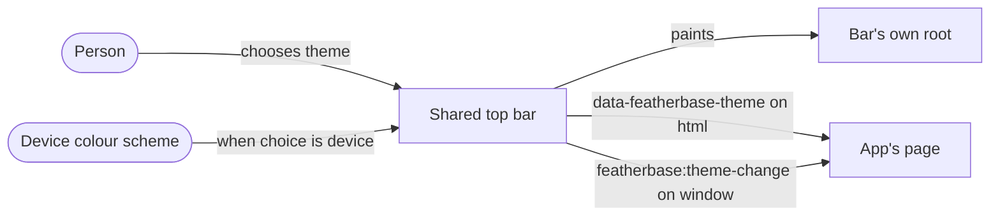

## Context

The shared top bar is drawn over an installed app's own page (#650). It paints its theme on its own shadow
root and never on the app's `<html>`, whose `data-theme` belongs to the app. A bar choice already reaches an
app through its address and the `featherbase:bar-change` event; the bar's height through
`--featherbase-bar-height` on the app's root. #668 asks for the theme the same way.

## Decisions

### D1. Both an attribute on the app's root and an event, like the bar's other extension points

On an app's page the bar writes the painted theme as **`data-featherbase-theme="light|dark"`** on the
document's root element, and dispatches **`featherbase:theme-change`** on `window`, with `detail` `{ theme }`,
once when it first paints and once each time the painted theme changes (a choice, the server correcting a
stale browser copy, or the device flipping under "same as device"). An app may style with
`html[data-featherbase-theme=dark]` and need no script, or read the attribute on load and listen for the
event.

*Rejected:* the event alone, because an app script that runs before the bar's module script would miss the
first paint and have nothing to read; writing the app's own `data-theme`, because that attribute is the
app's (the bar-proof page sets `data-theme="app-owned"`), and taking it would restyle the app.

### D2. The painted theme only, never the raw choice

The value is always `light` or `dark`, the theme the person actually sees. "Same as device" is resolved by
the bar, so an app never has to watch `prefers-color-scheme` itself and disagree with the bar.

*Rejected:* also exposing the choice (`device`), which apps have no use for today and would be one more
contract to keep.
