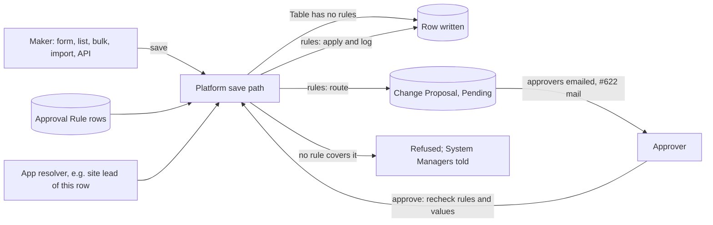

# Design

## Context

#627's questions were settled on 04-Nov (Q1 to Q8). #975 built the Change Proposal Table for an app that proposes on dated rows and names its own approvers. This change adds the rules engine on top: rules are rows, the check runs inside the platform's one save path, and a held change is a Change Proposal with no app.

## Decisions

### Rules narrow permissions, never widen them

A maker still needs their ordinary write permission on the row; a rule then decides whether the write applies, waits or is refused. The alternative, rules granting write on their own, would make every rule a second permission system and is #462's question, not this one.

### The check runs before the save's hooks, and approval replays the save as the maker

The check sits in the save path after permissions and the stale-row check, before any hook or script runs. A held change stores the values the maker sent. Approving saves them again as the maker, with the maker's permissions, so hooks, validation and history run once, on the change that is applied. The alternative, holding the row as the hooks left it, would run hooks for a change that may never happen, and apply values computed against an old row.

### A generic proposal changes its row in place

#975's app proposals end the old row and add a dated one, because that app's Tables are dated. A rule-made proposal targets an ordinary Table, so approving updates the row (or adds the new row, for a held create). The two kinds share the Change Proposal Table; an app proposal names its app, a rule-made one does not.

### Every matching rule that routes must be satisfied

Approval beats apply (settled). When more than one routing rule matches, for example one per column, each rule's approvers must approve: "all" needs one distinct person per approver it names, "any" needs one person among them. Picking only the first rule would let a narrower rule's approver be skipped.

### Notification reuses the workflow approval mail

Q2 chose a fixed workflow on Change Proposal with #622's mark. Change Proposal is written only by the platform, and the workflow engine refuses such Tables, so the platform instead sends the proposal's approvers the same approval mail, from the same function, that a workflow state marked "waits for approval" sends. There is still one mail path. The alternative, opening system-written Tables to workflows, would let a workflow move a proposal outside the decision rules.

### Who is exempt

The platform's own trusted writes, background system actors and the built-in Administrator account are not checked, so setup, syncs and break-glass keep working. People are checked whatever their roles, System Managers included: a System Manager who needs to change a governed Table adds a rule for it.

## Risks

- **Imports and bulk edits of a governed Table** return the row unchanged with its pending proposal. Their summaries count such rows as saved until the next slice shows them as pending.
- **Sub-table rows** can't wait for approval; an edit to a governed Table that changes them is refused, saying so.
