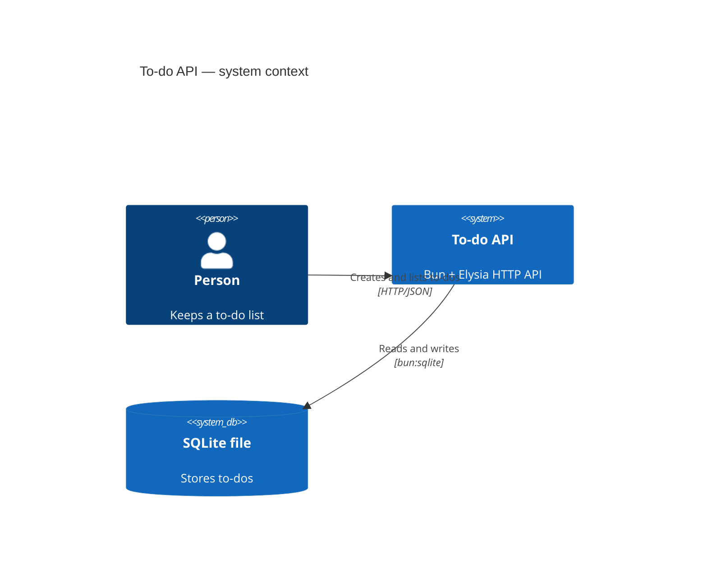

## Context

First code on this branch. See proposal.md for why. No ADRs exist yet (`adr/` is empty).

## Goals / Non-Goals

**Goals:**
- `POST /todos` creates a to-do; `GET /todos` lists them in creation order.
- To-dos survive a restart.

**Non-Goals:**
- Editing, completing, deleting or filtering to-dos.
- Users, sign-in, a web UI.

## Decisions

- **`createApp(dbFile)` builds the app.** A restart is then "a new app on the same file", which
  a test can do in-process. Alternative: start a real server per test — slower, and needs ports.
- **Raw `bun:sqlite`, no ORM.** One table, one statement each way; built into Bun, so no
  dependency. Alternative: Drizzle — earns its place when the schema starts changing.
- **Tests call `app.handle(new Request(...))`.** No server, no network.
- **Each test gets its own database** (`:memory:`, or a temp file for restart tests), so tests
  never share state.

## Risks / Trade-offs

- [The schema is created with `create table if not exists`, not migrations] -> fine for one
  table; add a migration tool with the first schema change.

## Migration Plan

None — nothing exists yet.

## Open Questions

None.
