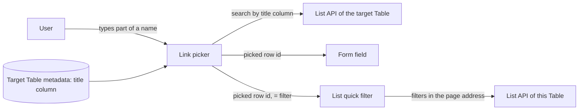

## Context

A link field's picker (`LinkControl` in the form) searches the target Table through the permission-filtered list API, by the column `pickerFor` names. Only Person and Service Account have entries; every other Table falls back to searching and showing `row_id`. A list's quick filters (`StandardFilters`) cover Choice and text columns; a Reference column is treated as text and filtered with `like` against the stored id.

## Decisions

### A Table without its own picker is searched and shown by its title column

The picker reads the target Table's metadata and, when `pickerFor` has no entry, searches and labels by its `title_column`. A Table with no title column keeps searching by id.

Rejected:
- **A hand-written picker entry per Table** — every new or connected Table would need one, which is the gap #796's verifier found.
- **A new server search endpoint that resolves titles** — the list API already filters by permissions and Data Scope; a second read path would have to repeat that.

### The list filter stores the picked row's id, not its name

Picking a row sets an `=` filter on the link column with the row's id, kept in the page address like every other filter; the box reads the name back through the same title lookup the form uses.

Rejected:
- **Filter by the typed name (`like` on the linked row's title)** — names are not unique and can change, so a shared filtered link could match other rows or stop matching; the list API would also need a join it does not have.

### The filter reuses the form's link picker, without "create new"

The quick filter renders the form's picker with a flag that leaves out the offer to create a row.

Rejected:
- **A separate filter picker** — two pickers would drift in how they search and label rows, which is the defect being fixed.

## Risks / Trade-offs

- The picker reads the target Table's metadata once per link field -> it is the cached meta query every form already makes.
