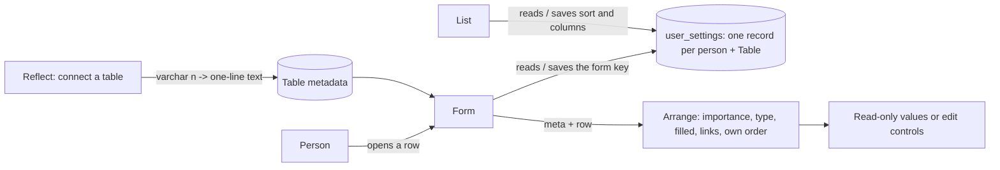

## Context

The generic form (`FormView`) renders every Table's row as sections split by Section Break, two columns wide, each field as an input control; on a read-only connected row every control is disabled. Each person's list arrangement is already stored server-side in `user_settings`, one JSON record per person and Table, which a Table rename carries along (`table-engine.ts` renames `user_settings.table_name`). A connected `varchar(n)` column becomes `Data` only when `n <= 140`, because `Data` values are checked at 140 characters (`packages/shared/src/schema.ts`); anything longer becomes `Text`, a multi-line box.

## Decisions

### The arrangement is stored in the person's server-side settings, beside the list's

The form saves `{ form: { mode, columns } }` into the same `user_settings` record the list uses for that person and Table, and the settings save now merges top-level keys into what is stored instead of replacing it. The list always sends all of its own keys (`sort`, possibly `null`, `shownCols`, `hiddenCols`), so for the list a merge is the same as a replace.

Rejected:
- **Browser storage (the prototype's localStorage)** - remembered per browser, not per person: a shared shop-floor computer would carry one person's arrangement to the next, and a person's choice would not follow them to their phone. The list already remembers per person on the server; a form that remembered differently would be the inconsistent one.
- **A second settings record keyed `form:<Table>`** - a Table rename moves `user_settings.table_name` for the Table's own record only, so the form's choice would be orphaned by a rename.
- **Each screen reading the whole record and writing it back whole** - the list and the form load independently, so whichever saves second would overwrite the other's keys.

### A connected table's one-line text is limited by its source, not by Featherbase

Reflect maps every `varchar(n)` / `char(n)` (Postgres and MySQL) to one-line text (`Data`) whatever `n` is; only unbounded text stays `Text`. Featherbase's 140-character check on one-line text is skipped for a connected Table's columns, because the source holds the real limit and already refuses an over-long value in plain words (`REFUSAL_CODE.tooLong`, "A refused save says why in plain words").

Rejected:
- **Keep the 140 cut-off** - a `varchar(255)` name stays in a tall multi-line box, which is the complaint in #795.
- **Map to `Data` and keep the 140 check** - a writable source's `varchar(300)` value longer than 140 characters, savable today, would be refused by Featherbase.
- **Store each column's declared length and check it in Featherbase** - a metadata schema change to repeat a check the source already makes and reports.

### Bookkeeping fields are recognised by name

A field named `created|updated|modified|deleted` + `_on|_at|_by|_by_id|_date` is bookkeeping and goes to the footer line in every arrangement but the Table's own order: the same naming rule reflect uses to keep these columns out of a connected table's list (#796).

Rejected:
- **A per-column "bookkeeping" flag a builder sets** - no connected table has it, so every Table would need marking by hand before its rows read well.

## Risks / Trade-offs

- A Table not laid out in sections now opens by importance on an editable row too, so its fields reorder -> nothing is lost or hidden on an editable row (empty fields fold only on a read-only row, bookkeeping fields stay editable controls at the foot), and the person can pick the Table's own order once, which is remembered.
- The grouping is computed from the saved row, not from the values being typed, so a field does not jump between "filled" and "empty" while the user types -> a field filled during the edit moves on the next open.
- A save of the arrangement that fails leaves the choice in place for this visit only -> the next open uses the last saved choice.
