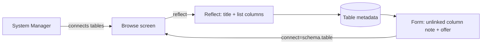

## Context

Reflect writes a source-bound Table's metadata once, when the table is connected: today no `title_column`, and `in_list_view` on the first four data columns. Every foreign key is already recorded raw on its column (`source_fk_schema/table/column`); the column becomes a Reference only once a table binding the target's key is connected (`linkReferencesTo`).

## Decisions

### Defaults are written once at connect time, as ordinary metadata

Reflect sets `title_column` and `in_list_view` when it creates the Table; nothing is re-derived when rows are read.

Rejected:
- **Derive the title and list columns at read time** — every read path (lists, row titles, search) would need the rule, and a builder's later choice would have to override a rule rather than replace a value.

### "Not connected yet" is read from the column itself

The form shows the note on a column that has a recorded source foreign key and is not a Reference: reflect leaves exactly those columns unlinked because no connected table binds the target's key.

Rejected:
- **A server-computed "target connected" flag on the meta** — a Table's cached meta would go stale whenever another Table of the same data source is connected or removed, so every reflect and delete would have to invalidate its neighbours; the recorded edge already says the same thing without a cache.

### The offer opens the Browse screen with the table chosen; it does not connect from the form

The link carries `connect=<schema.table>`; the Browse screen loads that schema's tables and ticks the one asked for, leaving its name box and the Reflect button to the user.

Rejected:
- **Connect straight from the form** — skips the proposed name the user may want to change (#783) and the other tables they may want with it.

## Risks / Trade-offs

- A foreign key that lands on a column other than the target's key stays unlinked even after the target is connected, so the note still shows -> the Browse screen then shows that table as already connected, and its column preview says why it can't link.
- A table with none of the name columns keeps reading by its values -> unchanged from today.
- The target table may not be connectable (off the data source's allowed list, no key, refused) -> the Browse screen shows it with its reason and leaves it unticked, as it does for any such table.
