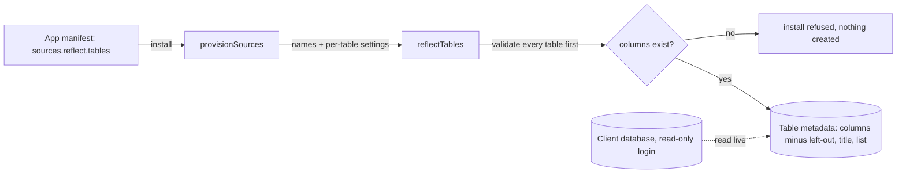

## Context

An app manifest's `sources[].reflect` names a data source's tables to connect at install (`{ schema, prefix, module, tables: string[] }`). Install calls `reflectTables`, which since #783 takes a name per table and since #796 picks a title column and list columns by rule. Columns that look like secrets are already skipped when a Table is created. A declarative manifest (no code) installs through `POST /api/install_app { manifest }`; trusted runtime packages (`featherbase.json`) carry no `sources` and must own at least one Table.

## Decisions

### A table's settings sit on its own entry in `reflect.tables`

Each entry is either a table name, as today, or `{ table, name?, leave_out_columns?, title_column?, list_columns? }`. Column names are the source's.

Rejected:
- **Parallel maps beside `tables`** (`names`, `leave_out`, `titles`, `lists`, each keyed by table) — what one table does is spread over four places, and a key misspelt in one map is silently ignored.

### Left-out columns are skipped when the Table is created, never connected and then removed

Reflect drops them from the columns it creates, the same way it drops secret-named columns; a left-out column cannot be the key, and it is never picked as the modified column.

Rejected:
- **Connect, then remove with `remove_columns`** (how the hand-made setup did it) — two steps, and a failure between them leaves a Table showing personal data.

### A setting naming a column the table lacks refuses the whole install

Every requested table's settings are checked against the source before any Table is created, like the allow-list check (#518): each named column must exist, and the title and list columns must be connected columns (not the key, the modified column, a left-out one or a secret-named one).

Rejected:
- **Ignore unknown columns** — a misspelt left-out column would silently show what it was meant to hide.

### StyleHR is a manifest-only app

`client-apps/jeyarama/stylehr/app.json` is a declarative manifest, installed through the manifest install path.

Rejected:
- **A trusted runtime package** — it would need a build, a server bundle, and a Table of its own to satisfy the package schema, all to hold no behaviour; and the runtime manifest has no `sources`.

## Risks / Trade-offs

- A column the HR system adds later is connected the next time the app is installed, unless the manifest leaves it out -> the README says to review new columns before reinstalling.
- An upstream column the manifest leaves out that is later dropped refuses the install -> the error names the column; remove it from the manifest.
- The settings apply only when a Table is created; a Table already connected under the same binding is adopted as it is -> unchanged from today's adoption rule.
