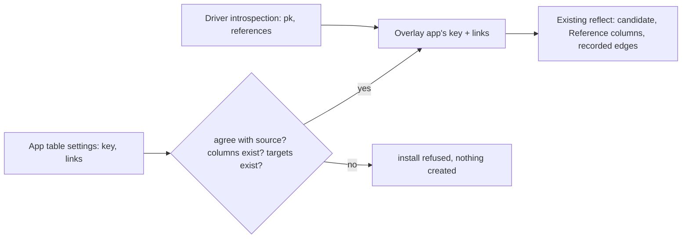

## Context

Reflect learns two facts from a source's introspection: a table's single-column primary key (`pk`) and, per column, the foreign key it carries (`references`). Everything readable about links follows from those two facts: a column whose reference lands on a connected table's key becomes a Reference (`buildBoundTable`), and the raw edge is recorded so the other connection order converges (`linkReferencesTo`). Postgres and MySQL report both facts. Our duckdb driver reads neither (DuckDB can declare them, warehouse copies don't), and reflect falls back to a duckdb table's first column as its key; so on a warehouse source the agreement check below never refuses anything. Since #808 an app's `reflect.tables` entry carries per-table settings (`leave_out_columns`, `title_column`, `list_columns`), validated against the source before anything is created.

## Decisions

### Key and links are two more table settings, laid over introspection

`{ table, key?, links?: { <column>: <table> } }`. Before a requested table is built, its introspected `pk` is replaced by `key` and each linked column's `references` is set to the target table's key. Nothing downstream changes: the same code that turns a real foreign key into a Reference turns a declared one into a Reference, in either connection order.

A link names a table, not a table and column: the target is that table's key, the source's primary key or the `key` this same install declares for it, never the first-column fallback. A table connected later from Browse cannot declare a key, so a link resting on a guessed key would never form again; within one install, either connection order converges, as with real foreign keys. A Reference holds one value that must address one row, so any other target column could not be a Reference anyway.

A link's target is addressed like `tables`: schema-qualified, or a bare name in the linking table's schema, or a bare name found once on the source. Introspection is limited to the install's schema, so targets in other schemas are out of scope.

Rejected:
- **A separate `keys`/`links` section on the source** — the same parallel-maps objection #808 recorded: one table's description spread over several places.
- **Link to an arbitrary target column** — cannot become a Reference; it would be a promise the platform can't keep.

### A declaration agrees with the source or refuses the install; it never overrides

A key on a table whose source declares a different primary key, or a link on a column whose source declares a different foreign key (compared as table and key column), refuses the install. A declaration that matches is accepted. A key on a table whose source key spans several columns is refused too: one of them alone does not identify a row. So the live StyleHR app can carry the same key and links as the warehouse one, and a source that later gains real constraints can never be silently contradicted by an app.

Rejected:
- **Declaration wins** — would let a manifest bind rows by a non-unique column on a source that knows better.
- **Refuse any declaration on a source that declares keys** — forces two different table descriptions for the same tables, which then drift.

### Every key and link is checked with the other settings, before anything is created

A key or link column must be on the table, not left out and not credential-named; a link's target must be a table on the source and allowed by its allow-list, and must have a key. A disallowed target is refused in the same words as a missing one, so a refusal never reveals that a hidden table exists. Errors are collected (the allow-list check is caught, not thrown) and join #808's settings errors, so one install reports them all and creates nothing. The key passed to #808's checks is the declared one.

### A declared key only on a read-only data source

A declared key is the app author's promise that the column is unique. On a source Featherbase writes to, a broken promise would send one edit or delete to every matching row, so a key is declared only on a read-only data source. Links carry no such risk and are allowed on any source.

Rejected:
- **Allow it everywhere and warn** — the failure is silent data damage, found after the fact.

### The warehouse StyleHR is a sibling app with identical table settings

`client-apps/jeyarama/stylehr-warehouse/app.json` reads `bronze_stylehr.public` through a MotherDuck read-scaling token in `STYLEHR_WAREHOUSE_URL`; its `reflect.tables` equals the live app's. A server test fails if the two differ. Both use the same Table names, so an instance installs one or the other.

Rejected:
- **One app with two sources** — two sets of thirteen Tables under different names on one instance.
- **Choosing the source by environment at install** — a new install-time switch for one client's need.

## Risks / Trade-offs

- A declared key that is not actually unique gives rows that open as the first match, on a read-only source only -> the warehouse StyleHR keys (`id`) were checked unique on 03-Nov-2026.
- Our drivers read only single-column foreign keys, so a link declared on one column of a multi-column foreign key passes the agreement check -> low risk; a Reference holds one value anyway.
- The warehouse copy keeps rows the HR system deleted and is as old as its last load -> stated in the app's README; out of scope here.
- An instance can't hold both StyleHR apps -> the install refuses on the first clashing Table name; the README says to choose one.
