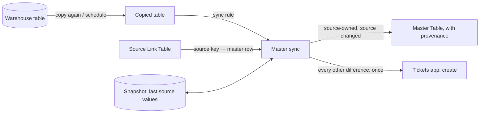

# Design: master data sync

## Decisions

### 1. The rule is one JSON document per copied table, kept beside the copy

`featherbase.master_sync` holds one validated rule per copied table, set by a System Manager through the copied
table's `set_master_sync` action, the way #845 keeps a copy's schedule. Rejected: a metadata Table of rules with
a child Table of columns. It gives a form, but the rule is written once per source and is checked as a whole
(the master Table, the link Table and every column must exist).

### 2. Three values per column, with the snapshot as "last seen"

The snapshot is the source values seen on the last run, kept per linked row. It is replaced with the source now on
every run, whatever was decided, so a difference that was raised is not re-detected as a new kind of difference
next time. The rule table is in `decideColumn` and tested case by case.

The snapshot is kept per master column. A rule change that matches values differently (another master Table,
source, link or column mapping) clears the snapshots, so the next run starts again from Featherbase rather than
from values seen under the old matching.

Values are compared as the master column's type: 7, "7" and "7.000000000" are one number, and a date is its day.

On a row's first run after it is linked there is no snapshot. Then a value the source owns is filled only where
Featherbase has none; a disagreement is raised, never overwritten. (Open question for Siraj.)

### 3. "Once" is a fingerprint of the difference

A difference is identified by the copied table, the row, the column and the two current values. It is stored
before its ticket is raised, and the ticket is raised with the fingerprint as the Tickets action's idempotency
key, so a re-run, or a retry after Tickets was unavailable, never raises it twice. A changed value is a new
difference. Rejected: asking Tickets whether an earlier ticket is still open, which would make the platform read
an app's Tables.

### 4. Tickets are raised through the app, as a service account

The platform calls Tickets' own `create` action, as the `svc-master-sync` service account, which holds System
Manager only for the length of a sync. The ticket is checked and routed by Tickets like any other (type fields,
routing to the System Support Contact). The app is named in the rule (`tickets` by default), so the platform does
not depend on the Tickets package.

### 5. Provenance on the history row

An applied change is saved through the ordinary save (permissions, triggers, history), by the sync's service
account, and its history row carries `synced_from`, `sync_copied_table` and `sync_run`, which a later outbound
feed can skip. So a master Table must keep history: a rule naming one that does not is refused, and so is a run.

### 6. Nothing deleted, nothing linked, nothing held

A gone row sets the rule's inactive column, else raises a ticket. A new row raises a ticket. No change is held for
approval: the ticket carries the decision (a later permissions piece adds held changes).
