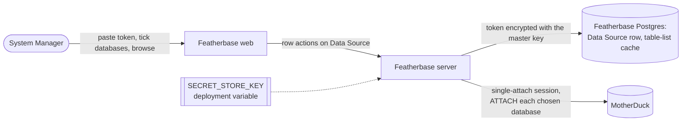

## Context

A MotherDuck source today is a Data Source row whose `url_env` names a deployment variable holding
`md:?motherduck_token=…`. The DuckDB driver opens that URL in MotherDuck's default workspace mode,
which re-attaches every database ever attached on the account (about 2½ minutes for a real
account) and cannot reach a share the account has not attached. Attaching one there would change
the account for every other client. This design covers part 1 of #772 (connect and browse);
part 2 (copy in, copy again) adds its decisions when its mockup is agreed.

## Decisions

### D1. A pasted token is encrypted with one master key per deployment

The token is stored on the Data Source row, encrypted with AES-256-GCM under a key from a new
deployment variable, `SECRET_STORE_KEY`, declared in the variable registry: must differ across
environments, with a fixed default in development and test. It is not required at boot, so
existing deployments keep starting; outside development and test, saving a pasted token is
refused, naming the variable, until it is set. The
row also keeps the token's last four characters for display. The server decrypts only to open a
connection and never returns, logs or echoes the token; error messages have it scrubbed.

- **Rejected: keep the token in a deployment variable** (today's way). It fails the goal: the job
  must be done in the app, with no server access (owner, 02-Nov-2026).
- **Rejected: store the token in plain text.** A database dump or read access would leak it.
- Losing the master key means pasting each token again; there is no key-rotation tool yet.
- Recorded as an ADR, because it supersedes, for MotherDuck tokens, the rule that a secret stays a
  deployment variable.

### D2. A MotherDuck source opens in single-attach mode and attaches only its chosen databases

The driver opens an in-memory DuckDB, loads the `motherduck` extension with the token, sets
`motherduck_attach_mode = 'single'`, then attaches each chosen database by its share address
(`md:_share/<name>/<id>`) or, for one the account owns, by `md:<name>`. (`md:?attach_mode=single`
is refused by MotherDuck without a database name, so the address form cannot be used.) The chosen
databases are stored on the Data Source row as a list of `{name, address}`. The test lists what
the token can read from `md_all_databases()` (owned) and `md_information_schema.shared_with_me`
(shared), then attaches one owned database for that session only: `current_user()` names the
account and `duckdb_databases().readonly` says whether the token can write, so no write is ever
attempted. (Probed on a real account, 02-Nov-2026: about 5–10 seconds, against 2½ minutes in
workspace mode.)

- **Rejected: workspace mode** (today). Slow, blind to unattached shares, and an attach would
  change the account for every client.
- The chosen list doubles as the source's allowlist: a database not chosen is never attached.

### D3. A database's table list is kept in Featherbase's database, until refreshed

The first browse of a database stores its schemas and tables (name, row estimate, column count)
in a new platform table keyed by source and database, with the time it was read. Browsing reads
that; **Refresh** reads MotherDuck again and replaces it. Columns and first rows of the one table
being previewed are always read live (one small query).

- **Rejected: keep it in the server's memory.** A restart or a second server process would pay
  the minute again, and two processes could show different lists.
- **Rejected: read MotherDuck on every visit.** About a minute per database on a real share, and
  each read is billed.

### D4. Tests talk to a local DuckDB file standing in for MotherDuck

Every test, the acceptance suite included, points the MotherDuck connection at a local DuckDB file
through a development-and-test-only variable, `MOTHERDUCK_STANDIN`. The file carries an
`md_information_schema.shared_with_me` view and attachable database files, so listing, choosing,
attaching and browsing run the real code. The server refuses to start with the variable set
outside development and test. The single line that opens `md:` stays in the existing hosted-service
module (ADR 0012), so no new coverage exclusion is added.

- **Rejected: run the tests against real MotherDuck.** CI has no token, and the results would
  depend on a live account.
- **Rejected: mock the driver.** It would test the mock, not the attach and listing SQL.

## Risks / Trade-offs

- A token pasted into a deployment where many people are System Managers is usable by all of
  them through the browser. The page says so, as today's planned connection console does.
- The table-list cache can be stale; the page shows when it was read and offers Refresh.
- MotherDuck may change `md_information_schema`. The test fails loudly with a plain reason rather
  than showing an empty list.
