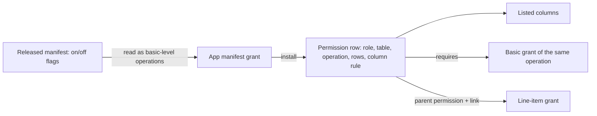

## Context

A Permission row was one role's switches on one Table (`can_read` … `can_amend`), a
level (`tier`: basic or restricted) and a creator restriction (`own_rows_only`). A
restricted-level row widened the Columns a basic row admitted; it never gave Row access
of its own. #462's agreed design (PR #683, `domain-data-administration`) replaces this
with one row per operation and explicit Column selections. This change lands that
representation alone, so that pieces B, C and E build on it.

## Goals / Non-Goals

**Goals:** per-operation grants with Column reach; a lossless conversion of every
existing grant; released apps keep loading and upgrading with unchanged artifacts.

**Non-Goals:** scopes and delegation, approvals, Platform Admin, adding or widening grants
on app upgrade, any new permissions UI.

## Decisions

### 1. A grant's Columns are a rule: basic level, every Column, or a list

`column_rule` is `basic` (every basic-level Column, including ones added later and the
basic-level line items), `every` (every Column and line item) or `listed` (only the
Permission Columns named, and line items only through a listed child grant).

*Rejected:* only explicit Column lists, as #683 drafted. A converted grant would then
stop at the Columns that existed on migration day: a Column added later would be hidden
from everyone but administrators, and marking an existing Column restricted would no
longer hide it from basic grants. Both silently change access on a live instance. The
rule keeps the old level semantics exactly, and explicit lists stay available.
(Decision principles: consistency; no change to who can do what.)

### 2. A restricted-level grant becomes an `every` grant that requires a basic one

Each old restricted row becomes, per matching basic grant of the same Table and
operation, an `every` grant whose `requires_permission` is that basic grant. It
contributes Columns only while its prerequisite is active and held, and inherits a
creator restriction from it. A restricted Person read also becomes `read_identifiers`.
A create grant's Columns still include those its holder's edit grants reach.

*Rejected:* merging restricted rows into their basic rows, which would combine a
creator-scoped basic grant with a wider restricted one into one broader grant.

### 3. Released manifests are read as basic-level operations, and their records too

A manifest permission written as flags is read as `operations` with the `@basic` Column
level and `scope_mode: creator` for `own_rows_only`. A restricted-level flag declaration
is refused (no released manifest used one). The migration rewrites each installed app's
recorded declaration the same way, so the record and the shipped artifact still compare
equal. Files and artifact digests are untouched, so Tasker, Tickets and Feather Dash ship
without a version bump, and an image that rebuilds an older version from its source
archive can still upgrade it.

*Rejected:* converting the apps' manifests now. That changes their artifacts under the
same versions, which every instance refuses ("manifest changed under the same version"),
and an upgrade still has to read the previous version's flag manifest. An app that later
converts must write `@basic` where it had flags: `*` reaches restricted Columns too and
is an added grant, which upgrades refuse (piece E).

### 4. A change to an ungranted Column is refused

A save, import or bulk change that would alter a Column the caller's grant does not reach
is refused with nothing saved. A value equal to the stored one is not a change.

*Rejected:* keeping the silent drop, which reports success after saving part of the
request. Agreed on #462; it is the one deliberate change to existing behaviour here.

### 5. Creator-scoped Column reach applies per row

Columns from a creator-scoped grant count only on rows the person created. Before, a
creator-scoped restricted row widened Columns on every row the person could read. This
is narrower, never wider, and follows the agreed #462 rule that each grant keeps its own
reach.

### 6. Native SQL reads only what it can return whole

`fc_has_read` (row security for direct database clients) admits Administrator, or an
enabled principal holding directly an unscoped, platform (not app) read grant whose rule
reaches every Column of the Table and its line items (`every`, or `basic` while nothing
there is restricted). It refuses Data Scope holders and app or system Tables. Native SQL
cannot hide Columns, narrow rows or know app availability, so finer readers use the
server's read path.

*Rejected:* the old rule (any basic read grant), which let a creator-scoped grant or a
basic grant on a Table with restricted Columns read every row and Column directly. The
Featherbase server itself does not use this path. Narrowed direct views are #921.

## Risks / Trade-offs

- The migration rewrites every Permission row. It is rehearsed on fresh, local and
  legacy-shaped databases in tests; a live instance needs a restored-snapshot rehearsal.
- Refusal can surface in a client that sends an unchanged-but-unreadable value under a
  different representation. The comparison is on stored values, and the shipped apps'
  grants reach every basic-level Column.

## Migration Plan

`0139_operation_permissions` runs once on the next release: converts rows, repoints each
installed app's grant ids and recorded declaration, adds the dependency constraints and
replaces `fc_has_read`. Rollback is restoring the pre-release backup; there is no down
migration.

## Open Questions

None for this change. Decisions 1, 3 and 5 refine #683's draft and are recorded here for
the owner's review.
