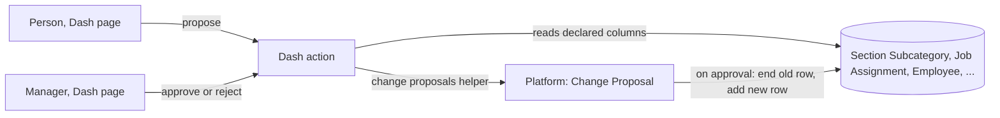

# Design

## Context

#627 settled the shape: one platform Change Proposal Table with one child row per changed column (original, proposed, review base), and the states Pending, Applied, Rejected and Needs fresh review. This builds only what the first screen needs, with the app naming its approvers. #627's rules engine can later replace the app's naming without changing the Table.

## Decisions

### Staff read base Tables through the app, not with a grant

The app reads a declared list of Tables and columns as the platform, the way a scope provider does, and answers only what the person should see. The alternative was the Tickets route: `linked_tables` read as the caller, which needs every Dash reader granted read on Employee and Job Assignment. That would open the whole staff list, with sign-in IDs, to every store person in Admin and over the API. It was rejected as too wide. An administrator still decides: a Table is read only when it is both in the manifest's `baseTables` and listed in the app's `linked_tables` setting.

### Approving is not editing

An approver needs no write grant on the base Table. The platform applies an approved change itself, through the normal save path with its validators, in the action's transaction. The save is authored by the maker, and a history entry on each row names the maker, the approver and the proposal.

### Every correction is one row, ended and replaced

A move, an add of something placed elsewhere in the store, and a change of a person's section are all "end this row, add a new one with these values". An add of something not placed anywhere in the store is a new row. So a proposal targets one row. The new row starts on the day it is approved, and the old one ends the day before. A row that started that same day ends the day before it started: it was never in force, and no day has two answers.

### Approvers are named by the app and checked again at the decision

The app resolves the approver from the Job Assignment's manager when the proposal is made and again at the decision. The platform enforces the rest: a person who can't sign in doesn't count, then it falls to the role, the maker is never eligible, and a proposal with nobody else to approve it is refused. A proposal follows a change of manager.

### One-row staleness

At approval each changed column, and the end date, is compared with what was reviewed. Any difference moves it to Needs fresh review and changes nothing. The app adds its own checks: the destination section is still active and the person still holds the job. In this slice Needs fresh review is an end state: the person asks again.

## Risks

- **#967 will make these Tables decide scope.** An approval here will then change what a person can read. The approver rule is already the owner's; the save path is trusted, so it keeps working.
- **No notification yet.** Approvers learn of a proposal from the sidebar count. #622's path comes with #627's fixed workflow.
