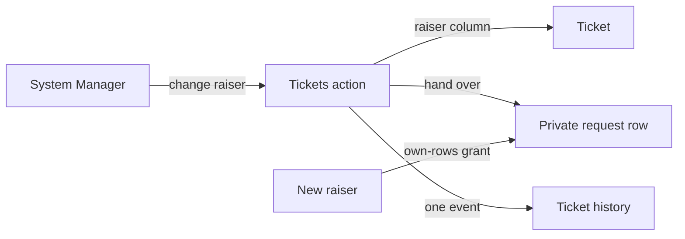

## Context

Own-rows grants follow a row's creator, and the private request row of a ticket is reached only through one. The ticket's raiser is a plain column. An action reads and writes as its caller, and may not touch the Person or Share Tables.

## Decisions

### The private request row is handed over by a new platform helper

An action may call `documents.handOver(table, rowId, person)` to make `person` the creator of one row. The host allows it only for a Table the app owns and only when the caller is a System Manager, and `person` must be an enabled person.

Rejected: sharing the row with the new raiser, because the old raiser would keep their access through the row's creator, and actions may not write Share. Rejected: naming a column an own-rows grant follows, because it changes what every own-rows check means, for one app's need. Rejected: leaving private tickets out, because their raisers must keep reading what they raised.

### Whether a person is enabled comes from a new platform question

`people.enabled(ids)` answers which ids are enabled people, as the caller may see them. A built-in or merged-away account does not count.

Rejected: reading Person through the action's documents, because the host closes platform Tables to actions on purpose. Rejected: changing `people.names` to drop disabled people, because history must keep naming someone who has since left.

### The old raiser's own history rows stay theirs

Only the request row moves. An event row's creator is who did that thing, and it is the audit trail: the old raiser may still read through the generic API the events they wrote themselves, which say only what they already knew.

Rejected: handing their events to the new raiser, because it rewrites who wrote each event.
