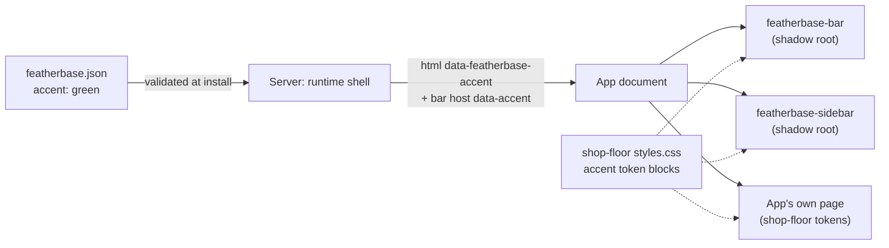

## Context

Every installed app's page already carries the shared top bar. The server adds a `<featherbase-bar>` host to the served document, and the bar draws itself in a shadow root (#650). The platform also offers `<featherbase-sidebar>`, the shared app navigation frame that Tasker uses: the app supplies plain buttons and links, and the platform draws the rows and the current-page style. Tickets uses neither its sidebar nor the platform's design tokens, so it draws a second shell under the bar. The agreed layout (Option A, "list beside the ticket") is the numbered checklist in #941. This file holds only the two decisions that shape the platform feature behind it.

## Goals / Non-Goals

**Goals:** Tickets in the standard shell; an accent any app can choose in one line, readable in light and dark and covered by the contrast guard.

**Non-Goals:** a per-person colour picker (removed in #380 on purpose); colours for anything but actions and selection; recolouring the platform's own Admin pages; phone layout.

## Decisions

### D1. An accent is a name from the platform's set, declared in the app's manifest

`featherbase.json` may carry `"accent": "<name>"`, one of the names the platform lists (first `blue`, the default, and `green`). Each name maps to a light and a dark block of the action tokens only (`--color-action`, `-hover`, `-ink`, `-tint`, `--color-focus`). The platform's contrast guard checks every block. Install refuses an unknown name and lists the names it knows.

- *Rejected: a colour code in the manifest.* Contrast can't be proved ahead of time, and each app would need a second value for dark.
- *Rejected: bringing back the per-person palette picker (UI-025).* The owner removed it on 22-Oct-2026 (#380), and an accent is the app's identity, not the person's preference. Only its override-block mechanism and its every-palette contrast check are reused.

### D2. The server writes the accent into the served document, and the bar and sidebar copy it onto their own roots

The runtime shell adds `data-featherbase-accent="<name>"` to the entry document's `<html>` and to the `<featherbase-bar>` host. Shop Floor's accent blocks key on that attribute, so the app's page has the accent from its first frame without running any script. The bar and the sidebar draw in shadow roots, which a selector on `<html>` can't reach. Each therefore sets the attribute on the element that also carries its painted `data-theme`, and the dark accent block matches both.

- *Rejected: the app setting the attribute from its own script.* The first frame would flash the default blue, and the manifest value would no longer be the one source.
- *Rejected: the server inlining the colour values as a style.* The values would leave `styles.css`, where the contrast guard reads them.

## Risks / Trade-offs

- An app stylesheet can still hard-code colours. Tickets' rule is that it uses only tokens, and its own test checks that its stylesheet has no literal colours.
- Accent and theme must be set on the same element for the dark accent to apply. The bar and sidebar tests pin this.

## Migration Plan

Tickets ships as a new version, which an upgrade applies as usual. No data changes. An installed app's manifest is read when its document is served, so after the upgrade the accent shows without restarting the server.

## Open Questions

None.
