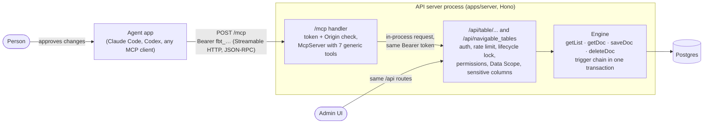

## Context

Issue #1083. The owner decided: reads and writes from day one, and the endpoint is `/mcp` inside
the existing Hono API server (`apps/server`), not a separate process. On 09-Nov-2026 the owner
approved D1 to D7 and answered the open questions: import stays out of this change; a change made
through an agent is marked as such in history (D8); and a Service Account's token opens `/mcp`,
acting with only that account's roles (D2).

What exists today:

- Every row read and write goes through one Table-scoped HTTP surface: `GET|POST /api/table/:table`
  (list with `filters`, `fields`, `order_by`, `limit_start`, `limit_page_length` capped at 500;
  `:meta` and `:count` suffixes) and `GET|PATCH|DELETE /api/table/:table/:name`. The routes add
  glue around the engine calls (`getList`, `getDoc`, `saveDoc`, `deleteDoc`): the lifecycle lock,
  `assertRowsWritable`, `rowForCaller` (sensitive columns stripped from the reply),
  `publishDocEvent` (realtime), slug resolution of the Table name.
- `/api/*` middleware resolves `Authorization: Bearer …` (or the `sid` cookie) with `resolveToken`.
  Access tokens carry the `fbt_` prefix and act as their owner, a Person or a Service Account
  (`access-tokens` spec). The per-principal rate limiter and `runInSession` run after it.
- Errors leave the server as one envelope, `{ error: { type, message, fields? } }` (`errors.ts`).
- `/api/navigable_tables` lists the Tables the caller can read; `:meta` returns a Table's
  metadata with `readable_columns` for the caller.
- History is the `version` Table: one row per tracked save (`recordVersion` in `document.ts`, and
  the retire/reactivate entry beside it), `created_by` the actor's id, `data` a JSON object
  (`changed`, `created`, `import_run`, `retirement`, ...). `GET /api/activity/:table/:name`
  (`documentActivity`) returns it with the actor's name. An access token's request runs as the
  token's owner, so today nothing in history tells an agent's change from the owner's own.
- `@modelcontextprotocol/sdk` 1.32.2 is the latest stable (`npm view`, 2026-10-23). It ships
  `WebStandardStreamableHTTPServerTransport`, which takes a web `Request` and returns a `Response`,
  so it fits a Hono handler without Node `req`/`res` adapters. It accepts zod 4, which the server
  already uses.

## Goals / Non-Goals

**Goals:**

- An MCP client connected with a person's access token can list Tables, describe one, query, get,
  create, update and delete rows, with exactly that person's access and the full trigger chain.
- No per-Table code: the tools and their guidance come from Table metadata at call time.
- No second implementation of row access: one path for the Admin UI, scripts and agents.

**Non-Goals:**

- Building or changing Tables; row actions (submit, cancel, amend, rename, workflow transitions);
  import and its undo; files and attachments; comments; reports and datasets; Settings Tables.
- MCP resources, prompts, subscriptions and server-initiated notifications.
- The MCP OAuth authorization flow, and a local stdio launcher.
- Tokens narrower than their owner (the `access-tokens` spec says a token carries no narrower
  scope; changing that is its own change).

## Decisions

### D1. Stateless Streamable HTTP, one server object per request

`/mcp` is a Hono route that builds a fresh `McpServer` and a `WebStandardStreamableHTTPServerTransport`
with no session id generator (stateless) and `enableJsonResponse: true`, handles the one POST and
discards both. `GET /mcp` and `DELETE /mcp` answer 405, which the protocol allows for a server
that offers no stream and no sessions.

*Rejected: stateful sessions (`Mcp-Session-Id`, kept in memory).* The tools need no server push
and no state between calls, and in-memory sessions break across replicas and restarts (#671 already
requires replicas to agree). Stateless also means a revoked token stops the very next call.

### D2. Only an access token opens `/mcp`; a browser Origin outside the instance is refused

The handler reads `Authorization: Bearer …` and accepts only an access token (`fbt_` prefix),
resolved by the same `resolveToken`, so revocation, expiry and a disabled owner apply. Any access
token works, a Service Account's included (owner's decision, 09-Nov-2026): the agent acts as that
account, with only the account's own roles, and its changes carry the D8 mark the same way. A session token and
the `sid` cookie are ignored; no token answers HTTP 401 before the protocol starts. A request with
an `Origin` header not in `config.allowedOrigins` is refused with 403 (the protocol's DNS-rebinding
rule). No `/mcp` CORS is offered.

*Rejected: accept the browser session too.* A cookie would let any page the person visits drive
`/mcp` with their full access, and sessions are short-lived browser credentials the person cannot
see or revoke in the token list. *Rejected for now: the MCP OAuth flow.* It needs an authorization
server, client registration and consent screens; Claude Code and Codex accept a header today.

### D3. Each tool call is served in-process by the existing HTTP API

A tool handler calls `app.request()` on the same Hono app, against the existing route
(`GET /api/navigable_tables`, `GET /api/table/:table:meta`, `GET /api/table/:table`,
`GET|PATCH|DELETE /api/table/:table/:name`, `POST /api/table/:table`), forwarding the caller's
`Authorization` header. The tool layer only shapes arguments and replies.

*Rejected: call `getList`/`getDoc`/`saveDoc`/`deleteDoc` directly.* That copies the route glue
(lifecycle lock, `assertRowsWritable`, `rowForCaller`, `publishDocEvent`, slug resolution, rate
limit), and every copy drifts the day a route gains a check. *Rejected: extract shared service
functions from the routes first.* Worth doing one day, but it refactors a
2,500-line route file that this change does not need to touch. The cost of D3 is one JSON round trip in memory and one token
lookup per call.

### D4. Seven generic tools, never one per Table

| Tool | Serves | Marked |
|---|---|---|
| `list_tables` | readable Tables, with label and description | read-only |
| `describe_table` | readable columns: name, label, type, required, choices, links-to Table, read-only, nested-row columns one level down | read-only |
| `query_rows` | `table`, `filters`, `columns`, `order_by`, `limit`, `offset`, `include_retired` → `rows`, `total`, `offset`, `limit` | read-only |
| `get_row` | `table`, `id` → the row with its nested rows | read-only |
| `create_row` | `table`, `values` → the saved row | not destructive |
| `update_row` | `table`, `id`, `values` (only the named columns change; a nested-row list sent is the whole list) → the saved row | destructive, idempotent |
| `delete_row` | `table`, `id` → `{ deleted: id }` | destructive, idempotent |

`filters` is the list API's own language, `[column, operator, value]` triples with its operators,
validated by the API. `query_rows` without `columns` returns every readable column that is not a
nested-row column, since the API's default (the id only) is useless to an agent. Rows use the
API's own shape, keyed by column name with `row_id`.

*Rejected: one tool per Table (`create_customer`, …), generated from metadata.* Hundreds of
Tables would flood the agent's context, the tool list would differ per person and go stale when a
Table changes (a stateless server cannot announce `list_changed`), and the generic tools carry the
same information through `describe_table`.

### D5. Writes are approved in the agent's app, not by a second step on the server

Each tool carries MCP annotations (`readOnlyHint`, `destructiveHint`, `idempotentHint`) as in D4,
so the agent's app runs reads freely and asks the person before an update or a delete. The server
adds no confirmation round of its own.

*Rejected: a two-step delete (preview, then confirm with a code).* The agent completes both steps
itself; no person sees the code, so it only adds a call. *Rejected: MCP elicitation.* Client
support is uneven and a stateless server cannot hold the call open for an answer.

### D6. A refusal is a tool result with `isError`, in the API's own words

Any `{ error: { type, message, fields } }` from the inner request becomes a tool result with
`isError: true`, text `"<type>: <message>"` followed by one line per field (`column: message`),
and the same object as `structuredContent`. Nothing is translated, so the agent reads what a
person in the Admin would. JSON-RPC errors are kept for a malformed protocol message; the SDK
(1.32.2) answers an unknown tool or arguments that do not fit a tool's schema as a tool error too,
which serves the agent the same way. Authentication fails as HTTP 401 before either.

*Rejected: answer a refusal as a JSON-RPC error.* Clients often show protocol errors to the person
and hide them from the model, so the agent could not correct its call.

### D7. Limits: 100 rows a page, the person's rate budget, the SDK's body cap

`query_rows` defaults to 20 rows and caps at 100 (the HTTP API allows 500), and every reply states
`total` so the agent pages on. Each tool call is one inner `/api` request, so it spends the token
owner's existing request budget, and a 429 comes back as a D6 refusal. A POST body over the SDK's
4 MiB default is answered 413.

*Rejected: the API's 500-row cap.* A page of 500 wide rows overruns an agent's context and buys
nothing an agent cannot get by paging.

### D8. History marks a change made through an agent, with the token's label

The `/mcp` handler resolves the access token once, keeping its id and label, and runs each tool's
inner request inside a request-scoped context (`AsyncLocalStorage`, like `runInSession`) that says
"through an agent, with this token". Every history entry `recordVersion` writes inside it adds
`agent: { token_id, token_label }` to the Version row's `data`. A row created by hand gets no
history entry (its creator is read off the row, #829), so a row an agent creates gets its created
entry (`created: true`, no changed columns) to carry the mark. The retire and reactivate entry is
left alone: those are row actions, which the tools do not offer.
The actor stays the token's owner in `created_by`, so who did it, permissions, "my rows" and every
existing reader are unchanged. `documentActivity` passes `agent` through, so the row's history
(`GET /api/activity/:table/:name`) shows it. The label is the one the token had at that moment; a
later rename does not rewrite history, and the id finds the token in the token list.

The context is set only in-process by the `/mcp` handler, never from a header, so no outside
caller can claim or hide the mark. A Table that keeps no change history records no mark, as it
records no change.

*Rejected: a new column on `version`.* It needs a migration for a fact only some entries carry, and
`data` already holds the other per-entry facts (`import_run`, `retirement`). *Rejected: an agent
as the actor (`created_by` = the token).* Permissions, row ownership and every "who" reader key on
the principal; the owner decided the actor stays the token's owner. *Rejected for this change:
showing the mark in the Admin's timeline.* That is a UI change and takes the UI route; this change
records it and returns it with the history.

## Risks / Trade-offs

- [An agent can make many writes quickly, all under the person's name] → the person's own rate
  budget, the client's approval prompt (D5), history and revocation in the token list. An import
  is out of scope, so no bulk write path exists.
- [The `/mcp` route sits beside GET catch-alls (legacy redirect, app addresses, SPA fallback)] →
  mount it before them and add `mcp` to the SPA fallback's server-owned list; a test asserts POST
  and GET reach the handler on an app address.
- [The outer `/mcp` handler holds the lifecycle lock while the inner request takes it again] → it
  is outside `/api/*`, so it never takes the lock; only the inner request does.
- [Tool descriptions drift from the API] → descriptions are generated from the same constants the
  API validates (operators, page cap); #1084's OpenAPI description can later be checked against
  them.
- [SDK churn: 1.x deprecates options often] → pin the exact version; DNS-rebinding is done in our
  own handler, not the SDK's deprecated options.

## Migration Plan

No data or schema change. Ship with the release that adds the dependency; roll back by removing the
mount. `docs/DEPLOY.md` notes that a reverse proxy must pass `/mcp` to the API process.

## Open Questions

None. The owner answered all three on 09-Nov-2026:

- Import (with undo) is not part of this change; it stays out of scope, for a later change.
- History marks a change made through an agent with the token's label (D8).
- A Service Account's token may open `/mcp`, acting as that account (D2).
