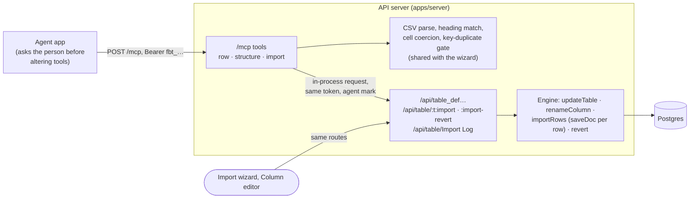

## Context

Issue #1105. `/mcp` (ADR 0021, the archived `mcp-server` change) serves seven row tools, each an
in-process request to the existing HTTP API with the caller's access token, marked as an agent's
(D3, D8 there). The owner now wants the rest of a Table's life through the same door: its
structure, then importing a file into it, then undoing that import.

Owner's decision on permissions (09-Nov-2026): whoever can do it today with the token's owner can
do it through MCP, with the same checks as the existing routes, no extra role and no superuser
bypass. Every write is an inner request to an existing route.

What exists today:

- Structure: `POST /api/table_def` (create), `PUT /api/table_def/:name` (the whole definition;
  columns matched by name; a column left out is refused unless named in `remove_columns`, and its
  values are kept; a type change is refused except text to link and back), `POST
  /api/table_def/:name/rename_column`. All need System Manager (`assertSystemManager`). The column
  editor reads `:meta`, changes one column and PUTs the whole definition back.
- Import: `POST /api/table/:table:import` takes JSON rows (at most 10,000 a request), with
  `dry_run`, `key_column`/`empty_cells`/`columns` for an upsert, `analyze_keys` for the overlap
  check, and `context.run_id` to join parts into one run. `:import-revert` undoes a run. The Import
  Log Table records each part. Parsing the file, matching headings, coercing cells by type,
  failing duplicate keys before chunking and sending 500-row parts all happen in the browser
  (`ImportWizard`, `lib/import-run.ts`), mostly through pure functions in `packages/shared`.
- The wizard's check is optional, but at import time it rehearses again and stops for two things:
  an append whose every row already matches existing rows (acknowledge), and more than 20 changed
  rows (type the count) (`spreadsheet-import` spec).

## Goals / Non-Goals

**Goals:** an agent shapes a Table and imports a CSV into it, then can undo the import, with
exactly its person's rights and the same rules, guards and history as the Admin.

**Non-Goals:** Excel workbooks; deleting or renaming a whole Table; deleting a removed column's
values; Customize Form columns on platform Tables; import conflict review; deleting the Tables an
import created; anything a new route would be needed for.

## Decisions

### D1. Ten generic tools beside the seven

| Tool | Serves | Marked |
|---|---|---|
| `create_table` | `POST /api/table_def` | adds |
| `add_column` | `:meta`, then `PUT /api/table_def/:name` with the column appended | adds |
| `change_column` | `:meta`, then the PUT with one column changed (label, required, choices, links_to, type, unique, description, default) | alters |
| `rename_column` | `POST /api/table_def/:name/rename_column` | alters |
| `remove_column` | `:meta`, then the PUT without the column and `remove_columns: [it]` | alters |
| `suggest_table` | nothing: the shared inference on the CSV alone | read-only |
| `check_import` | `:import` with `dry_run` (and `analyze_keys`), in parts | read-only |
| `run_import` | a fresh rehearsal as above, then `:import` in parts with one `run_id` | alters |
| `list_imports` | the Import Log list for the Table, one entry per run | read-only |
| `undo_import` | `:import-revert` (with `dry_run` to rehearse) | alters |

One tool per structural operation, not an `alter_table` taking a whole definition: each
operation carries a different risk (adding loses nothing; removing and retyping can), so each gets
its own annotation and the person approving reads one change. A whole definition would also make
the agent resend every column, and any it dropped is refused as a removal it did not mean.

*Rejected: `alter_table`.* As above. *Rejected: a column editor that only takes column_def's own
field names.* See D2.

### D2. Columns are written in the words `describe_table` reads them in

The structure tools take a column as `{ name, type, label, required, choices: [..], links_to,
unique, description, default }`, the shape `describe_table` already returns, and translate it to
the route's `column_name`, `column_type`, `reqd`, `choices` (one per line), `reference_table`.
`change_column` changes only the fields it names; `links_to: null` turns a link back into text.

*Rejected: the route's own column fields.* Two vocabularies for one thing; the agent reads one
and must write the other.

### D3. A file reaches the server as CSV text in the tool argument

`check_import`, `run_import` and `suggest_table` take `csv` (the file's text, header row first)
and an optional `delimiter` (comma, tab or semicolon). At most 10,000 data rows (the import
route's own cap per request) and 3 MB of text, below the 4 MB the MCP SDK's transport takes for a whole request, so the refusal is in words the agent reads rather than a protocol error. The server parses it (RFC 4180 quoting) and then
does what the wizard's browser code does, with the same shared functions: match headings to
columns by name, then label (`autoMapImportColumns`), let `columns` override or skip a heading,
coerce cells by column type (`coerceRows`), fail rows whose key repeats in the file
(`splitForSend`, moved to `shared`), send 500-row parts sharing one `run_id`. A refused row is
named by its row number in the file, the header being row 1. The run records `file_name` in the
Import Log when the agent gives one.

*Rejected: a base64 file argument, so Excel works.* The server has no workbook parser (SheetJS is
a browser dependency) and adding one adds a dependency and an attack surface for little: an agent
holding a workbook converts it to CSV in one step. *Rejected: a new HTTP route that takes a
file.* A second import path whose rules would drift from the wizard's; the route stays rows-only.

### D4. An import runs only as it was checked

`check_import` returns `check`, a SHA-256 digest of the caller's token id, the Table, its columns
(name and type), the CSV and every option. `run_import` takes `check` and recomputes it; anything
different (another file, mapping, key, delimiter, a Table whose columns changed, another token) is
refused, "check the import first", and nothing is written. No state is kept on the server.

Then, as the wizard does on every click, `run_import` rehearses again before writing, and stops:
without a key, when every row already matches exactly one existing row by some column, unless
`add_anyway: true` (the refusal names the column to match on); with a key, when more than 20 rows
would change, unless `confirm_changes` equals that number.

*Rejected: no check step, as the route has none.* An agent skips an optional step; the person
approving `run_import` sees arguments, not the refused rows. *Rejected: a server-kept check id.*
`/mcp` is stateless (mcp-server D1). *Rejected: an HMAC.* The guard is against skipping the check,
not an adversary: an agent able to forge the digest can call `check_import` for free.

### D5. What each tool is marked

Reading only: `suggest_table`, `check_import`, `list_imports` (and the four existing reads).
Adds, not destructive: `create_table`, `add_column`. Alters, destructive: `change_column` (a
retype or new choices bind existing values), `rename_column` (queries and links by the old name
break), `remove_column` (values are kept, but the column leaves every screen), `run_import` (a
keyed import updates existing rows, and its annotation is fixed whatever the arguments), and
`undo_import` (deletes rows). `run_import` is not idempotent: run twice without a key, it adds
twice.

*Rejected: marking `run_import` as adding only.* True without a key, false with one, and an
annotation cannot depend on the arguments.

### D6. No check of the tools' own

The structure tools rely on the routes' `assertSystemManager`, the import tools on the import
action's create/write checks, `list_imports` on the Import Log's read permission. The tool layer
adds none and skips none (owner's decision).

*Rejected: refusing a structure tool early when the token's owner lacks System Manager.* A second
copy of the rule, and it would drift the day the route's rule changes.

## Risks / Trade-offs

- [A 10,000-row import is about 60 inner requests (rehearsal, overlap analysis, the run) within
  one tool call] → each part counts against the caller's rate budget as the wizard's would; the
  default budget is far above it.
- [A row an automation refuses passes the check and fails the run] → as in the wizard; the run
  reports it by row number.
