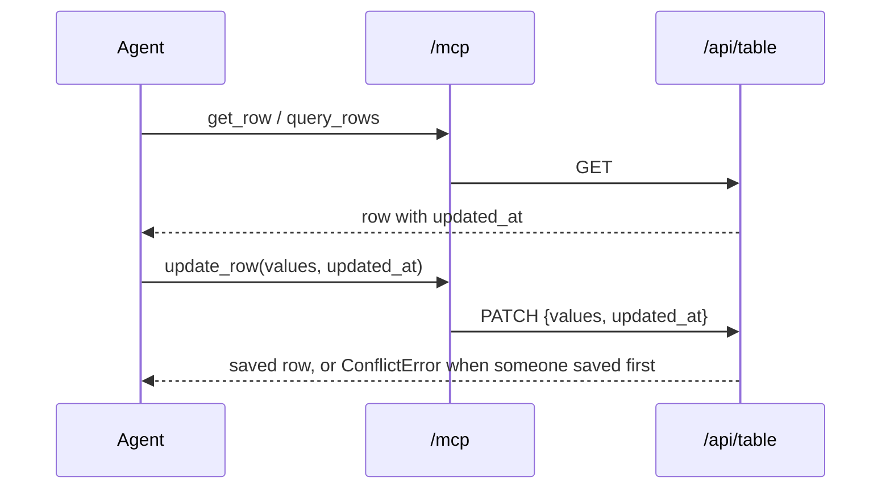

## Context

The `mcp-server` change (archived 2026-11-09) gave `update_row` an optional `updated_at`: when the
agent left it out, the tool read the row and sent the current version. The HTTP API itself already
requires the version on every update and refuses a stale one ("has been modified after you loaded
it"). So the tool, not the API, was skipping the check.

## Goals / Non-Goals

**Goals:** an agent's change is checked against the version it read, every time.

**Non-Goals:** adding a version check to the API's delete of a plain stored row. It has none today;
such a row is refused deletion once it has any history, which any tracked change gives it.

## Decisions

### D1. `update_row` and `delete_row` take the version the agent read, and refuse without it

Supersedes the `update_row` and `delete_row` rows of the archived design's D4. Both tools take a
required `updated_at`: the value `get_row` or `query_rows` returned. A missing one is refused
before any request reaches the API, with a message telling the agent to read the row first and
pass its `updated_at`. A stale one reaches the API and comes back as its own `ConflictError`
(the archived design's D6). `delete_row` sends it as the API's `?updated_at=`, which the API
compares for an app's rows and a connected database's rows. `query_rows` adds `updated_at` to the
columns it returns when the agent names none.

*Rejected: keep it optional and read the current version when it is missing.* That is the bug: the
check then compares the version with itself and always passes. *Rejected: optional, but refused
when missing.* The tool's input schema would not tell the agent's app the field is needed, so every
agent would learn it from a refusal. *Rejected: `update_row` alone.* A delete is the more
destructive write; where the API can check a version, the agent should give it one.

## Risks / Trade-offs

- [An agent that never read the row needs one more call] → `query_rows` returns the version, so a
  found row needs no extra read.
- [`delete_row` asks for a version the API ignores on a plain stored row] → one rule for the agent
  for both destructive tools; the API decides where it is compared.
