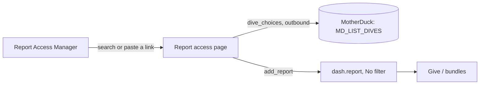

## Context

The owner decided on 14-Nov-2026 (#1169, comment of that day): one role gives and adds reports; upgrades apply the access they declare without anyone's approval while Featherbase has one client and one System Manager. That replaces the 11-Nov design (a Report Publisher role, and access waiting for approval in Apps), which was never pushed.

## Decisions

### Upgrades widen access only for the app's own roles

An upgrade applies any grant its version declares for a role that version declares, not a platform role. All and Guest stay refused, as does a role the app doesn't declare, so an upgrade can never open a Table to everyone or hand access to a role it doesn't own. Rejected: approval in Apps (ADR 0026 of the 11-Nov design), because a deploy then needs the owner present; and allowing every role, because All would silently open a Table to every signed-in person. Revisit before a second client or a second System Manager.

### A dataset can be unscoped

The Dive list holds nothing about stores, but a dataset read gives a person with no store no rows, and a Report Access Manager may reach no store. An app may mark a dataset `unscoped`: it maps no scope filter and every read gets all its rows. Rejected: a MotherDuck helper on the read context, which would be a second way for app code to reach a source; and opening Dash's warehouse token to the app module, which the platform deliberately never does.

### An added Dive takes no filter

A Report Access Manager adds a Dive as a report taking no filter: whoever is given it sees everything the Dive shows. The create grant needs no extra save rule, because the widest report anyone can make is exactly that one. Store-filtered shapes need the Dive's state keys, which only its author knows, so they stay with a System Manager. Rejected: reading the Dive's source to detect the keys it reads, which needs a per-Dive fetch the dataset can't express; left for when a store-filtered Dive is asked for.
