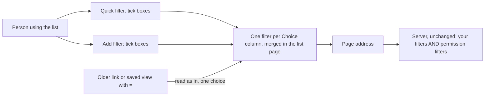

## Context

The quick filter boxes come from `StandardFilters` in `ListView.tsx`, and "Add filter" from `FilterBar` in the same
file. Both write filters into the page address as `[column, operator, value]`, and every filter is joined with AND.
#742 gives a Choice column a dropdown with `=` and `!=` in both places.

The server already accepts `in` with a list of values, for normal Tables (`compileFilter` in
`apps/server/src/query.ts`) and for Tables bound to a data source (`mapFilters` in
`apps/server/src/sources/dispatch.ts`, then each driver). It adds a person's permission filters to the same list, also
joined with AND.

## Goals / Non-Goals

**Goals:** the promises in this change's specs, with no server change.

**Non-Goals:** `not in` for Choice; months for date columns; OR between different columns.

## Decisions

### 1. The list page keeps one filter per Choice column; the server is unchanged

The quick filter and "Add filter" both edit the one `in` filter a Choice column may have: adding the same column again
adds its ticked choices to that filter, and unticking or ticking every choice removes it. The server still joins every
filter with AND, so a filter can only narrow the rows a person may already see. When the page opens an address with
several filters on one Choice column, it merges them into one `in` filter before asking for rows; an older `=` counts as
`in` with one choice.

*Rejected: merging filters on the same column in the server.* It would change what every caller's filters mean,
reports and saved reports included, and a merge that ever reached the permission filters would show rows a person may
not see.

### 2. The list page reads a Choice `=` filter as `in` with that one choice; nothing stored is rewritten

A link or saved view holding `["floor","=","Ground"]` on a Choice column shows Ground ticked and can take more choices;
the first change to it saves `in`. `=` stays a valid filter on the server, so nothing else needs to change. An older
`!=` on a Choice column counts as `in` with every other choice, so the quick filter ticks what shows, and the first
change saves that `in`; the column never keeps a second filter.

*Rejected: a migration that rewrites saved views to `in`.* Links in bookmarks and chats can't be rewritten, so the list
page must read `=` anyway; a migration would add a data change for no gain.

## Risks / Trade-offs

- The server still joins a hand-made address's filters with AND for any other caller, such as a report; only the list
  page merges them.
- A long `in` list makes a long page address. Choice lists in the apps here have at most 6 choices, so this is not
  expected to matter.
