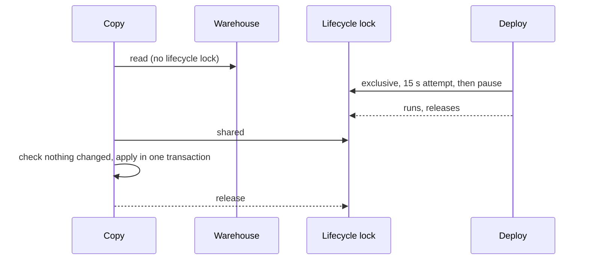

## Context

The shared lifecycle lock is held for a whole request and a whole job. A deploy needs it exclusively. Agreed with the owner on 05-Nov-2026 (#971).

## Decisions

### Deploy retries: 20 attempts of 15 seconds, 15 seconds apart

Total 585 seconds. A waiting deploy stalls new requests (proved by a test against real Postgres), so each attempt stays short and the pause equals it: people get at least half of the time, and no one waits more than 15 seconds for one attempt. Rejected: polling with a try-lock, which never stalls anyone but starves under steady overlapping requests, because it never holds a place in the queue. Railway sets no pre-deploy limit by default and `.railway/railway.ts` sets none, so nothing cuts this short; a Pre-deploy Timeout set on a service would.

### Copy paths leave the outer lock by name

The middleware lets `POST …:copy_again` and `POST …:copy_create` through with no lock, as it does for app reads (#625), and the copy takes it only to apply. A job says so when registered, and the runner gives it the claim under the lock and runs it outside. Rejected: a general "this action manages its own lock" flag read from the registry, which needs the middleware to parse action routes for a benefit only copies have today.

### Lock order: the copy's own lock before the lifecycle lock

A copy holds its per-table advisory lock across the read, so it takes that before the lifecycle lock. Every copy path takes them in this order, and no holder of the lifecycle lock waits for a copy's own lock, so there is no cycle.

### An app-owned target is rechecked with the app's serving identity

The read records the owning app's version and artifact; the apply refuses under the lock if it changed, by the check outbound reads use (`assertStillServing`). The existing check on the copy's mapping and columns stays.

### A no-op row is decided in bulk, and still observed

A row skips the save only when every copied value equals the stored one and it has no open import conflict; anything else takes the existing save path unchanged. Each skipped row still gets its observation for this run, in one bulk insert. Rejected: skipping the observation when the latest one already says the same, which saves rows but lets undoing the earlier run lose what a later run saw, hiding a later conflict (Codex adversarial review).

### Skipping runs no automations for a no-op row, on copies only

Rows that do not change no longer fire hooks, scripts, webhooks or email rules. Nothing was mutated, so invariant 2 holds. Ordinary `:import` keeps saving every row: it is out of this change.

## Risks

- A copy's read and its apply no longer see one lifecycle state. The checks at apply cover the mapping, the columns and the owning app's identity.
- Job bookkeeping for a copy runs outside the lifecycle lock. It only writes platform job rows, one statement at a time.
