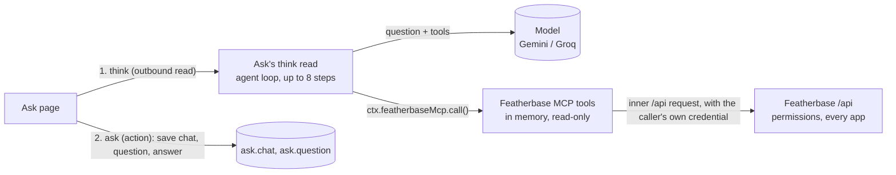

## Context

Featherbase already serves its tools to outside agents over `/mcp` (ADR 0021): each call is one
inner `/api` request made with the caller's access token. Ask needs the same tools from inside the
server, as the person who asked. An app's own `documents` helper cannot help: it refuses another
app's Tables. Each decision below was taken by the owner (Mohammad), 26 Nov 2026, after research.

## Goals / Non-Goals

**Goals:** answer from every app the person can use, as them, read-only; keep the platform piece
generic so any app can use it.

**Non-Goals:** writes (#1372); a scheduled Ask with nobody signed in; tools of Ask's own.

## Decisions

### Ask is an agent over Featherbase's MCP tools

The model gets the question and the platform's read-only MCP tools and decides which to call.
Rejected: #1377's design of Ask's own tools, an admin's list of askable Tables and prepared
queries, which cover one app at a time and need upkeep for every new Table.

### The tools run in memory, with the caller's own credential (ADR 0028)

The same MCP tool server as `/mcp`, connected with an in-memory transport. The read takes the
credential its request was authorized with (session or access token; header first, then the
`sid` cookie) and each tool's inner `/api` request carries it, under `runAsAgent` as `/mcp`'s
do. So every existing front-door check applies on every call (that session signed out or expired,
signed out everywhere, turned off, sign-in method removed, test-mode limits), every app speaks
its installed version, and history reads "via Ask" (the app's title, else its name). A read the
server starts itself has no credential and gets no tools. The credential stays inside the tool
helper: never in errors, logs, tool results or the model's context.
Rejected (Mohammad, 26 and 27 Nov 2026): a 5-minute access-token pass (rows, cache, renewal, a
sweep, shown on the Access Tokens page, survives signing out everywhere); a minted session token
(passes for a fresh sign-in, or needs a new format and key); no token with the person on the
in-memory mark (a new front-door branch, and its own session-id check to match).

### Only the read-only tools are offered or run

The tools are filtered by their read-only hint; any other name answers "There is no tool called
…". Rejected: offering all tools and relying on the model, since a write must need the person's
confirmation (#1372).

### What the agent read is kept with the answer, not in the Access Log (for now)

Each question saves the steps behind its answer (task 2.2b): each tool, its Table and filters,
and its result in short. The person sees how the answer was found, and an administrator, who
reads every Ask row, can answer "what did Ask read for this person". No Access Log entry per
tool call. Deferred (Mohammad, 27 Nov 2026): one Access Log entry per tool call (`agent_read`,
"via <app>"). The platform logs no ordinary reads, the agent reads only what the person may
open, and Ask is the only app with an agent, so the saved steps cover it. Revisit when a second
app declares `featherbaseMcp`, or when the real model (step 3) sends rows outside and an
admin-wide record of what left is needed, as exports and prints are logged.

### Think in a slow read, save in a short action

A model call takes 5–30 s, so the loop must not run inside a transaction. A `think` outbound read
(its handler runs after its transaction closes) runs the loop; then the `ask` action saves chat,
question and answer in one transaction. The page shows one "Thinking…" across both. Rejected: the
loop inside the `ask` action, which would hold a connection and its locks for the whole loop.

### Opt-in per read, with a manifest flag

A read declares `"featherbaseMcp": true`, accepted only with `"outbound": true`. Rejected: handing
the tools to every read, since most reads are page helpers that should not reach other apps.

### The platform code lives beside `/mcp`, not in it

`mcp.ts` stays the `/mcp` endpoint and exports its tool server; `mcp-app-reads.ts` holds the
in-memory client. Rejected: adding both to `mcp.ts`, mixing two jobs in one file.

### A refusal is a result the model reads; at most 8 steps

A refused tool call goes back to the model as its result so it can try another way. If the steps
run out after a refusal, the person is told its reason. Rejected: #1377's fixed 2 retries.

### The page carries the answer from think to ask, unsigned for now

`think` returns the answer; the page passes it to the `ask` action as `{ kind, text }` beside the
question, and `ask` saves it after checking its shape (kind `answer` or `cannot`, text not blank,
at most 20000 characters). It is not signed until 2.4 decides (Open Questions): until then a
person could save any answer, but only in their own chat, which nobody else reads (Mohammad,
27-Nov-2026). Rejected: `ask` running the agent itself, which holds the transaction open through
the model's slow thinking.

### The steps behind an answer are saved with it, in short

`think` returns each tool call it made as `{ tool, args, summary, refused? }`; the summary is one
short line ("2 rows", "12 tables", "refused: …"), never the rows. The page passes them to `ask`,
which checks their shape and saves them in a JSON column on `ask.question`. This is how ChatGPT,
Claude and Gemini keep an agent's steps: structured, drawn as one line per step. The page shows
them only when asked, by Ctrl+O or a small link under the answer (Mohammad, 27-Nov-2026; a page
step after 2.3). Rejected: plain text lines (the page could not draw them its own way); each
tool's full result, for a Claude Code-style full view (copies rows into Ask).

### Groq first, its model fixed in the code, then a setting

Step 3 connects Groq first: fast replies keep an agent that makes several tool calls quick to
test, and its OpenAI-style tool calling is well tested. The model name is written in the adapter
first, and becomes an Ask setting (with the address) right after it works, so switching model or
moving to Gemini is a settings change (Mohammad, 27-Nov-2026). Rejected: Gemini first (its
OpenAI-compatible layer has more quirks); a setting from the start (Mohammad wanted it working
first).

### History in three stages: the last 10 turns first, then the whole chat, then hybrid memory

A model remembers nothing between calls: ChatGPT, Claude and Gemini re-send the conversation
each time, with some trace of earlier tool use, and trim or summarise long chats; Groq is only an
API, so Ask decides. The page also sends `chat` to `think`, which reads that chat's last 10
earlier questions on the server (`query_rows` on `ask.question` as the person: own rows only, so
nobody borrows another's history) and gives them to `Model.next`, oldest first, each as its
question, answer and saved step lines; never rows. The model's instructions say earlier answers
may be out of date and every number is fetched again with the tools. Ask deals in numbers, so
accuracy decides: the steps tell a follow-up ("which ones?") where the answer came from instead of
leaving it to guess, fresh fetches stop sums on stale figures, and a short history is used more
accurately than a long one; it also starts the habit of keeping what the agent did, which the
agent across every app will need. This is the **first of three stages** (Mohammad, 27-Nov-2026):
(1) the last 10 turns with their steps; (2) the whole chat, every question and answer with its
steps, as ChatGPT and Claude keep a conversation while it fits; (3) a hybrid memory (recent turns
in full, older ones summarised). Which is most accurate for an agent dealing in numbers is still
to be researched; each stage is built after the one before works. Rejected for now: questions and answers only (a
follow-up guesses the Table); the whole chat (bigger, slower calls, can hit the model's or the free
tier's limits); a running summary (a model call each time, can drop details); the page sending
the history (a person could send one that never happened, and the payload grows).

### One OpenAI-style adapter for the model

Gemini, Groq and later OpenRouter all accept OpenAI-style chat calls with tools, so one adapter set
by address, key and model covers them; keys are the app's declared secrets. Rejected: OpenCode Zen
(#1377), and one adapter per provider.

## Risks / Trade-offs

- A question whose session ends mid-way gets refused lookups for the rest of it; the answer says
  it could not answer.
- A person whose own session is a test-mode or preview sign-in still gets the tools; they only
  read, so nothing lasting can be added through them.
- `query_rows` returns at most 100 rows a page, so totals need a sum tool (step 5).

## Migration Plan

Ask's manifest gains the `think` read at 0.1.0: recreate the local database (see
`feather-ask-ui`). No platform migration.

## Open Questions

- The page sends the answer to save, so it could save a made-up answer in its own chat: sign it
  in `think` and check it in `ask`, or accept it since it is only the person's own chat.
- **View as can mix two people in one answer** (raised 27-Nov-2026, to decide later). When the
  tool calls carry the asker's own session and the asker is viewing as someone, the front door
  answers GET tools as the person viewed but the POST dry runs (`check_import`, `suggest_table`)
  as the asker, since `viewAsRoute` treats that POST as the asker's. Exiting View as mid-question
  switches the remaining calls too. Example: Selvi, viewing as Ravi, asks "How many tickets can I
  see, and can I import this CSV?" and gets Ravi's 3 tickets but Selvi's "yes, you may import".
  Nothing leaks (the asker may read both); the answer misleads. Rule: one question, one person.
  Recommended fix A: pin the View as for the whole question (every tool call answered as the
  person viewed, refused once that View as no longer holds). Fallback B: no tools while viewing
  as someone. Decided later (Mohammad, 27-Nov-2026): task 1f2, at the final step after all the
  implementation.
