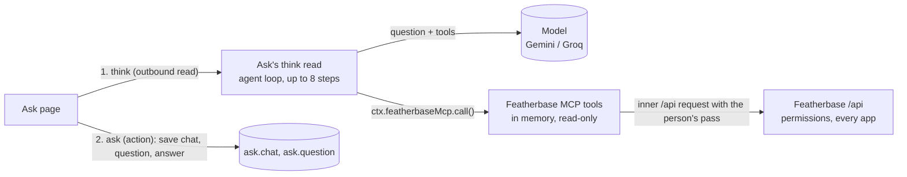

## Context

Featherbase already serves its tools to outside agents over `/mcp` (ADR 0021): each call is one
inner `/api` request made with the person's access token. Ask needs the same tools from inside the
server, as the person who asked. An app's own `documents` helper cannot help: it refuses another
app's Tables. Each decision below was taken by the owner (Mohammad), 26 Nov 2026, after research.

## Goals / Non-Goals

**Goals:** answer from every app the person can use, as them, read-only; keep the platform piece
generic so any app can use it.

**Non-Goals:** writes (#1372); a scheduled Ask with nobody signed in; tools of Ask's own.

## Decisions

### Ask is an agent over Featherbase's MCP tools

The model gets the question and the platform's read-only MCP tools and decides which to call.
Rejected: #1377's design of Ask's own tools, an admin's list of askable Tables and prepared
queries, which cover one app at a time and need upkeep for every new Table.

### The tools run in memory, as the person, with a 5-minute pass

The same MCP tool server as `/mcp`, connected with an in-memory transport. Each tool's inner
`/api` request carries a **pass**: an access token the platform issues for the person, labelled
by the app ("Feather Ask"), lasting 5 minutes, kept only in server memory, reused for that
person's next questions and renewed when under 2 minutes remain. Calls run under `runAsAgent`, as
`/mcp`'s do, so every app speaks its installed version and history reads "via Feather Ask".
Rejected: forwarding the browser session (breaks ADR 0021, and the MCP spec forbids passing other
tokens through; there is no session in a background run); an in-process identity with no token (a
second, credential-free way into `/api`, needing an ADR that supersedes 0021).

### Only the read-only tools are offered or run

The tools are filtered by their read-only hint; any other name answers "There is no tool called
…". Rejected: offering all tools and relying on the model, since a write must need the person's
confirmation (#1372).

### Think in a slow read, save in a short action

A model call takes 5–30 s, so the loop must not run inside a transaction. A `think` outbound read
(its handler runs after its transaction closes) runs the loop; then the `ask` action saves chat,
question and answer in one transaction. The page shows one "Thinking…" across both. Rejected: the
loop inside the `ask` action, which would hold a connection and its locks for the whole loop.

### Opt-in per read, with a manifest flag

A read declares `"featherbaseMcp": true`, accepted only with `"outbound": true`. Rejected: handing
the tools to every read, since most reads are page helpers that should not reach other apps.

### The platform code lives beside `/mcp`, not in it

`mcp.ts` stays the `/mcp` endpoint and exports its tool server; `mcp-app-reads.ts` holds the
in-memory client and the pass. Rejected: adding both to `mcp.ts`, mixing two jobs in one file.

### A refusal is a result the model reads; at most 8 steps

A refused tool call goes back to the model as its result so it can try another way. If the steps
run out after a refusal, the person is told its reason. Rejected: #1377's fixed 2 retries.

### One OpenAI-style adapter for the model

Gemini, Groq and later OpenRouter all accept OpenAI-style chat calls with tools, so one adapter set
by address, key and model covers them; keys are the app's declared secrets. Rejected: OpenCode Zen
(#1377), and one adapter per provider.

## Risks / Trade-offs

- Each pass is a row in the access tokens Table; expired ones pile up until a sweep deletes them
  (ADR 0027 asks for one).
- The person's own access tokens list may show the passes.
- `query_rows` returns at most 100 rows a page, so totals need a sum tool (step 5).

## Migration Plan

Ask's manifest gains the `think` read at 0.1.0: recreate the local database (see
`feather-ask-ui`). No platform migration.

## Open Questions

- The page sends the answer to save, so it could save a made-up answer in its own chat: sign it
  in `think` and check it in `ask`, or accept it since it is only the person's own chat.
- Whether passes should be hidden from the person's access tokens list.
- Whether the pass deserves its own ADR beside ADR 0021.
- Which Gemini and Groq models (step 3).
