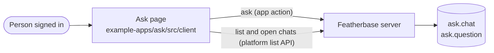

## Context

Ask is an app shipped with the platform (`example-apps/ask`), built on the same contract as
Tickets: a manifest, a server module and a React page under the platform's top bar and sidebar.
The decisions below were each taken by the owner (Mohammad) during the build, 23–26 Nov 2026.

## Goals / Non-Goals

**Goals:** ask, see the answer, keep chats, reopen them; laid out as ChatGPT, Claude and Gemini.

**Non-Goals:** what the answer says (`feather-ask-agent`), rename and delete, date groups, the
panel on every page.

## Decisions

### Ask is an app, open to everyone, own rows only

`ask.chat` is the app's entry Table with `role: All`, `own_rows_only`, read and create.
Rejected: an admin-only page in the Admin UI, since the people who need answers are not admins.

### Questions are saved in two Tables, one action saves them

`ask.chat` (title) and `ask.question` (chat, question, answer, answer kind). One app action `ask`
starts a chat titled by the first question (one line, 140 characters) or joins the one the page
names, in one transaction, with an idempotency key so a retried request saves once.
Rejected: one Table holding a chat's questions as a list, which the platform's list and own-rows
rules could not page or protect per question.

### Reading chats uses the platform's own list

The page lists and opens chats through the platform's Table list API, so own-rows-only, paging and
counts come from the platform. Rejected: an app read of Ask's own, which would duplicate them.

### The list is "Recent Chats", in the sidebar and on its own page

As ChatGPT: under New chat, the newest 20 with how long ago, Load older conversations, and a link
to the full page (50 at a time). Rejected: #1377's "My Questions", since it lists whole chats.

### Links, not buttons, with the app's own router

New chat, Recent Chats and each chat are links (react-router, `basename="/ask"`), so Back and
Forward work and Ctrl+click opens a tab. Each chat is a `RecordLink` (the platform's rule), and the
app maps `ask.chat` records to its own page with `RecordPagesProvider`, so a chat opens in Ask.

## Risks / Trade-offs

- The page sends the saved answer; with the agent, the answer comes from a separate read (see
  `feather-ask-agent`, Open Questions).
- An administrator's list API sees everyone's chats; the page shows only what the API returns.

## Migration Plan

Ask stays at version 0.1.0 until its first release on `main`; it is installed nowhere else, so a
manifest change recreates the local database instead of adding a migration.

## Open Questions

None for the page.
