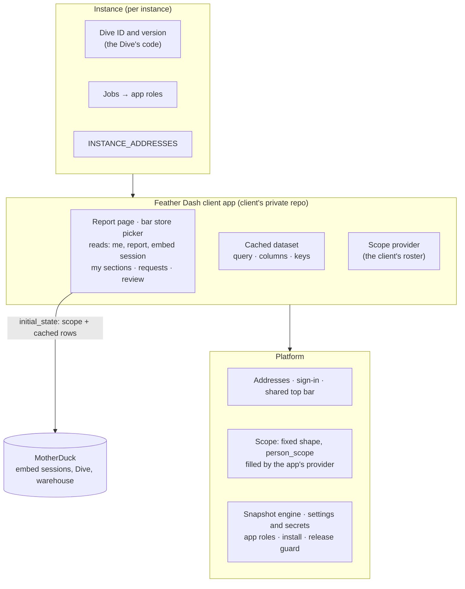

## Context

The decision in #458 is fixed. Featherbase is the master-data system. Feather Dash
is a reporting app installed on top of it, the way Tasker is. This design sets out
how to get there without the live report ever breaking. It is the first design
checked against [ADR 0011](../../../docs/adr/0011-platform-app-instance.md)
("Platform, App, Instance"): **each layer knows only the layer below it**, and the
test for any file is whether a second client would have to change it.

**Today (main at `b19be104`, 26-Oct-2026):**

- **The report is platform code.** The page is `apps/web/src/pages/SalesTarget.tsx`
  at `/featherbase/sales-target`. The server side is `apps/server/src/sales-target.ts`
  (scope derivation, embed-session minting, the `/api/sales_target/{me,embed_session,report}`
  routes, the `Sales Target Viewer` gate), `sales-target-report.ts` (shaping over
  the snapshot or a live read, through one shared function so the two cannot
  disagree) and `datasets/sales-target-mtd.ts` (the dataset SQL, its loader and its
  validation). The dataset is registered with the generic snapshot engine
  `dataset-snapshot.ts` and refreshed by the `refresh_datasets` job.
- **The SQL names one client's warehouse.** It is the clearest break of one-way
  knowledge in the platform today.
- **The embed.** Featherbase mints a MotherDuck embed session and passes the
  reader's scope as the Dive's `initial_state`, which the Dive reads with
  `useDiveState`. The Dive is code the client's team writes in MotherDuck, and it
  fetches its own numbers with `useSQLQuery`. Its configuration (`DIVE_ID`,
  `DIVE_VERSION`, `SERVICE_ACCOUNT`) comes from the environment or a leftover shared
  `.env.local`. The CSP allows `EMBED_ORIGIN` as a frame source on every page.
- **Scope is derived in the report's own module** from nine Excel-born tables, which
  `security-tables.ts` lists by name (#437). So the platform names one client's
  roster.
- **The page header is its own.** The report page, the Portal and the restricted
  shell each draw their own row (identity, store switcher, "Sign-in methods",
  "Log out"). Only the Admin screens (`AdminLayout.tsx`) have the real top bar, with
  an Account menu.
- **One address setting.** `SITE_URL` is the instance's one trusted origin, used for
  emailed links, the Google `redirect_uri`, the cookie's `Secure` decision and the
  release checks. dash.* and featherbase.* currently serve the same instance, and
  nothing routes by address.
- **Who may use the Admin screens.** `whoami` computes `manage` (System Manager) and
  `table_access` (any Table granted through Permission rows). A Store Manager with a
  grant on one Table already sees a trimmed Admin with only that Table.
- **Apps already run server code.** A manifest (`featherbase.json`) declares owned
  Tables, permissions, migrations, actions and reads. The server module runs
  trusted, with no sandbox. Every read and action re-checks roles and scope fresh,
  inside one transaction. Install, preview → upgrade → activate are operator calls.
  Discovery serves the installed *exact* version, identified by a fingerprint of its
  files (`artifact_digest`). Upgrades refuse new Tables and new or wider grants.
  *(27-Oct-2026, #651: no longer true for new Tables. An upgrade can now add,
  remove and rename the app's own Tables and add, change, rename and remove
  columns; a Table it adds arrives with the grants its version declares. Wider
  grants on Tables the app already had are still refused. See the archived
  OpenSpec change `app-schema-evolution`.)*
- **Measured on dev, 26-Oct-2026** (two runs, a Team Leader):

  | | cached numbers | embed session | Dive frame loaded | Dive numbers drawn |
  |---|---|---|---|---|
  | cold | 1.0 s | 1.8 s | 2.5 s | between 2.5 and 5 s |
  | warm | 0.5 s | 0.9 s | 1.7 s | about 2.2 s |

  About half the wait is before the Dive's code runs, and half is the Dive's own
  queries.

**Related work this must fit:**

- **Roster redesign #449** (owner decisions 23-Oct-2026): `section`,
  `section_subcategory`, `position` and `value_mapping` replace the nine tables. Job
  roles (#392) are granted from current `position` rows.
- **Security #441/#443/#437**: audit tables are system-written; access-deciding
  tables are written by a System Manager only.
- **#462**: a named role that may write specific protected tables without being a
  System Manager. Section editing waits for it (D5).
- **#484**: turning UI-built Tables into app code. Not needed here.
- **#487**: moving a client seed pack and runbook out of this repo.

## Goals / Non-Goals

> **Revised 27-Oct-2026 ([ADR 0013](../../../docs/adr/0013-client-apps-and-product-apps.md)).**
> Feather Dash is a **client app** for one client, kept in that client's private
> repository, not a generic app in this one. Its report query, Dive settings, roster
> derivation and retail terms live in the app. The platform work of stage B (B1–B5)
> is unchanged in purpose and stays here. Where older text below says "instance
> setup" for the report query, read "the client app". See the decision log, 15–17.

**Goals:**

- Feather Dash is a **client app in the client's private repository**, installed and
  upgraded like any app. Featherbase core holds no report-specific page, route,
  dataset or role, and names no client.
- **Per-instance values stay out of the app's code**: secrets, the Dive used on each
  instance, and job bindings (ADR 0013).
- The Feather Dash address opens Feather Dash directly, under its own name. The
  Featherbase address stays the Admin screens. Which address opens what is
  configuration, never code.
- **Scope is a fixed platform shape** filled by a provider that an app declares, so
  the platform never holds a client's roster logic, and #449 can change the roster
  without touching the platform.
- One top bar on every address.
- Every stage is small, reversible until its clean-up step, and keeps the live
  report working.

**Non-Goals:**

- Implementing #449's tables, #462's delegated role, or #484.
- A sandbox for app code (ADR 0011: trusted and reviewed, with three guardrails).
- Multi-tenancy. An app address is another address for the same instance and the
  same data, not a site.

## The picture



## Decisions

### D1. The boundary: three layers, not two

| Piece | Layer | Why |
|---|---|---|
| Report page, empty and error states, the remembered store | **App** | Product UI, the same for every client |
| Reads `me`, `report`, `embed_session`; the IST month-to-date period; the embed-session call | **App** | Product behaviour |
| Section-change requests, the my-sections and review pages | **App** | The app's own workflow |
| The roles the app needs, and their suggested jobs | **App** (declared) | The app says what it needs; the instance decides who |
| **The cached dataset**: the query, its columns, keys, which columns are money, and its budget | **App** (client app, ADR 0013) | It names one client's warehouse; a second client adapts a copy of the app |
| **The scope provider**: who covers which stores and sections | **App** (client app, declared, E1) | The client's roster logic; the platform only enforces the shape |
| Dive ID, Dive version, embed service account | **Instance setup** (app settings) | Configuration, not code |
| The Dive's own code | **Instance** (written in MotherDuck) | The client's report design. The app never copies its layout |
| `MOTHERDUCK_TOKEN` | **Instance** (a declared secret, an environment variable) | A secret never goes in a table |
| Jobs → app roles | **Instance** (an Admin-editable setting, seeded from the app's suggestions) | Who may use what is the client's decision |
| Which address opens what | **Instance** (`INSTANCE_ADDRESSES`) | Configuration |
| The scope shape, its provider, the snapshot engine, sign-in, addresses, the top bar, the Access Log | **Platform** | Shared by every app |

Per-instance settings travel through the instance's settings file
(`instance-settings.json`, applied with a service-account token; revised by #620:
#491 took instance settings out of manifests). The app's code reaches the server in
a client image built on the platform's image (D7).

### D2. Platform extensions

Each is generic: none names Feather Dash or a client. Each joins the
extension-point catalogue (ADR 0011), which is generated from the manifest schema
and checked in CI.

**E1. The scope shape and an app-declared provider** (owner decision 27-Oct-2026,
#559: the platform defines the shape and enforces it; an app declares the provider
that fills it).

- **The shape** is a list of *places* the person covers. Each place has a label and
  the filter values that go with it. For a Team Leader of one section:
  `{ label: "Store 12 / Kids Wear", filters: { store: ["12"], subcategory: [...] } }`.
  A place may also carry the basis (section staff, team leader, department manager,
  floor manager, store manager) for display, and a confirmation status
  (`confirmed` / `assumed`) per filter value, which stage D shows (task 4.1). A place
  always names at least one filter value, and labels are unique within a scope. The
  shape is a shared type, validated at the boundary.
- **A `person_scope` operation policy** sits beside `table` and `stores`, with read
  and action roles like `stores`. The platform calls the provider fresh on every
  request, validates and freezes the answer, and hands it to the handler. A request
  may narrow it by naming places or filter values (`payload.scope`); naming a place
  or value outside it, or values that no single place covers together, refuses the
  *whole* request, records the refusal in the Access Log, and reveals nothing. It
  **fails closed**: no provider, a provider that throws or reads outside what it
  declared, an invalid shape, or an empty scope all mean no access. An empty scope
  is never read as everything, for an administrator too. An ambiguous employee code
  still yields no scope.
- **The provider is declared by an app.** Its manifest says
  `"scopeProvider": { "name": "<export>", "tables": [...] }` and its server module
  exports the function under `scopeProviders`. The function gets the person and a
  read context limited to the Tables it declared, each of which must be marked as
  deciding scope and hold no Sub-tables (a row read would hand over undeclared child
  rows). It may also name identifier systems, `"identifiers": ["<system>", ...]`
  (#660; for example the employee-code system, so a roster derivation can find a
  person's rows by code). The person it gets then carries `identifiers`: for each
  named system, and only those, the person's current values, read fresh on every
  resolution and frozen with the rest. *Current* means valid today: started on or
  before today, with no end or an end after today, where today is India's day (as
  the leaver check counts it), so a value with a future start is not passed (owner
  decision 27-Oct-2026, provisional, for review 28-Oct). Each value comes as
  `{ value, shared }` (#662): `shared` is true when the same value in the same
  system is valid today on another person, so a derivation can refuse a code that
  cannot say whose rows are whose. Holders are counted by the person they resolve
  to: a record merged away (`replaced_by`) counts as its survivor, so a person's own
  replaced record is not someone else. Only the boolean is passed, never who else
  holds the value or how many, and it is worked out in the same read as the values,
  under the same locks. It gets nothing else about the person, and `identifiers` is
  empty when it names none. A named system the
  instance does not have, or has turned off (owner decision 27-Oct-2026,
  provisional: a turned-off system passes no values and counts as missing), or has
  made Secret (Codex round 1 on #661: a system made Secret after values were
  recorded still holds them in plain, so a Secret system's values and hints never
  reach an app, whatever is stored), answers
  "not set up yet" before the provider runs, so no one gets a scope; the release
  check and Instance health name it with the app's other missing setup. The
  declared systems are locked (FOR SHARE) in the request's transaction before they
  are checked and until the provider has answered (Codex round 2 on #661), so an
  admin turning one off or making it Secret waits for requests in flight, and the
  next request sees the change.
  It reads as the platform, so a manager needs no read grant on the roster,
  and under the provider app's own installed version, whatever the consuming
  request named. Exactly one enabled app may provide the scope on an instance: a
  second is refused at install, enable, upgrade and activation, the release
  preflight refuses an instance with two, and two at run time mean no scope for
  anyone. A replayed action answers from its stored result, so it is admitted only
  while the caller's scope still covers every place and value that run used. Feather Dash is a client app in the
  client's private repository (ADR 0013) and supplies the client's roster derivation
  (B6′). That derivation never moves into the platform. #449 decides where the
  roster Tables live; the provider follows them. **No consuming app changes either
  way.** The provider's output in this shape is also #449's parity target.
- **The report definition maps filters to query columns**, for example
  `subcategory` → the hierarchy code. So the app and the platform never learn the
  client's column names.
- **One-way knowledge in the security list.** A Table whose rows decide scope is
  marked by its own definition (`decides_scope`), and the platform guards a marked
  Table like the named security Tables. The client's roster table names leave
  `security-tables.ts` only once the client's instance setup marks those Tables, in
  the go-live cut-over (task 5.2). Today's platform report keeps its current code
  until the clean-up release.
- Rejected: the platform computing retail scope itself (it would know store, floor
  and section, which a CRM client does not have). Also rejected: each app reading
  the roster tables (the readings drift, and client table names would enter the
  app). Also rejected (27-Oct-2026): moving today's derivation into a platform
  provider for a while; it would put the client's roster logic in this repository.

**E2. Declared settings and secrets.**

- Manifest: `"settings": [{ "name": "dive_id", "required": true }, …]` and
  `"secrets": ["MOTHERDUCK_TOKEN"]`.
- Values live in a platform `App Setting` Table, keyed by app and name (row
  `<app>.<setting>`). It is a security Table. Settings hold only what differs
  per instance (ADR 0013). The instance sets them through its **instance
  settings file** (`instance-settings-as-code`; #491 removed instance settings
  from manifests), with its apply, dry run and export: `App Setting` is in the
  file's managed scope (the `value` field), and a setting the file sets is
  read-only in Admin (#494). A setting the app does not declare is refused at
  save, and a stored value for one never reaches the app. Secrets stay
  deployment variables and are never stored, logged or returned (#620).
- Handlers receive `context.settings` and `context.secrets`, holding only what was
  declared and set. A missing required value gives a "not set up yet" answer
  (`NotSetUpError`, 409) before the handler runs, so the app's client can show
  it and nothing crashes. An answer or error that holds one of the app's secrets
  is withheld or replaced before it is answered, stored or logged.
- The release check warns when an installed, enabled app lacks a required
  setting or secret (names only), and Instance health shows the same per app.
- Retires `SALES_TARGET_SHARED_ENV`, `readSharedEnv`, `TEST_ACCOUNTS` and the
  experiment's password seeding.

**E3. Cached datasets declared by an app** (revised 27-Oct-2026, ADR 0013).

- **An app declares its cached dataset**: a data source the instance already
  declares (read-only), the query, named columns, keys, which columns are money,
  and the filter mapping (E1). For a client app the query lives in the app and is
  reviewed in the client's repository.
- The platform builds the cached snapshot from it on the existing engine: build,
  validate, activate atomically, keep the last good copy, record misses, refresh on
  the `refresh_datasets` schedule. The storage is raw, never a Table, never exported,
  and read only through a scope-checked read (#246).
- **The live read runs the same query, limited to the reader's scope**, through the
  same shaping function, so cached and live cannot disagree in layout or maths.
- Reads get `context.datasets.active(name)`, with equality or `in` filters on
  declared keys only. No SQL crosses from the app to the platform.
- **As built (#625, migration 0135).** The manifest's `datasets` entry is
  `{ name, source, query, columns: [{ name, type }], keys, filters }`; `type` is
  `text`, `integer`, `number`, `money`, `date` or `boolean`. Keys and mapped
  columns must be `text`, `integer` or `date` (they compare as text), and the query
  must be one statement. Each dataset registers on the snapshot engine as
  `<app>.<name>`, with the declaration's hash as its definition version, so a
  changed query never serves old rows. Rows are stored, shaped, in the raw
  `app_dataset_row` relation; an empty candidate is refused like any failed build.
  The query reaches its source wrapped twice: projected to its declared columns,
  a `date` column cast to a day in the source (so a time of day lands on the same
  day cached and live), then limited to the reader's rows as bound values.
- **Exact keys (Codex round 1).** An integer key or scope-mapped column keeps its
  exact digits, answered as text in both the cached and the live read, so ids
  above 2^53 never round into each other's scope. Any other integer must be one a
  JavaScript number holds exactly, or the build or read fails loudly.
- **Read-only sources (Codex round 1).** Postgres runs the query in a `read only`
  transaction. A local DuckDB file is opened in DuckDB's `READ_ONLY` mode, one
  instance per source shared by browsing, connection tests and dataset queries
  (the driver never writes; round 2). A MotherDuck
  connection cannot be opened read-only: its guarantee is a read-scaling token
  (MotherDuck: such a token "grants permission for read operations" while
  "restricting write and administrative operations"), which the platform cannot
  detect. So the Data Source gets a "Read-scaling token" checkbox (migration
  0136); until an administrator ticks it, a MotherDuck source cannot back an app
  dataset: reads answer "not set up yet" and the setup checks name a
  `read-only data source`. Other engines cannot run a dataset query. Today's Sales
  Target reader is untouched.
- **The scope through the mapping.** Each of the reader's places is one group of
  conditions; a place adds rows only when the dataset maps every filter it names
  (an unmapped filter would widen it), and no place means no row. `active` answers
  `{ dataset, served, at, rows }`, or `null` when nothing has built yet, recording
  the miss. `live(name, filters)` answers the same shape and is available only in
  an outbound read (E5). A dataset whose source the instance lacks answers "not set
  up yet", and Instance health and the release check name the missing data source.

**E4. Declared outside sites.** Manifest `"frameOrigins": ["https://embed-motherduck.com"]`.
The platform allows them as frame sources only on that app's own pages. The global
`EMBED_ORIGIN` entry goes away. The browser-level stub keeps working through a
development-only setting.

- **As built (#642).** `frameOrigins` must be exact `https` origins (the URL
  parser's origin reads back the same text: no wildcard, path, trailing slash,
  credentials or written-out default port); discovery refuses anything else.
  Every response's policy is `frame-src 'self'` plus the origins of the app
  whose page it is, set only on the HTML an app serves. There is no
  instance-wide outside origin. Until B9 the Sales Target page
  (`/featherbase/sales-target`) keeps `MOTHERDUCK_EMBED_ORIGIN` for that page
  alone, which also keeps the browser-level stub working. A document keeps the
  policy it was loaded with, so the report's route enters by a full load when
  the document was loaded at another page (sign-in, the Admin hand-over).

**E5. Reads that call out.** A read declared `"outbound": true` has its
authorization decided and frozen inside the platform transaction; its handler runs
*after* the transaction closes, so no row lock is held during a MotherDuck call.
`context.recordView(...)` writes the Access Log row (platform-written, #441).

- **As built (#625).** The places, payload, settings and secrets are decided and
  frozen inside the authorization transaction, which then commits; the handler
  runs after it on the pool, holding no transaction (`inAppTransaction()` is false
  in it) and no lifecycle lock: an app read takes the lifecycle lock itself, only
  while it authorizes (the request middleware no longer wraps `/api/app_reads/*`),
  so stalled outbound handlers cannot exhaust the lifecycle pool or hold off an
  install, upgrade or enable (Codex round 1). The serving app version is frozen
  with the authorization. The handler's view records are held until it answers,
  then written under one shared lifecycle lock together with the check that the
  app is still enabled and serving that version; if the check fails, nothing is
  written and the answer is refused (round 2).
- **Retired datasets (round 2).** The refresh closes the asks for a dataset no
  app version declares any more, and skips and closes those of a disabled or
  mid-upgrade app, so the shared refresh job never fails on them. Document reads would lock rows, so in an outbound handler they fail
  loudly; `context.datasets.live` is allowed only there. Actions cannot be
  outbound.
- `context.recordView({ dataset })` writes one `view_report` Access Log row for
  the viewing person: the dataset (or the read), the places' labels, and what this
  request actually served (cached with its snapshot, or live). The platform fills
  each field; the app only names the dataset.

**E6. App roles bound to jobs.** See D4.

**E7. The release guard.** The release step refuses when an *installed and enabled*
app's exact installed version is missing from the image. A refused release keeps
the previous deployment serving, so a deploy can never silently take the report
away.

- **As built (#642).** `preflightRelease` loads every app on
  `FEATHERBASE_APP_PATHS` exactly as boot does (registering nothing) and
  refuses when an installed, enabled app's `package_version` and fingerprint
  (`artifact_digest`, or the recorded manifest for a legacy install) are not
  among them, before the first migration. The message names the app and
  version and says to ship them in the image or disable the app. A version
  shipped twice with different files counts as not shipped, as boot drops it
  (Codex round 1 on #643). The server's start and `cli boot-check` run the
  same check and refuse, except on a `development` server: init.sh runs apps
  from their source folders, so editing an app or switching branches changes
  its fingerprint, and there the server starts with the app unavailable and
  warns, naming the app, the version and how to bring it back (init.sh repeats
  the warning). A disabled app never blocks, and a row with no recorded
  version (mid-recovery, which no image can serve) is not checked.

**E8. Bar controls.** An app may declare a control for the shared top bar:
`"bar": [{ "picker": "Store", "options": "<one of the app's reads>", "sets": "store" }]`.
The platform draws it in Shop Floor style, fills it from the app's own read (which
is scope-checked), and puts the choice in the address (`?store=12`), where the app
reads it. An app never runs its own code in the bar (ADR 0011).

- **As built, server side (#642).** Discovery refuses a control whose
  `options` is not one of the app's reads, whose `sets` is not a query-string
  key (`^[a-z][a-z0-9_]{0,63}$`), or whose key another control already sets.
  `GET /api/app_bar/:app` answers `{ controls: [{ picker, sets, options }] }`
  for an app the person can open (the same gate as its pages; otherwise
  404). Each picker's options are its read's answer, run for the person under
  their own scope as the app's serving version, and must be a list of
  `{ value, label }`, both text, in the read's order; any other answer fails
  the request. A person the read refuses gets no options, so the bar leaves
  the control out; the read has logged the refusal.
- **As built, the bar (#642, to the owner's checklist and mockup).** On an
  app's address the shared top bar draws each declared picker after the app's
  name: the declared word as a muted label, then a select-only combobox whose
  list is the read's options in order (the current one ticked and bold). One
  option shows as plain text; none hides the control. The choice is written to
  the address through the router (`?<sets>=<value>`, a history entry, no
  reload). With no choice in the address, or one that is not among the reader's
  options, the picker writes the first option into the address in place
  (`history.replaceState`: no Back step, no reload) and announces it once, so
  the app and a shared link always see an explicit choice; with one option it
  writes that one, with none it writes nothing (owner decision 27-Oct-2026,
  #650). On a phone the label is visually hidden
  but stays the accessible name, and the value is cut with an ellipsis.
- **As built, the bar over the app's own pages (#650).** The bar is drawn over
  the app's own pages too (D3, "As built"), so the picker sits above the app's
  content on any address that opens the app's page. There the choice goes into
  the document's own address (`?<sets>=<value>`, a history entry, no reload), and
  the app learns of it in two ways, both part of the extension-point catalogue:
  - on load, from `location.search`;
  - for each later choice, from one browser event on `window`,
    **`featherbase:bar-change`**, whose `detail` is `{ key, value }`, both text
    (for example `{ key: "store", value: "S103" }`). It fires once per choice,
    after the address has changed, and once for the first option the bar
    writes in on load. Moving through history fires the browser's own
    `popstate` only.
  - **An app must listen for the event, not only read the address on load.**
    The bar writes the first option in on load *after* the app's own startup
    script may already have read the address, so on a page opened with no
    choice the first store reaches the app only through the event. The
    recommended pattern: read `location.search` on load, then update on every
    `featherbase:bar-change` (and on `popstate`, for Back and Forward):

    ```js
    let store = new URLSearchParams(location.search).get('store')
    window.addEventListener('featherbase:bar-change', ({ detail }) => {
      if (detail.key === 'store') store = detail.value // then redraw
    })
    ```
  - **An app may change `?<sets>=` itself** with `history.pushState` or
    `replaceState`; the bar follows (it observes those writes; Codex round 1
    on #658). A valid value the app sets is not announced back to it. If the
    app drops the key, or sets a value the reader does not have, the bar
    writes the first option back in place and announces it once, as on load.
  - **No platform module paints as it loads** (GitHub Codex on #658). In a
    production build the theme code can share a chunk with the Admin and load
    before the bar has chosen its own root, so painting at load time would
    overwrite the app's `<html data-theme>`. Each entry paints as it starts.

**E9. Platform version.** The manifest's `apiVersion` becomes `platformVersion`,
dated by month (`2026-10`), outright and with no alias. Tasker and the fixtures
change with it.

### D3. Addresses, sign-in and the top bar

**One list replaces `SITE_URL`.** A deployment variable, read before the database:

```
INSTANCE_ADDRESSES =
  https://dash.example.com         opens feather_dash   used in emails
  https://featherbase.example.com  opens admin
```

- Each entry is an absolute `https` origin outside development and test, with a
  host unique in the list.
- It opens `admin` (the Admin screens) or one installed app.
- **Exactly one** entry is marked as used in emails.
- At least one entry opens `admin`.
- The release check validates the list. `SITE_URL` is removed outright: every
  reader of it (emailed links, Google sign-in, cookies, trusted origins, release
  checks) moves to the list. `docs/DEPLOY.md` changes with it.

**Matching.** The request's `Host` (lowercased, port stripped) is compared exactly
with the listed hosts. The header can only *select* a listed address. Every
absolute URL the server builds comes from the list, never from the header.
`tenancy.ts` sites stay separate: they are separate schemas with separate data,
while these are addresses for one instance.

**On an address that opens an app:**

- `/` redirects to the app's root (`/feather_dash/`).
- Sign-in, password reset, the OAuth callback, `/privacy`, `/api/*`, the shell's
  assets and the app's own root are served as usual.
- Every other `/featherbase/*` page, and every other app's root, redirects to the
  app's root.
- An app that is not installed, or disabled, shows the existing "Application
  unavailable" page and never falls back to Admin.
- **An address is presentation, never a security boundary.** Every API call is
  authorized on its own merits, the same way on every address.

**Sign-in and sessions.**

- **One sign-in per address.** The sid cookie stays host-only. Signing out on one
  address ends only that address's session. Rejected: a parent-domain cookie, which
  exposes a live credential to every subdomain.
- Password, StyleHR (delegated) and sign-up are same-origin and work unchanged.
- **Google** uses `<that address>/api/oauth/google/callback`. The OAuth `state`
  records the address, and a callback arriving elsewhere is refused. Each address
  must be registered on the Google client (a deployment step).
- **Emails link to the address marked for emails** (dash, owner decision 26-Oct-2026).

**Landing, and the hand-off in both directions.** After sign-in, a person lands
where they can do something:

1. On an app's address, if they can open that app: they stay.
2. Otherwise, if they can use Admin: they are handed to the Admin address.
3. On the Admin address, if they cannot use Admin but can open an app that has an
   address: they are handed to that address.
4. Otherwise: the no-access page, which says who to ask.

The hand-off is a one-time, one-minute code that names the target address and
mints a *new* session for it, redeemed at that address's `/featherbase/oauth-callback`.
It is bound to the target address, because the minting host's cookie cannot cross
hosts. This replaces `landingFor`'s role check, `capabilities.report` and
`ReportOnlyShell`.

**One top bar on every address** (owner decision 26-Oct-2026). The bar becomes one
shared platform component, replacing the separate headers of the report page, the
Portal and the restricted shell.

- The same frame on every address. The right-hand side is the theme toggle and the
  **Account** menu, which holds **Sign-in methods** and **Log out**.
- On the Admin address: "Featherbase Admin", the Admin menus and the notification
  bell.
- On an app's address:
  - the app's name;
  - no Admin menus and no app switcher;
  - **"Open Admin"**, shown only to people who can use Admin;
  - the app's declared bar controls (E8), such as Feather Dash's store picker;
  - no bell until the app sends notifications.
- #309 rejected a *package-chosen* presentation mode. Here the *address*, an
  instance setting, picks the contents.
- **As built, an app's own pages (#650).** The runtime shell's server-drawn
  header, its app switcher, `runtime-shell.css` and `runtime-shell.js` are
  removed outright. The shell now adds two things to the app's entry document:
  a `<featherbase-bar data-app data-title>` host, first in the body, and the
  platform's bar script, `/featherbase/bar.js`. The app's assets, its frame
  policy (E4), the client version header and identity are served as before.
  - **How the bar gets in: the platform's bar bundle, not the app inside the
    platform's page.** `/featherbase/bar.js` is a second entry of the web app
    that renders the real `TopBar` into the host's shadow root, so there is one
    bar implementation and the app keeps owning its document. Rejected: mounting
    the app's page inside the platform's single-page app, which would take the
    app's document, address and styling away from it and run its code in the
    platform's page.
  - **The bar stays the platform's, and the page stays the app's** (ADR 0011).
    The bar's styles live in its shadow root and its theme is painted on its own
    root, never on the app's `<html>`. Its router is private and in memory, so it
    never reads or rewrites the app's address or history state. Every way out of
    the bar (Sign-in methods, Log out, Open Admin) loads the platform's page in
    full. App code must not reach into the bar's host.
  - The bar is sticky at the top of the window, above the app's content, as
    the runtime shell's header was. It publishes its height on the app's root as
    **`--featherbase-bar-height`**, for an app that pins something to the window
    below the bar. This replaces the shell's `--featherbase-runtime-shell-inset`,
    with no alias, and joins the extension-point catalogue. Tasker 2.3.0 still
    reads the retired name, so its phone inspector opens under the bar until a
    new Tasker version reads the new one; its shipped files are left alone,
    because an installed app is matched by fingerprint.
  - On an app's own page the bar names the app on every address, draws the
    app's declared controls, and offers "Open Admin" to people who can use
    Admin, since the page is never the Admin. The app's page keeps its own
    document title.
- **Branding.** `/api/brand` answers with the opened app's title on an app's
  address. The login page and document title use it.

**What a System Manager sees on dash.** If they cannot open Feather Dash, they are
handed to Admin (rule 2). If they can, they get their *own* scope (an administrator
role is never all stores), plus "Open Admin". "See as this person" is a separate
feature (follow-up).

### D4. Roles: the app declares what it needs; people hold jobs

| App role | Lets a person |
|---|---|
| Feather Dash Reader | open the report for their own scope |
| Feather Dash Section Editor | raise change requests for sections in their own scope |
| Feather Dash Section Reviewer | see every open request and apply or reject it |

- **People never hold these by hand.** An **Admin-editable setting binds jobs and
  roles to app roles** (owner decision 26-Oct-2026). It is a security Table, `App
  Role Binding`, written by a System Manager only. The release check refuses a
  binding to `All` or `Guest`.
- **Seeded from the app's suggestions.** `"roleDefaults"` in the manifest
  (`{ "<app role>": ["<instance role>", …] }`) is written as binding rows at
  install, once; a suggested role the instance does not have is skipped and the
  Activity Log says so. An upgrade never re-imposes it, so widening the audience
  is an instance decision, not an app release. The planner's "never widen a
  grant" rule still holds, because a binding is not an app grant. A suggestion
  for a role the app does not declare, or through `All` or `Guest`, stops the
  app from loading.
- **The role check** treats a person as holding an app role if they hold it directly
  or hold any role bound to it, checked fresh on every request. It is one level
  deep, only for an enabled app and a role that app declares, and never a
  platform role (System Manager, Administrator), so it applies to the `table`,
  `stores` and `person_scope` policies and to the app's grants alike (#620).
- **Bindings are not in the instance settings file.** They are people-and-access
  decisions an admin makes in Admin, which the settings file deliberately leaves
  out (instance-settings-as-code D2).
- **Rows come from scope, never from roles.** A Team Leader and a Store Manager hold
  the same Reader role and see different rows.
- **A stand-in until the roster lands.** Before stage C, no jobs exist, so the
  binding is `Sales Target Viewer → Feather Dash Reader`. The roughly 40 trial users
  keep access with no edits. Everything else in the app is built and tested against
  the setting, so stage C changes only the setting's rows.

### D5. Section editing: requests in the app, applied by #462's role

**The model.**

- **A request Table**, `feather_dash.section_change`. Columns:
  - store, section;
  - kind: `confirm_section`, `move_subcategory_in`, `move_subcategory_out`,
    `add_staff`, `end_staff`, `correct_section_detail`, `note`;
  - subject, proposed value, reason;
  - status: `open`, `applied`, `rejected`, `withdrawn`;
  - decided by, decided at, decision note.
- **Raising a request.** Action `request_section_change`, policy `person_scope`, for
  the Section Editor. A section outside the caller's scope is refused (E1). A move
  between two sections names both. It is accepted if *either* is in scope, and the
  reviewer sees both. Requesters read their own requests and withdraw only open ones.
- **Deciding a request.** Action `decide_section_change`, for the Section Reviewer.
  Applying writes the master rows *as the reviewer*, through the normal save path,
  so version history and #449's "imported rows remember human edits" keep the change
  across later imports.
- **The reviewer is not a System Manager** (owner decision 26-Oct-2026). The reviewer
  role is bound to #462's delegated role, which may write the roster tables without
  System Manager's other powers.
- **Stage D waits for #462** (owner decision 26-Oct-2026). This supersedes the
  earlier interim of a System Manager applying requests: no request is ever applied
  by a System Manager.
- **What the screens show.** "My sections" lists each section in scope with its
  subcategories, each marked *confirmed* or *assumed*, plus open requests. That
  status rides on the scope shape (E1), so managers need no read grant on the master
  Tables. The reviewer page lists every open request, grouped by store.

**Rejected:** direct writes by managers (a subcategory move changes someone else's
scope); Admin grants plus Data Scope rows (they cannot express "sections your
position names", and they would hand managers Admin screens they do not need).

### D6. The report page: the Dive is the report

(Owner decisions 26-Oct-2026.) Feather Dash embeds **any** Dive a client
configures, and Dives keep changing. So nothing in the app copies a Dive's layout.

- **The Dive is the one standard visual.** No Featherbase table sits beside it or in
  front of it.
- **Cached numbers inside the Dive.** When the report definition declares a cached
  dataset, Feather Dash adds the reader's cached rows to the embed session's
  `initial_state` under one documented key, `cached`, with the refresh time. The
  Dive shows them at once while its own queries load (`live.data ?? cached`),
  labelled "Cached · refreshed 05:49".
- **The reader chooses when to see live numbers.** When the Dive's queries return,
  the Dive shows "Live numbers are ready · Show them". The screen never changes
  under someone reading it. Only one set of numbers shows at a time.
- **Opt-in, so "any Dive" holds.** A Dive that ignores `cached` loads as today.
  Keeping the cached shape equal to the live shape is the Dive author's job, and both
  are reviewed together in the client's repository. The key is part of the
  extension-point catalogue.
- **Budget.** MotherDuck caps `initial_state` at 64 KB. Only the Month to date tab
  is cached (the tab the Dive opens on). If a reader's cached rows exceed 56 KB, no
  cache is sent and the Dive loads normally. **A cache is never truncated**, because
  a partial cache would look like a total.
- **One timestamp line, the same wording in both states:** "Data to 25-Oct-2026 ·
  refreshed 05:49 IST" for cached, "… · fetched 10:32 IST" for live.
- **The generic quick view** (a plain Shop Floor table built from the report
  definition) is shown **only when the Dive cannot load**: not set up, or
  unreachable. It is clearly labelled as cached.
- What remains of the wait (session and frame, 1.7–2.5 s measured) shows as
  "Opening your report…".
- The store picker moves into the top bar (E8).
- **Retires** today's fold-away quick table, whose bug was folding when the session
  was *requested* rather than when the Dive had *drawn*.

### D7. Packaging, versions, install and upgrade

**The app.** A client app in the client's private repository (ADR 0013), not in
this one. Its layout: `package.json`
(version `1.0.0` at first install), `featherbase.json`, `src/` (client: Vite +
React; server: `src/server.ts` bundled to `dist/server.mjs`), `dist/client`. The
client uses the Shop Floor tokens and components, imported at build time from a
small workspace package extracted from `apps/web`, so the design guards apply to it.

```json
{
  "manifestVersion": 1, "platformVersion": "2026-10",
  "name": "feather_dash", "title": "Feather Dash",
  "server": "dist/server.mjs", "client": "dist/client",
  "entryTable": "feather_dash.section_change",
  "roles": ["Feather Dash Reader", "Feather Dash Section Editor", "Feather Dash Section Reviewer"],
  "roleDefaults": { "Feather Dash Reader": ["Store Manager", "Floor Manager", "Department Manager", "Team Leader"] },
  "settings": [{ "name": "dive_id", "required": false }, { "name": "dive_version", "required": false },
               { "name": "embed_service_account", "required": false }],
  "secrets": ["MOTHERDUCK_TOKEN"],
  "frameOrigins": ["https://embed-motherduck.com"],
  "datasets": [{ "name": "…", "source": "…", "query": "…", "columns": ["…named, typed, money or not…"], "keys": ["store", "item"] }],
  "scopeProvider": "…",
  "bar": [{ "picker": "Store", "options": "me", "sets": "store" }],
  "reads": { "…": "me, report, embed_session (outbound), my_sections — policy person_scope" },
  "actions": { "…": "request_section_change (person_scope), decide_section_change (table)" },
  "tables": [{ "name": "feather_dash.section_change", "…": "…" }],
  "permissions": ["…own-rows create/read for Section Editor; read/write for Section Reviewer; reviewer write on the roster Tables…"]
}
```

The Dive settings are optional: without them, the app serves the generic quick view.
The entry Table is the request Table, because an app must own at least one Table.
The Reader gets an own-rows read on it, which shows nothing until the person raises
a request.

**Versions.** Code-only changes are patch or minor releases with an empty migration.
A new optional column is an `addColumn` migration. A new Table or a wider grant is
refused by the upgrade planner, so **1.0.0 already declares the request Table and
every grant stage D needs**.
*(27-Oct-2026, #651: the upgrade planner now accepts a new Table, with the grants
its version declares, and every other schema change in `app-schema-evolution`;
only a wider grant on a Table the app already had is still refused. 1.0.0 no
longer has to declare Tables a later version needs.)*

**Delivery** (owner decision 27-Oct-2026, Q2 = (a)). The client's repository
builds a **client image on top of the platform's image**: it starts from a pinned
platform image, adds the built app (every version installed on any instance, the
predecessor pattern), and sets `FEATHERBASE_APP_PATHS`. E7 turns a missing version
into a refused release. This repository's build never takes a private input.
**Publishing the platform image** (owner decision 27-Oct-2026, #587). A GitHub
Action here publishes the server image to the GitHub Container Registry, tagged by
commit SHA, once that commit's tests have passed. The published image is the
Dockerfile's `platform` target, with no app. The client's repository has a
small Dockerfile: `FROM` that tag, copy the built app, set `FEATHERBASE_APP_PATHS`.
Moving an instance to a newer platform is a pull request that bumps the tag, which
replaces today's manual commit pin on prod. Railway already builds this repository
from `apps/server/Dockerfile`; its own builders build one repository and cannot
combine two.

*Considered: Featherbase as an npm package.* The client's repository would depend
on it and build its own server, with Railpack or its own Dockerfile, the pattern
the client's dbt runner uses. The image won, for three reasons:

- **Clients run the exact artifact that was tested.** A package rebuilt in each
  client's pipeline is a new, untested build.
- **The platform owns the operating system, Node and certificate layers.** With a
  package, every client would choose and patch them. (The image finds Chromium for
  printing at run time, as today; it does not ship one.)
- **Featherbase is the host program, and apps are its plug-ins.** It is not a
  library a client calls.

The app contract (the manifest, `platformVersion`, `FEATHERBASE_APP_PATHS`) is the
same either way, so a package can be added later without changing any app.

**Local development of a client app** (owner requirement 27-Oct-2026). A developer
working on a client app in the client's repository runs it locally, with hot reload,
against a featherbase checkout or a chosen featherbase version, without building
Docker images. That was the one real advantage of the npm-package route, and it is
kept. The mechanism is decided with B6′: for example, a featherbase dev command that
takes an app path, or pnpm-linking a local featherbase checkout.

**Nothing from a client's repository enters this one**: #310's
Feather Dash 0.1.3 and 0.2.1 fixtures, which carry one client's Dive ID and store
code, must be dropped from that PR.

**Dev and prod.** Prod auto-deploys from `main` (`docs/DEPLOY.md:881` still says it
deploys a `production` branch; that line is stale and is corrected in stage A). The
design holds either way, because **a deploy never upgrades an app**:

1. A merge ships the new artifact.
2. Discovery keeps serving the installed exact version; nobody sees a change.
3. On dev, a System Manager runs preview → upgrade → activate and checks the result.
4. On prod, the same steps run after the owner approves.

A small CLI wrapper (`cli app:upgrade feather_dash <version>`) prints the plan and
runs the three calls, so the unavailable window stays short and the steps cannot run
out of order.

**Install, once per instance.** Install the app, then the instance's settings and
bindings, then add the address. Dev first;
prod after approval.

### D8. Migration: four stages

**Go-live order (owner decision 27-Oct-2026).** Section editing is part of go-live:
at go-live, store managers can request corrections to wrong subcategory → section
mappings, and a steward who is not a System Manager applies them. So stages B, the
first part of C, and D reach managers **together, in one cut-over**. No 1.0.0 goes
to the trial first. The order of work:

1. B1–B5: the platform extensions (E9, E1, E2 with D4, E3 with E5, E4 with E7 and E8).
   E1's scope shape already carries each section's mapping status (task 4.1).
2. The #462 design with the owner, in parallel with B1–B5.
3. #246 items 1–2 on the section and mapping Tables, after B2: explicit scope
   columns and `scope_required`, so no scope rows means no rows.
4. Stage C1: #449's section and mapping Tables, and the scope provider reading them
   (needs the owner's go on #449's design). Only these Tables keep a human edit
   across the next roster import.
5. The #462 build: the steward role, limited to its stores through #246.
6. B6′: the Feather Dash client app in the client's repository (B6 and B7 merged,
   ADR 0013).
7. Stage D: section editing.
8. One cut-over: the parity check, install on dev, switch the dev address; then prod
   with the owner's approval. Then the stage B clean-up.

**Stage A: addresses and the shared bar, around today's page.** Platform only.

- *Build:*
  - `INSTANCE_ADDRESSES` replaces `SITE_URL`, with release checks;
  - host matching and the app-address redirects;
  - per-address brand and Google `redirect_uri`;
  - the hand-off in both directions, and landing;
  - the shared top bar (Account menu with Sign-in methods, "Open Admin");
  - the `DEPLOY.md` corrections.
- *Interim target:* until the app is installed, an address that opens `feather_dash`
  serves today's report page inside the shared bar. This is the only interim
  behaviour, and stage B deletes it.
- *Live safety:* the trial address keeps working, and the Admin address is unchanged.
- *Rollback:* restore the previous address list.
- *Before prod:* #487 (the client seed pack and runbook leave this repository).

**Stage B: Feather Dash as a client app** (revised 27-Oct-2026, ADR 0013).

- *Build here (platform):* E1 (the shape, `person_scope`, the app-declared provider),
  E2, E3 (app-declared datasets), E4, E5, E7, E8, E9, D4's bindings, and the
  publishing of the platform image (D7).
- *Build in the client's repository (B6′):* Feather Dash 1.0.0 with page parity and
  the cache-in-Dive contract (D6); today's query and roster derivation, moved out of
  this repository; the scope provider; the role suggestions and the binding
  stand-in; the Dive's few lines for `cached` and the live-ready notice; the client
  image; and local development of the app with hot reload against a featherbase
  checkout or version, without Docker images (D7), whose mechanism is decided here.
- *Check on dev:* install beside the platform page. On a restored dev snapshot, for
  every person with a scope today, the app's `me` and `report` answers must equal the
  platform endpoints' (same scope, rows and totals), and the embed's scope state must
  be identical. The address switches to the app in the go-live cut-over, together
  with stage D.
- *Promote:* the same steps on prod after the owner's approval.
- *Clean up:* a platform release deletes the core page and route,
  `/api/sales_target/*`, `sales-target*.ts`, `datasets/sales-target-mtd.ts`, the old
  snapshot tables (by migration), `capabilities.report`, `landingFor`,
  `ReportOnlyShell`, the stage A interim target, and the client's table names in
  `security-tables.ts`. The parallel window is a rehearsed cut-over closed by a
  named step, not a compatibility shim.
- *Rollback until clean-up:* point the address back at the platform page.

**Stage C: adopt the roster redesign** (needs #449 and #392).

C1 (the section and mapping Tables, and the provider reading them) is on the go-live
path. C2 (bindings moving to the manager jobs) may follow go-live.

- The scope provider reads `position`, `section`, `section_subcategory`, wherever
  #449 places them. #449's per-person parity check, on the scope shape, is the gate.
- Job roles are granted from current `position` rows. The binding setting moves from
  `Sales Target Viewer` to the manager jobs. `Sales Target Viewer` and
  `Sales Target Assignment` are removed.
- Feather Dash does not change, which proves the E1 boundary.

**Stage D: section editing** (needs #246 items 1–2, #462, and C1). Part of go-live.

- Feather Dash 1.1.0: my-sections page, the request and decide actions, and the
  reviewer page. The Table and grants were declared in 1.0.0. Since 1.0.0 never
  reaches managers alone, both versions go out in the go-live cut-over.
- The Section Reviewer role is bound to #462's delegated role.
- *Rollback:* do not activate; dev proves it before prod is upgraded.

### D9. Fit with the security rules (#437, #441, #443)

- **System-written audit.** Access Log rows and Version history are
  platform-written. The app gets `recordView`, not a write handle on audit Tables.
- **Security Tables.** `App Setting` and `App Role Binding` join them. The app never
  writes a security Table on its own authority. The reviewer writes roster Tables
  only as a person whose own rights (#462) allow it.
- **Release checks** gain: the address list's validity, no app-role binding to
  `All`/`Guest`, E7, and a warning for a missing required secret.
- **Scope still fails closed**, and a refusal reveals nothing.
- **Cached rows sent to the Dive** are the reader's own scope-checked rows, sent to
  the same service that already holds the warehouse.

## Risks / Trade-offs

- **Two sign-ins for people who use both addresses.** Accepted; the alternative is a
  shared parent-domain cookie.
- **Google needs one redirect per address.** Forgetting one breaks Google sign-in on
  that address only; the stage A checklist carries it.
- **The scope shape is a contract apps rely on.** It is designed once, carries a
  platform version, and joins the catalogue.
- **App-declared SQL** runs against a read-only source the instance already
  declares, and a client app's query is reviewed in the client's repository. It never comes from a user
  at runtime.
- **The cache depends on the Dive's cooperation.** It is opt-in; without it, the
  Dive loads as today.
- **The parallel window in stage B** is closed by a named clean-up task.
- **Shared design tokens.** If extracting them slips, the client copies the tokens as
  Tasker does, and the guard's pending list records it.

## Migration Plan

See D8. Stage A is done. B, C1 and D reach managers together in one go-live
cut-over (owner decision 27-Oct-2026); C2 may follow. Dev first. Prod gets each stage
only after the owner's approval, rehearsed on a restored prod snapshot with prod's
real environment variables, as `docs/DEPLOY.md` requires.

## Decision log

Owner decisions on PR #460, 26-Oct-2026 (in the PR comment, then in review):

1. **Code home** (superseded by 15). Feather Dash is a generic app in this repository. Each client's
   report definition, Dive and bindings are private instance setup in the client's
   repository. Nothing from a client's repository enters this one. (Revises the
   first answer, "the app's code in the private repository", once the split removed
   everything private from the app.)
2. **Scope** is a fixed platform shape with a swappable provider; #449 decides where
   the roster lives. (Revised 27-Oct-2026: an app declares the provider, #559.)
3. **Section edits** are change requests applied by a reviewer who is not a System
   Manager. The generic role is #462, and stage D waits for it.
4. **Emails** link to the address marked for emails (dash). Anyone landing on the
   wrong address is handed to the right one.
5. **Addresses** are one `INSTANCE_ADDRESSES` list; `SITE_URL` goes.
6. **App access** is an Admin-editable setting binding jobs to app roles, seeded from
   the app's suggestions.
7. **The admin screens are called Admin** (as in #472).
8. **One shared top bar** on every address; Sign-in methods in the Account menu; apps
   may declare bar controls now.
9. **The Dive is the report**, with cached rows inside it and the reader choosing
   when to see live numbers.
10. **Platform version**, dated by month, replaces `apiVersion`.
11. **No sandbox now**, with ADR 0011's three guardrails.

Owner decisions, 27-Oct-2026 (relayed through the rollout session):

12. **Section editing is part of go-live.** Store managers request corrections to
    wrong subcategory → section mappings; a central steward, not a System Manager,
    applies them (D5 unchanged). #462 designs the steward role.
13. **One cut-over.** Feather Dash and section editing reach managers together; no
    1.0.0 to the trial first.
14. **Order:** B1–B5; the #462 design in parallel; #246 items 1–2 after B2; C1
    (#449's section and mapping Tables, with the provider swap); the #462 build;
    B6/B7; D; the cut-over (D8).
15. **Feather Dash is a client app** for one client, in the client's private
    repository ([ADR 0013](../../../docs/adr/0013-client-apps-and-product-apps.md)).
    B6 and B7 merge into B6′ there. Product apps (Feather Tickets, Feather Tasker)
    stay generic.
16. **The scope provider is declared by an app** (Q1 = (a)). The platform holds the
    shape and enforces `person_scope`; the client's roster derivation lives in the
    client app and never moves into the platform.
17. **A client app reaches the server in a client image** built on the platform's
    image (Q2 = (a)). The platform image is published to the GitHub Container
    Registry, tagged by commit; an npm package was considered and not chosen (D7,
    #587).
