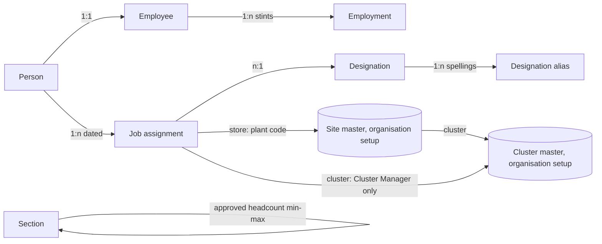

## Context

Feather Dash's org chart Tables (#630) say who holds which job in a store. The owner and the
client's CEO settled the people side on 04-Nov-2026 (#928). Kept from 27-Oct: dates start
inclusive and end exclusive; acting is a dated assignment; the reporting line sits on the job
assignment. The organisation setup owns the Legal Company, Site and Cluster masters on the
instance; Feather Dash names them by code, as it names a store by its plant code. Scopes and
permissions over these Tables are #683's (piece B).

## Decisions

### 1. The employee number lives on the employment, not on the employee

A person keeps their own permanent number; each company issues an employee number for one stint
(owner, decision A). So `employment.employee_number` is the only copy, and `employee` (ported
from #683) drops its `employee_number`.

- *Rejected:* keep `employee.employee_number` as "the current employment's number". It is a
  second copy that must be rewritten at every rejoin and transfer; it is ambiguous for a person
  employed by two companies at once and empty for someone who has left. Deciding principle:
  consistency (one fact, one place). A reader wanting "the current number" filters employment on
  an empty `left_on`.
- `employment.employee` references `employee`, not Person, so a stint always has an employee
  record, and the save can lock that row (decision 4).

### 2. Approved headcount is two columns on section, not a dated child table

`section.approved_headcount_min` and `approved_headcount_max`, both optional, max ≥ min.

- *Rejected:* a dated `section_headcount` table (starts_on/ends_on, one range per period). It
  would answer "what was approved in August?", but the source carries one current range per
  section, nothing asks for history yet, and every reader would need a dated join and an overlap
  rule. Deciding principles: consistency (a section's other limits, such as Team Leaders allowed,
  are undated columns) and cheaper loads. The section now tracks changes, so the version history
  says when a range changed. If dated approvals are needed later, the columns move to a child
  table; pre-release, that is a plain change.

### 3. A person's time: the deployment is taken out of the Primary

Each job assignment has a type (Primary, Secondary, Temporary deployment; Primary by default) and
a percentage (100 by default, more than 0, at most 100). Acting cover takes no share. On any day:
at most one Primary; Primary + Secondary ≤ 100%; Temporary deployments ≤ the Primary's share.

- So a full-time deployment is one new row at 100%, and the home row stays as it is: Primary,
  with its cost centre (decision E). The person's time still never exceeds 100%: the
  deployment's share is taken out of the Primary's.
- *Rejected:* every active row counted toward 100%. Deploying someone would then mean closing
  their home row and reopening it at 0% for the deployment's dates, so the home assignment would
  not "stay".
- A person leading two sections holds two rows (one per section, #630), so their shares split,
  for example 50% and 50%.

### 4. Where each rule is enforced

- Employment's rules (no overlapping stints at one company; one company's number names one
  person) are **refused at save**. The validator locks the employee row first, in the save's
  transaction, so two stints of one person are saved one after the other.
- A person's time is **listed on the conflict list**, like the org chart's other rules across
  rows ("Org-chart conflicts are listed, and never change coverage", #630). A store goes live
  once its list is empty. A load can then write a person's rows in any order, and deleting a
  Primary (which runs no save validation) still surfaces.
- *Rejected:* refusing time at save. A person's rows span stores and are written row by row, so
  an intermediate state is refused even when the end state is right; the delete path is not
  covered either.

### 5. Designations: a master plus an alias table

`designation` (clean title, active, folded unique key) and `designation_alias` (source, alias →
designation), the same pattern as `job_alias`, `section_alias` and `floor_alias`.

- *Rejected:* a "source text" column on the designation. One clean title often has several source
  spellings, and the alias table already matches loads on a whole value.

### 6. Jobs above the store and the cluster

Director and Chief Operating Officer join Cluster Manager and the store jobs. A job assignment's
`store` stays the plant code of the site the person works at; for these three, the site they are
based at, such as the corporate office. A Cluster Manager's row names the `cluster` they manage, by
the organisation's Cluster master code; no other job names one.

- A store's Cluster Manager is worked out: store (plant code) → site → cluster → the current
  Cluster Manager of that cluster. The masters live in the organisation setup, so the link is by
  code, as for the store; working out the reach is piece B's (#683). Until then, coverage reads a
  Cluster Manager's `store` as today.
- *Rejected:* a Reference to the Cluster master. That master is instance setup, not Feather Dash's
  own, and the app cannot install against a Table it does not ship.

## Risks / Trade-offs

- **Codes, not links**: `legal_company` and `cluster` are codes, so a mistyped code saves. The
  loader takes them from the masters; piece B can check them when it reads the masters.
- **Two saves of different people claiming one number at once** are not serialised (each locks its
  own employee row). Loads write one company's numbers from one source, so this is left out.

## Migration Plan

New Tables and new defaulted or optional columns; no platform migration. Feather Dash stays
0.10.2: before go-live, dev and prod are reinstalled fresh.

## Open Questions

- Leaving reasons are kept as the HR system gives them until a closed list is agreed.
- Who reads and edits employees and stints is piece B's: no app role is granted them here.
