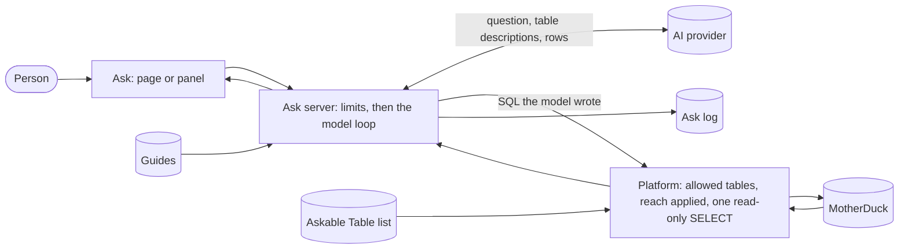

## Context

Featherbase limits what a person sees by their reach: the stores and subcategories their business role covers. Dash applies it by working out the person's filters and handing them to the report's Dive. An app's server can read only its own Tables, and the warehouse (MotherDuck) is read with one read-only token that can see every store. An earlier draft (#1353) answered from a copy of report data and was reviewed on 19-Nov-2026; three of its ideas are kept (D1, D2, D7's tests).

## Goals / Non-Goals

**Goals:** any question the askable tables can answer; an answer never outside the asker's reach; the cost of every question known and limited before it is spent.

**Non-Goals:** data that is not in the warehouse, more than one askable table, and acting on a request (#1372). Guaranteeing that an answer is right: the fence stops a leak, not a wrong join.

## Decisions

Each was agreed with the owner, one at a time, on 19-Nov-2026.

### D1. The model writes the SQL, in a tool loop

The model is given the tables this person may ask, with their descriptions, and three tools: list tables, describe a table, run a query. It reads rows or the error, corrects itself, and answers. A fixed number of rounds.

- *Instead of Featherbase building SQL from described measures:* that answers only what was described in advance, and cannot do joins. The owner: "Why should we get in the way?"
- *Instead of an agent framework or a retrieval step:* the loop is small, and a few dozen table descriptions fit in the prompt.

### D2. Featherbase limits the rows, as Dash does for a Dive

Before a query runs, every askable table it names is replaced by that table cut to the asker's stores and subcategories, from the same reach Dash uses. A query must be one read-only SELECT, may name only this person's askable tables, and may not name a table in a way that steps round the replacement. It runs with a read-only connection, a time limit and a row limit.

- *Instead of MotherDuck secure views:* one view per table, written by hand and wired again for each new table; and a second copy of the access rules to keep in step.
- *Instead of copying the asker's rows out and querying the copy (the earlier draft):* not live, and not workable on large tables.

The cost: the fence is Featherbase's own code, so it is the part reviewed hardest (the issue's review route).

### D3. An admin fills in the Askable Table list

A Table in Featherbase: the warehouse table, its store column, its subcategory column, the roles that may ask it. A table with neither column is askable only by roles that see everything. A new row is checked by viewing as a person before it goes live.

- *Instead of each app's manifest:* every new table would wait for a release.
- *Instead of reading MotherDuck's shares:* they say who may see a table, not which column is the store.

Descriptions are not kept here: they are MotherDuck's table and column comments and a MotherDuck Guide, so Dives, MotherDuck's own AI and Ask share one description.

### D4. The model writes the answer from the rows

The rows that came back go to the model with the question, as a person would read them. A sentence written by Featherbase is the fallback when the model cannot be reached.

- *Instead of a template:* it answers only the questions planned for. The cost, accepted: the rows of each answer leave the instance for the AI provider.

### D5. Everything is kept, for good; the asker reads their own

The question, the SQL, the rows and the written answer are saved. The asker can always reopen their own; an Ask Admin sees all; nobody else, and not through the generic table screens.

- *Instead of keeping only the question and the SQL:* the owner wants the full record of what each person was told.
- *Instead of rechecking reach on reopen:* accepted that someone moved to another store can still read the answers they were given before (the issue's "Deliberately not handled").

### D6. Guides are rows in a Table, seeded by each app

Each app ships starter guides that load at install; an admin edits and adds to them. Ask uses only the guides of apps the asker may open, and says it does not know when no guide covers a question.

- *Instead of files shipped with each app:* a correction would wait for a release, and a client's own help does not belong in platform code.

### D7. One door to the model, with the limits in front of it

Every model call goes through one place, which checks the person's limits and the monthly budget first, counts every call of a question's loop as one question's cost, and never shows the provider's error text to the asker. It is tested against a model that has been talked into misbehaving.

The provider is one account that offers the GPT, Claude and GLM families and reports the cost of each call: OpenCode Zen (the owner's choice, 19-Nov-2026), with OpenRouter also supported. Only the door knows which.

- *Instead of a key per model maker:* three bills, three sets of limits, and no single price list.

## Risks / Trade-offs

- A valid query that answers the wrong question → every answer shows its SQL and what it covers; descriptions and join rules live in one MotherDuck Guide.
- A mistake in the fence leaks rows → a single SELECT over named tables only; tests with a misbehaving model; an adversarial review proposed for this part.
- A wrong store column in the Askable Table list → the view-as check before a row goes live.
- Spend runs away → limits and the budget are checked before each call; a loop has a fixed number of rounds.
- The log becomes a second copy of the figures → readable by the asker and Ask Admins only; treated as report data in backups.

## Open Questions

1. Where the query runner and its fence live. An app's server cannot query the warehouse freely today. The likely answer is a platform capability the Ask app calls, so no app can run a warehouse query without the fence. To be agreed with the owner before the specs.
2. How many rounds a loop may take, and the time and row limits of a query.
