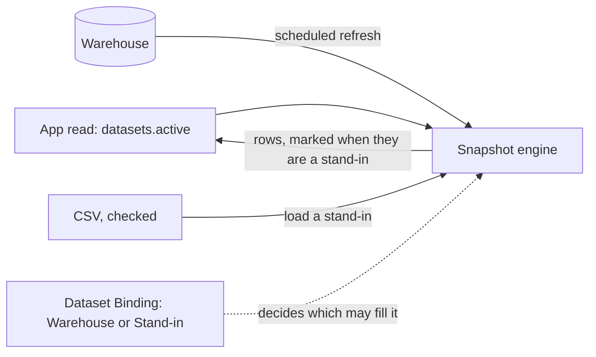

## Context

An app declares its datasets once and reads them through a stored snapshot
(`app-datasets.ts`, `dataset-snapshot.ts`, ADR 0013). A snapshot goes through
one lifecycle: build a candidate, validate, activate, keep the last good one.
This change adds a second way to fill a dataset, a CSV, without the app
knowing. The owner asked for it to stay plain enough for the
`featherbase-redesign` branch to adopt the idea later.

## Decisions

### D1. A stand-in is an ordinary snapshot with a flag, not a second store

The CSV's rows are loaded as a candidate and activated through
`buildSnapshot`, in the same `app_dataset_row` table, with `stand_in` set on
the snapshot's registry row. Reads, scope filtering, key filters and ordering
are untouched, so the app's code is the same for real and stand-in rows.

Rejected: a separate table of stand-in rows read by a branch in `active()`.
It would duplicate scope filtering, where a mistake shows one store another
store's figures.

### D2. The binding decides what may fill a dataset; the snapshot says what the rows are

`Dataset Binding.served_from` decides behaviour: a dataset bound to a stand-in
is not refreshed from the warehouse and does not need its Data Source. Whether
an answer is marked is read from the snapshot being served, never from the
binding. The two can disagree for a moment (the settings file flips a binding
to Warehouse before the next refresh runs), and then the rows are still a
stand-in and are still marked.

The build itself reads the binding, inside the lock that serializes builds of
one dataset, and skips a refresh of a dataset bound to a stand-in. Reading it
only when the job lists what is due would let a refresh that was already queued
replace a stand-in loaded a moment later (found in review).

Rejected: marking from the binding alone. A flipped binding would unmark
sample figures until the refresh ran.

### D3. A stand-in is never a guard's baseline, and is not itself guarded

The engine passes no previous snapshot to a refresh's validation when the
active one is a stand-in, so a drop guard has nothing to compare with. The
absolute guards (minimum rows, not all zero) and the empty-candidate refusal
still judge the real data. A stand-in is checked for fit only: sample data is
small, and a `min_rows` written for the real data would refuse it.

When a stand-in was loaded over real rows, the last real copy is kept while
stand-ins serve and is the baseline for the next real refresh, so a drop guard
is not blind once. With no earlier real copy there is nothing to compare with.

Rejected: clearing the stand-in before the first real refresh. The screen
would be empty if that refresh was refused.

### D4. A stand-in is tied to the dataset's shape, not its query

A warehouse snapshot's identity is a hash of the whole declaration except its
guard, so a changed query never serves rows cut to the old one. A stand-in's
identity is a hash of the columns, keys and scope mapping only. The query is
often corrected while the stand-in serves (that is the point of one), and that
must not blank the screen; a changed column must.

A dataset whose stand-in was retired this way is still bound to a stand-in, so
nothing refreshes it and the app shows nothing for it. Instance health names
it (one check per app with such a binding), as it names one that was bound
before any file was loaded.

Rejected: one identity for both. Every query fix during the gap would need the
stand-in loaded again.

### D5. `live()` on a stand-in answers the stand-in

A live read asks the warehouse, and a stand-in exists because the warehouse
cannot answer. `live()` answers the same stand-in rows, marked the same way,
and still requires the read to be declared outbound, so an app that calls it
behaves the same before and after the switch.

Rejected: refusing `live()`. The app would need a branch for stand-ins, which
is the one thing this change must not ask of an app.

### D6. The platform marks the response, and the page shell draws the line

Every `/api` response that served stand-in rows carries a header naming them,
set by the server from what the dataset engine served in that request. The
shared bar every app page loads already wraps the page's `fetch` (#1260); it
reads the header and draws one line under the top bar. An app cannot forget
the mark because it never draws it.

The mark must not depend on how or when the page asks. The shell watches
`fetch` and `XMLHttpRequest`, and the server repeats the list as a
`Server-Timing` metric, which a browser keeps with every request it made: from
that the shell learns of a stand-in served to a request that left before it
could watch, such as one made by a script that ran before the bar loaded.
Requests made in a worker or a frame are not seen.

What a page was told is remembered by its path, not its query string. Two
views of one page then share the line, which errs toward marking: keyed by the
query too, a view that changes its query and keeps showing rows it already had
would lose the line.

Rejected: a shared component each app places on its pages. It marks only the
pages whose author remembered it.

### D7. Switching tries the warehouse first and keeps the stand-in if it fails

Switch To Warehouse binds the dataset to the warehouse, runs the real refresh,
and binds it back to the stand-in if the refresh does not activate. The
stand-in keeps serving throughout, and the answer says why in the guard's
words. Binding first means a binding the settings file manages is refused
before anything is built.

### D8. Production needs a tick the settings file cannot set

On production, binding a dataset to a stand-in is refused unless Allowed On
Production is ticked on that dataset's binding. The settings file manages the
rest of the binding but not this field, so it is always a System Manager's own
act. The save guards only the move to a stand-in; the read guards serving. So
the tick can always be withdrawn, and withdrawing it stops the stand-in being
served on production at once (found in review: guarding every save refused the
untick this decision promises).
