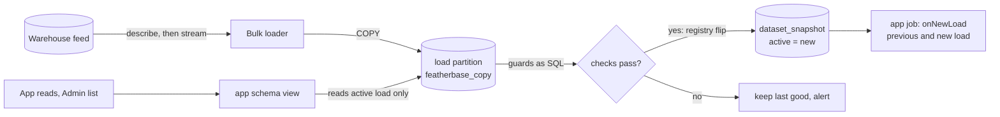

## Context

The owner agreed the data flow on 28-Nov-2026 (Forecasting backend design, sections 2–4): the warehouse publishes one feed per need; Featherbase copies each feed read-only, loads a new run beside the old one, swaps when its checks pass, checks the feed's shape before every load, keeps the copies out of CDC, checks for a new run every 15 minutes and refreshes daily feeds each morning. These decisions are how the platform does it. They were taken in autopilot from that design and the issue.

**Ratified 28-Nov-2026** (Siraj, through #4935: "yes with the changes above"): D1–D4 and D6–D10 as written; D5 changed to a load that runs only when someone asks (below). The 15-minute check and the daily time it replaced are gone.

## Decisions

### D1. A Read-only copy is a view over loads kept apart; the swap is a registry flip
Each load is written into its own partition of a load table in a platform schema (`featherbase_copy`), under a new load id. The Table people and apps read is a view in the app's schema that shows only the load the registry (`dataset_snapshot`) marks active. Activating a load is one update of the registry, so a reader sees the old load or the new one, never half. A read-only copy holds no link to a Data Source row: its app names the source, which an administrator connects after the install, as for a JSON dataset. The previous load stays until the next load succeeds (D7), and older loads are dropped whole (a partition drop, no row deletes).
*Rejected:* rename-swapping two tables (whatever depends on the old table follows it, and constraint names drift); delete-and-insert in one transaction (millions of row writes inside the swap, and bloat); one table with a load-id column that every reader filters (an app query that forgets the filter reads two runs at once).

### D2. The copy's Table comes from the declaration, not from migration steps
Installing or upgrading an app makes its Read-only copies match its `datasets[]`: a new dataset gets its Table, an added column is added (empty until the next load fills it), a removed one is dropped, a changed type or key rebuilds the copy empty and loads it at once, a dataset no longer declared is removed. A copy holds nothing a person made, so nothing is lost that a load does not bring back.
*Rejected:* declaring the copy as an app Table with migration steps. Every feed change would need a step, and the version ledger would guard data that is thrown away each run.

### D3. Types and keys
`text` → text, `integer` → bigint, `number` and `money` → unbounded numeric (decimals travel as text, so no digit is lost), `date` → date, `boolean` → boolean. `rowKey` names the columns that identify a row (store × subcategory × day); a load whose key repeats or is empty is refused. A row's id is its key values joined, so the Admin can open one.
*Rejected:* a generated surrogate id (a row's link would change every run).

### D4. The shape check describes the query on the source before reading a row
The loader asks the source for the columns and types the declared query returns, without running it, and compares them with the declaration by type family (any integer width is `integer`; any decimal, float or integer is `number`). An extra source column is ignored. A declared column the source lacks, or holds as another family, refuses the load: the job is marked refused, which alerts as any refused job does (#464), and the last good copy keeps serving.
*Rejected:* checking the first rows (an empty result or a null column hides a change).

### D5. A load runs only when someone asks (changed 28-Nov-2026)
Siraj's ruling on the first D5 (a check every 15 minutes and a daily time): "that is too much. we want a manually triggered run. not an automated one." So nothing loads a read-only copy on its own. A System Manager, or a holder of a role the dataset names in `loadRoles` (one of the app's roles), presses **Check for a new run** (loads only when the run check answers a new run; a copy with no run check loads every time) or **Load now** (loads whatever the run is) on the copy in the Admin. The same is `POST /api/copy_load { "table": "<copy>", "force": true|false }` for a script after the warehouse's build. A request queues one background job (a run can be millions of rows); a request while one waits or runs is that load. The copy says what its last load did, the run it holds and why its last load failed (`:copy_load_state`). A read-only copy has no Scheduled Job; editable copies keep #840 as it is.
*Rejected (by the owner):* the 15-minute check and the daily time. *Rejected:* loading inside the request (a large run outlasts it).

### D6. Who may ask
A System Manager, or a holder of one of the dataset's `loadRoles`. A warehouse script uses a service account holding such a role, with an access token. A reader of the copy may not load it.
*Rejected:* anyone who may read the copy (a team leader could reload the month's forecast).

### D7. After a new load the app's job is told both loads; the platform works out what moved
A dataset may name one of its app's jobs as `onNewLoad`. After a swap the platform queues that job; its context carries the copy, the previous and the new load, and `moves({ by, measure, threshold })`: the per-group totals of the measure in both loads where the change is more than the threshold (a share, 10% unless given; a group new or gone counts as moved). An app has no SQL of its own, so the comparison is the platform's. The previous load is kept until the next one succeeds, so the job can compare even if it runs late or is retried.
*Rejected:* handing the app the two load ids alone (it has no SQL to use them); dropping the old load at the swap (a retried job would find nothing to compare).

### D8. Typed by default; JSON only on request
A dataset without `store` is a Read-only copy. `store: "json"` keeps today's snapshot (demand-built, jsonb rows). Today's two JSON datasets say so: Dash's (in a version step with no Table change) and the dataset test fixture's. Moving them is later work, not this change.
*Rejected:* keeping JSON as the default (against the owner's ruling).

### D9. Two more guards, for copies only
Besides today's guards (at least N rows, not all zero, a drop at most N%), a copy may declare `source_total` (the loaded total of a column equals the source's own total of the same query, to the last digit) and `keeps_values` (every value of a column in the current load is still there, such as every store). A JSON dataset declaring either is refused.

### D10. CDC skips a Read-only copy without a change in the warehouse
The warehouse capture offers only relations that are ordinary tables and that `table_def` names. A copy's Table is a view and its loads have no `table_def` row, so neither is offered. The hand-off recommends an explicit rule in the adapter (skip a `table_def` row whose `table_copy.mode` is read-only) so a later storage change cannot quietly start capturing copies.
