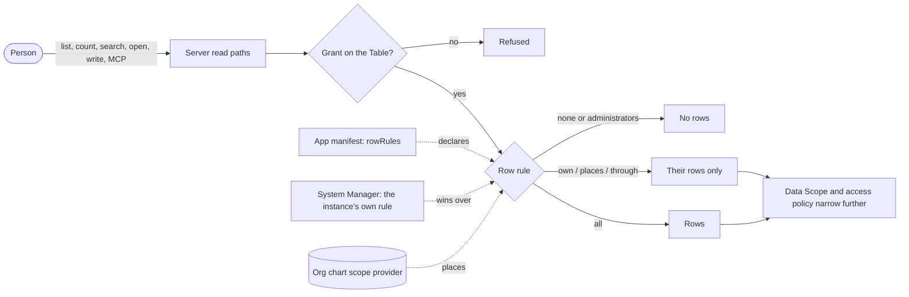

## Context

Before this change the only row filters were a grant's "own rows only", a person's Data Scope, a mandatory access
policy and, since #1454, places declared beside the manifest's Tables. A Table that used none of them was read whole
by whoever held a grant. The audit of a local instance with made-up data, and the reasoning behind each routine
choice, are in `docs/design/row-access.md`; this file holds the decisions a good engineer might have made otherwise.

## Decisions

1. **The rule belongs to the Table, not to the grant.** Alternative: extend a grant's scope (`all`, `creator`) with the
   new kinds, so each role carries its own row filter. Rejected: the author of a Table knows what its rows are about;
   every System Manager who later grants a role would have to repeat it, and one forgotten grant reads the Table
   whole. A grant keeps "own rows only" as the narrower reading one role gets, and `whole_for` covers the role that
   reads everything.
2. **No rule means no rows, including for existing code paths.** Alternative: default to every row and report the
   Tables without a rule. Rejected: that is today's behaviour with a report nobody reads. Closed is noticed the
   first time someone opens the Table.
3. **Existing Tables are given "every row" by the migration.** Alternative: close them all and open each by hand.
   Rejected for the upgrade only: it stops every live instance until 80 rules are set, for no gain over reviewing a
   list. This is the owner's call (decision 1 in the design page).
4. **An app's rule is read from its loaded manifest, not copied into the database.** Alternative: write it to the
   Table at install. Rejected: an upgrade would need a migration step per rule, and an app that fails to load would
   keep serving its old rules. The database column holds only what the instance itself said.
5. **Data Scope and mandatory access policies stay beside the rule.** Alternative: make them kinds. Rejected: Data
   Scope is per person and set by an instance, and a policy binds System Managers too; neither is a fact about the
   Table's rows that its author declares.
6. **A connected Table is every row or none.** Alternative: push own-rows and places filters to the outside
   database. Rejected for now: a connected row has no creator, and no instance has a connected Table about places.

## Risks / Trade-offs

- A Table made in the Table builder or the import wizard is closed until a System Manager sets its rule over the API
  or MCP. → The refusal says so; a screen for it is the owner's decision 5.
- An instance that takes the platform without the new app versions closes those apps' Tables. → Ship them together.
- `through` runs the target's whole list query as a subquery. → One level in every use so far; rings end closed.
