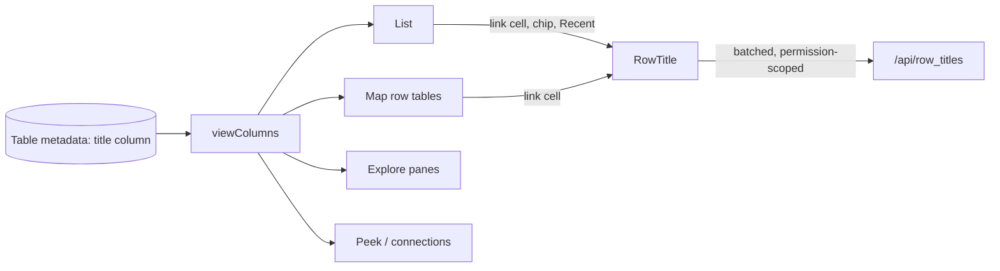

## Context

Which columns a list shows comes from `viewColumns` (`apps/web/src/lib/list-view-columns.ts`), which every list-shaped screen uses through `listColumns`: the list, the relationship map's row tables, Explore's panes, Peek and a row's connections. It always puts Row ID first (#738, Decision 1), and each screen fetches exactly the columns it shows, so `row_id` arrives only because it is the first column. A linked row's title is already resolved in batches by `RowTitle` (`apps/web/src/lib/row-titles.tsx`, `/api/row_titles`, permission-scoped), which Explore, the map's boxes and the home page use. Filter chips print the stored filter (`customer = cust-1`); the list's Recent strip prints the text recorded when the filtered list was visited.

## Decisions

### 1. A list leads with the title column; Row ID only when there is none (reverses #738's "Row ID first")

`viewColumns` returns the title column first when the Table names one the caller may read, and leaves Row ID out; otherwise Row ID first, as before. The leading column is the link to the row and is always on in the columns menu. Every screen built on these columns asks for `row_id` explicitly, so selecting, linking and keys keep working without it as a column.

Rejected:
- **Keep Row ID first and add the title beside it** (#738 as built): the owner's reading of a real HR database was that Row ID is a number nobody reads a row by; keeping it spends the list's first column on it for every titled Table.
- **Title first, Row ID kept as a second column**: the id then shows twice where the title is a code, and still takes a column on every titled Table. Anyone who needs the id finds it on the row's form.

### 2. Link titles render at the cell, through the existing batched title lookup

Each link cell renders `RowTitle`, which queues every title asked for in the same tick into one permission-scoped request and falls back to the id. Filter chips and the Recent strip use the same lookup, at render time, from the stored filter. A leading title cell that is blank uses it too, so a nameless row reads the same stand-in (a few of its values, else its Table and id) everywhere.

Rejected:
- **Have the list API return titles beside each link value**: the list read would have to join every linked Table under each one's own permissions (and a connected Table's at its source), a second permission path; the batched lookup already does this once per screen.
- **Record the picked row's name in the filter or in Recent**: names change and are not unique; the filter keeps the id (as #793 decided) and the words are derived when shown, so an old Recent entry reads the current name.

### 3. One product-wide "rows read by their title" promise was considered and not made

The promise now appears per screen: home pages, Explore (#784), connected rows (#783), the form's picker (#793) and, here, lists and the map. Gathering them into one product-wide requirement would mean rewriting four specs whose requirements each carry a screen-specific rule (the home page's values stand-in, a connected row's permissions), so it would not remove the duplication cleanly. This change adds to `list-view` and `search-and-explore` only.

## Risks / Trade-offs

- A list of many link columns asks for many titles → batched per tick, at most 100 per request, cached for five minutes.
- A titled Table whose title is a code (a store code) now leads with that code and hides Row ID → the code is what the Table chose to name rows by.
- Tests that pinned Row ID first on a titled Table change; each is listed in the PR as an intended change.
