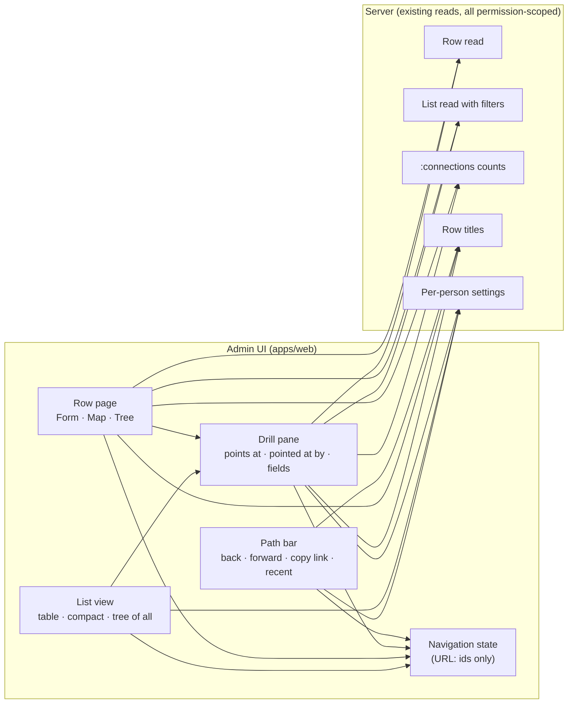

## Context

Issue #910 replaces four ways of looking at related rows (the peek slide-over, the row page's
Related tab, the relationship-map page and its row lists) with one drill pane, a path, and
Form · Map · Tree tabs on the row page. The agreed prototype is in `reference/`; the issue's
22-item checklist is the UI contract. Builds on #792 / PR #839, which made lists, filters and the
map read rows by their title through the batched, permission-scoped title lookup.

Everything the pane, map and tree show already has a permission-scoped read on the server: a row,
a filtered list, a row's counted backlinks (`:connections`), and row titles. Per-person settings
already live in one server-side blob per person (`/api/user_settings`), which the list uses for
its column arrangement.

## Goals / Non-Goals

Goals: one way in to related rows; a path that survives reloads, the browser's buttons and being
shared; nothing named that the viewer cannot read.

Non-goals: saved, named paths shared with others; editing inside the pane; changing Explore (it
keeps its own chain, and its "open the last row in place" uses the drill pane instead of peek).

## Decisions

### D1. The path lives in the page address, as identities only

The whole path (each step's table, row, open group, filters, tree expansion, pane place) and the
current step go into one address parameter, as row ids and column names, never as names. Names are
looked up for whoever is viewing, through the same permission-scoped title lookup the list uses.
Moving to an earlier step and then drilling elsewhere drops the steps after it, the way a browser's
history does. The path keeps its last 12 steps.

- *Rejected: paths stored on the server under a short id.* Shorter links, but it needs a new table,
  an endpoint and a sharing rule, and still has to name rows per viewer.
- *Rejected: names written into the address.* A shared link would show a colleague names they may
  not read (checklist item 22), and a renamed row would keep its old name.
- *Rejected: a branching path.* It would not match what the browser's back and forward do
  (checklist item 13).

### D2. Per-person choices go in the per-person settings on the server

The compact choice per table, the pane's place, and the last ten paths are kept in the existing
per-person settings, beside the list's column arrangement. A recent path is stored as identities,
like D1, and named when shown.

- *Rejected: browser storage (as the search bar's recents do).* The spec promises these per person,
  across sign-ins and devices; browser storage would lose them on another machine.

### D3. No new server endpoint: the pane, map and tree compose existing reads

The pane reads the row, its `:connections` counts, the chosen group as a filtered list, and the
titles of rows it points at. The tree does the same per unfolded line, 20 rows per group until the
user asks for all. A link to a row the viewer cannot read has no title from the lookup, so it is
shown as a row they cannot read, without its id or any action.

- *Rejected: one "neighbourhood" endpoint* returning links, backlinks, titles and rows together.
  Fewer round trips, but it would be a second permission path across linked tables, the reason
  #839 resolved titles at the cell instead. The 20-row cap keeps the extra requests bounded.

### D4. The pane replaces peek, the Related tab and the map page outright

One drill pane component serves the list, the row page and Explore. The map and the new tree
become tabs of the row page, addressed by the row page's own address; the separate map page and
its address are removed, with no redirect (pre-release rule).

- *Rejected: keeping peek for links on the form.* Two ways in is what the owner asked to end
  (checklist item 16).

## Risks / Trade-offs

- A deep tree makes one request per unfolded group; acceptable for master data, revisit if a real
  table makes it slow.
- Acceptance tests and page objects for peek, Related and the map are rewritten with the change.

## Migration Plan

Web only; no data migration. Old map links stop working (pre-release). The per-person settings
gain three keys; an absent key means the defaults (full table, pane placed for the window size, no
recent paths).

## Open Questions

None.
