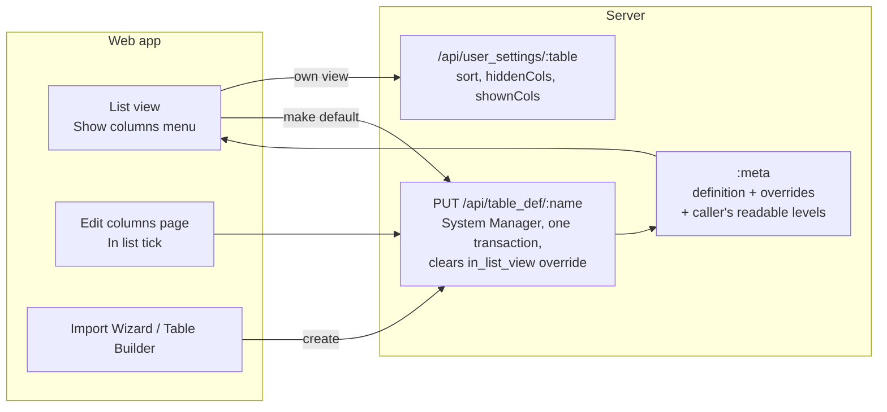

## Context

Which columns a list shows is decided by each column's `in_list_view` flag, but nothing after
creation lets anyone see or change it, and the importer sets it silently for the first 4
columns (#738). What the code does today:

- `inferTableDef` (`packages/shared/src/import.ts`) and the Table Builder flag the first 4
  columns.
- `listColumns()` (`apps/web/src/lib/meta.ts`) returns Row ID plus flagged columns, or the first
  two data columns when none is flagged. `ListView.tsx` builds both the grid and the "Show
  columns" menu from it, so the menu can only hide.
- A user's arrangement is stored per Table in `user_settings` as `{ sort, hiddenCols }`.
- The Edit columns page saves by PUTting the whole merged meta to `/api/table_def/:name`
  (System Manager, `updateTable`, one transaction). It is offered only on Tables that are not
  system, not system-written and not bound to a data source; "Make this the default" is offered
  exactly where it is.
- The `:meta` response lists every column, each marked `basic` or `restricted`, to anyone who
  may read the Table; rows leave out `restricted` columns for a `basic`-only reader.
- Metadata Overrides are laid over every meta (CUST-002), so an override beats the definition.
  Section Mapping on `jeyarama/dash` carries 3 `in_list_view = true` overrides as a stopgap.

## Goals / Non-Goals

**Goals:** the promises in this change's specs, with a user's view kept as changes on top of the
Table's default, and arrangements saved before this change keeping their meaning.

**Non-Goals:** quick filters (#742); list choices on system, system-written or bound Tables;
column order (stays the Table's column order).

## Decisions

### 1. A user's view is two sets on top of the Table's default

The saved arrangement becomes `{ sort, hiddenCols, shownCols }`, and what the user sees is:

```
Row ID + (the Table's list columns ∪ shownCols) − hiddenCols, in the Table's column order
```

Switching a column on removes it from `hiddenCols` and, if it isn't a list column, adds it to
`shownCols`; switching off does the reverse. "Make this the default" empties the System
Manager's own two sets, since their view is now the default. An arrangement saved before this
change has no `shownCols`, so it reads exactly as before.

*Alternative:* store the full list of columns each user sees. Rejected: a snapshot freezes the
view, so a new default would never reach anyone who had saved one, and every existing
arrangement would need converting.

### 2. Columns the user may not read are never offered

The `:meta` response gains the caller's readable levels (from `permittedTiers`); the menu, the
grid and the saved view skip columns above them. Credential columns are already withheld
everywhere (`SENSITIVE_COLUMNS`).

*Alternative:* strip restricted columns from the meta per caller. Rejected for now: the meta is
cached per Table on the server and shared by every screen, so per-caller meta is a wider change
than this issue needs.

### 3. List columns for everyone live in the Table's definition

The Edit columns "In list" tick, "Make this the default" and Table creation all save the
`in_list_view` flags through the existing `PUT /api/table_def/:name`: one request, one
transaction, System Manager checked by the server, no new endpoint. The same save deletes the
`in_list_view` Metadata Override of each column whose flag it changes, so an override can't make
the tick do nothing. Other overrides are untouched.

*Alternatives:* save list choices as overrides (rejected: the fact would live in the definition
at creation and in overrides afterwards); leave overrides winning and grey out the tick
(rejected: the hidden rule #738 is about, in a new place).



## Risks / Trade-offs

- **The Edit columns save sends the merged meta back**, so the stored value can't be read from
  the request alone → `updateTable` counts a column's flag as changed when it differs from the
  stored definition's **or** from what the column showed (definition plus override).
  *(Refined during the build, 31-Oct-2026: comparing with the stored value alone missed
  unticking a column only an override put in the list.)* A consequence: any Edit columns save,
  even a relabel, writes an `in_list_view` override's value into the definition and deletes the
  override. What everyone sees doesn't change; Section Mapping's 3 stopgap rows go at the first
  Edit columns save on that Table.
- **Stale entries in `shownCols` / `hiddenCols`** (a column later removed, or now equal to the
  default) → harmless: the formula ignores unknown columns, and a redundant entry still means
  what the user chose.
- **A default with nothing in it** → the list falls back to the first two columns (list-view
  spec), so it is never empty.

## Migration Plan

No data migration. `user_settings` rows without `shownCols` stay valid (Decision 1); a test pins
that an old `{ hiddenCols: ["floor"] }` row still hides Floor. The 3 stopgap overrides on
Section Mapping are not deleted by any migration; each goes when someone changes that column's
list choice (Decision 3).

## Open Questions

None.
