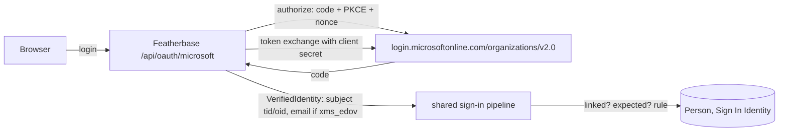

## Context

Google sign-in already runs through one shared pipeline (verify → resolve the person → eligibility → session → audit). Microsoft is a new kind on that pipeline: it adds only its own verify step and routes.

## Decisions

### D1. Any work account may try; Featherbase decides who gets in

The method uses Microsoft's `organizations` endpoint, so a person from any Entra tenant (Bisquared, a client on Office 365) can sign in without a new app registration. Admission is Featherbase's own rule: a linked account, an administrator's invite or mark, or the method's rule for unknown people, which refuses in production.

*Rejected:* a single tenant (Bisquared's). It is the tightest, but every new client tenant would need the registration changed. *Chosen by Siraj, 17-Nov-2026.*

### D2. The address is trusted only when Microsoft says its domain is verified

Any tenant administrator can give a user any `email` value, including someone else's company address ("nOAuth"). So the `email` claim counts as verified only when Microsoft's `xms_edov` claim is true, which means the tenant has proven it owns that domain. `preferred_username` is never used for admission. A verified address plays the part Google's hosted-domain claim plays: the domain rule, the expected-sign-in mark and invites work only on it. Without `xms_edov` the sign-in still works for an already-linked account, but it cannot make a first link through the address.

*Rejected:* trusting `email` alone, which is open to the nOAuth attack. Also rejected: reading the address from Microsoft Graph, which adds a second call and a permission but no stronger proof of the domain.

### D3. The permanent ID is the tenant plus the object ID

A link is keyed by `tid` and `oid` together (Microsoft's guidance for a stable user key across apps), never by email. The ID token comes straight from Microsoft's token endpoint over TLS, authenticated by the client secret, so its signature is not checked again (OpenID Connect Core 3.1.3.7). Its issuer must name its own `tid`, its audience must be this client, it must not have expired, and its nonce must match the one this browser's sign-in started with.

*Rejected:* `sub`, which is per-app and changes if the app registration is replaced.
