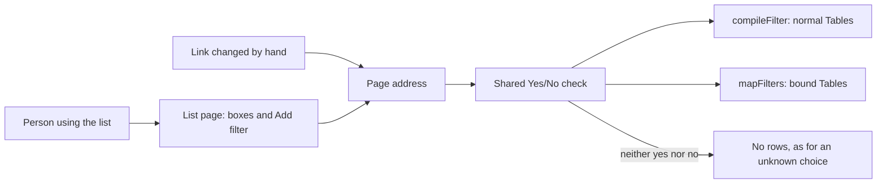

## Context

The boxes above a list come from `StandardFilters` in `ListView.tsx`, and "Add filter" from `FilterBar` in the same file.
Both write filters into the page address as `[column, operator, value]`. #738 adds `viewColumns()` for the columns one
person sees, so the boxes can read that instead of the Table's list columns.

A Yes/No filter's value can arrive as text. On a normal Table the database reads `"true"` and `"yes"` itself (the
connection sends filter values unprepared), but `"maybe"` gives a server error, and words such as `"on"` count as yes.
A Choice filter with an unknown value finds no rows, with no error. Filters are built in two places, and neither
converts the value:

- `compileFilter` in `apps/server/src/query.ts`, for normal Tables.
- `mapFilters` in `apps/server/src/sources/dispatch.ts`, for Tables bound to a data source.

## Goals / Non-Goals

**Goals:** the promises in this change's specs, with a Yes/No filter working the same however it arrives and on both
kinds of Table.

**Non-Goals:** date and number range filters; picking more than one choice in a filter; converting filter values for any
other column type.

## Decisions

### 1. The server checks every Yes/No filter value, for both kinds of Table

Someone changing a link by hand can put any value in a filter, and the page's dropdown can't stop that, because the link
skips the page. So one shared check converts or refuses a Yes/No filter value, used by both `compileFilter` and
`mapFilters`. It understands true, false, yes and no, in any capitals, and 1 and 0, as a number or text (added on
05-Nov-2026: a Check default is "1", and the tickets app routes with `primary = 1`). Any other value finds no rows, as
an unknown choice does on a Choice filter.

Tested on an in-memory DuckDB, MotherDuck's engine: true, false and the text forms already match the right rows, and
`"maybe"` gives a raw conversion error. So on MotherDuck the check turns that error into no rows, and keeps one rule on
every kind of Table. The address looks the same on all of them.

- Rejected: true and false only. A link saying yes would find no rows, though its meaning is plain.
- Rejected: refusing other values with a message. Yes/No should behave as Choice does, and Choice shows no rows.
- Rejected: fixing it only in the web app. A changed link or an API call would still find the wrong rows.
- Rejected: fixing normal Tables only. Bound Tables would keep the bug.
- Rejected: converting every column type. It could change existing filters and goes beyond this bug.

### 2. A Yes/No filter works like a Choice filter, in the page and in links

The dropdowns write the word `"Yes"` or `"No"` into the page address, as a Choice filter writes `"Closed"`, so the box
and the chip show the stored word with no translating. The server's check in Decision 1 converts it for the column.

- Rejected: storing a real true or false. The page would have to translate it to Yes or No for every box and chip, and
  the server conversion is needed for changed links anyway.

## Risks / Trade-offs

- [Real MotherDuck hasn't been tested, and CSV folder and MySQL sources handle Yes/No their own way] -> Test on a bound
  Table of each kind we can run. `mapFilters` already has each column's type through the binding.
- [A mistyped Yes/No value shows an empty list with no explanation] -> Accepted, to match Choice; the chip still shows the
  filter in use.

## Migration Plan

None. No stored data changes, and existing links keep working or now find their rows.

## Open Questions

None.
