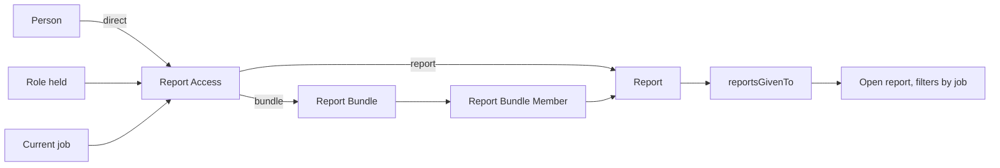

## Context

The owner agreed these on 07-Nov-2026; the checklist is in issue #1046. The report table belongs to #967.

## Decisions

### Assignment rows, not Permission rows

A `Report Access` row names one report or bundle and one receiver. Permission rows reach whole Tables, can't name a person, and only a System Manager writes them.

### A bundle's reports are rows of their own

Report Bundle Member links one bundle to one report, with a unique key. Taking a report out of a bundle is removing one row, which version history records, and the same save rule stamps the key.

### The person is stored as an id, not a link

Report Access keeps the person's id in a plain column. A link column checks that whoever saves it can read the Person, and a Report Access Manager can't, by design. The page picks the person by name from Employee and shows names, never the id.

### Removing marks a row removed

A delete leaves no trace of who took access away. Removing instead ticks the row's Removed box, an update that version history records with who and when, and clears its key, so the same thing can be given again as a new row. Readers skip removed rows. Bundle members are taken out the same way.

### Bundles are made on the Report access page

The owner asked for the standard form (point 17), but a Report Access Manager can't open the Admin pages, so the page makes bundles, puts reports in and takes them out itself, through the same save path. System Managers can still use the Admin form.

### Additive only, with no dates

A person's reports are the union of every route. A rule that subtracts would make "why can they see this?" depend on rule order, and dates would add states to read. Removing a row is the only removal.

### A job is a receiver

Read from the person's current Job Assignment, so joiners, movers and leavers need no upkeep. The alternative, syncing jobs into roles, adds machinery and a way to go stale.

### A narrow role writes these Tables, unlocked from the System Manager rule

The Tables are not marked `decides_scope`, and Report Access Manager holds ordinary grants on them. Its holder can give anyone any report, including themselves. That's accepted: what a report shows is still narrowed by job, and version history records each change.

### The Tables, the check and the page all ship with Dash

Reports are `dash.report`, so a core Table linking to them would make core depend on an app. Shipping with Dash gives real links and pickers, and the Tables, role and grants install with the app. The page writes through the generic save path as the signed-in person, which keeps the trigger chain and version history. Another client wanting this would mean moving it into the platform later.

### A grant never widens which stores a person sees

A report with no store filter opens for someone whose job reaches no store. A store-filtered one stays closed for them, and the person lookup says why. The alternative, a grant giving every store, would let one row quietly widen what a person sees to the whole company.

### The save rule lives on the Table

A server script refuses any mix other than one thing to one receiver, and stamps a unique `access_key`, so the database refuses duplicates even when two saves race. The reader also ignores a malformed row, so a bad row can never widen access.

### Reports decide who gets into Dash

Dash Reader goes to everyone who signs in, and the app adds a "has a report, or manages access" check to the gate. The role gate alone would shut out someone given a bundle by job, and the owner can't give roles. Reusing the no-access page means requests record and clear with almost no new code. The cost is that opening Dash with no report alerts the owner, within the existing daily cap, and each gate check does one more read.

### No row means no report, for everyone

There's no default and no administrator exception, matching "no assignment is not read as full access". The first rows load in the same release as the check.
