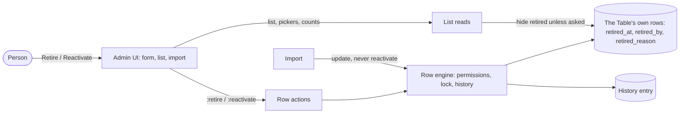

## Context

#859, with the brief Siraj gave on 04-Nov-2026 while curating master data on staging
(data-warehouse #4588): one platform-wide Retire / Reactivate, standard `retired_at`,
`retired_by` and `retired_reason` fields, a required reason; hidden by default with a filter to
show; imports update but never reactivate; who, when and why on the row and in its history;
retire needs the delete right, reactivate the write right, both enforced on the server; the
history rule (#321) stays. The decisions below are the ones that brief left open. Each names the
alternative rejected. Decision principles used: consistency with the platform's existing
mechanisms first, then the cheaper read path.

## Decisions

1. **Three standard columns on the row itself.** `retired_at` (timestamptz), `retired_by`
   (varchar) and `retired_reason` (text) join the standard columns every stored Table has, so
   every list, filter, sort and export can use them with no join. Rejected: a platform side
   table keyed by Table and row id (every list would join it, and the import match would too);
   reusing `status` (it carries the submit lifecycle, and a submitted row can be retired);
   a boolean flag (it cannot say when or by whom). The names are reserved: a builder's column
   cannot take them.
2. **The server hides retired rows at the read entry points.** The list, count, group count,
   aggregate and summary reads leave retired rows out unless the request names `retired_at` in
   a filter, or the list or summary passes `with_retired`. It is not part of the shared
   permission predicate: a `related` filter, the check that a comment's row is readable and an
   app's scope provider still see retired rows, so a retired store's invoices stay findable and
   retiring never changes access. Rejected: a default filter added by each client surface
   (every list, picker, board, dashboard and API caller would have to remember it, and the first
   one that forgot would offer retired rows).
3. **Which Tables can retire.** Every Table of kind `table` that stores its own rows. Not
   sub-tables (a line goes with its parent), Settings tables (one row), Tables connected to an
   outside database (the columns would have to live on the source) or the platform's
   engine-managed and system-written Tables. Rejected: every relation, sub-tables included
   (nothing would read the columns there).
4. **Permissions reuse delete and write.** Retire runs the delete checks: the Table's delete
   permission (own-rows scoping included), user permissions on the row, the security-writer
   check for scope-deciding Tables, and the locked-row check for rows managed by instance
   settings. Reactivate runs the same checks with write. Both are row actions, so the one
   action route, its system-written gate and its realtime event apply. Rejected: a new
   "retire" permission (the brief settled it, and roles would need re-granting).
5. **History entry, whether or not the Table tracks changes.** Each retire and reactivate writes
   one history entry carrying `{ retirement: { action, reason } }`, which the timeline shows as
   "retired this" with the reason, or "reactivated this". Rejected: a column-diff entry (these
   columns are not the Table's own, so the timeline would show raw names and the import revert
   trail would treat them as values to restore). Consequence, intended: the entry is history,
   so a retired row cannot then be deleted.
6. **Imports.** The update path already ignores standard columns, so a matched retired row is
   updated and stays retired. The dry run adds `retired`: how many matched rows are retired.
   Rejected: refusing or skipping retired matches (the next source import would then bring the
   row back as a new row, the very problem in #859).
7. **The delete refusal names the way out.** When the history rule or a link refuses a delete
   on a Table that can retire, the message ends "Retire it instead to take it out of use and
   keep its history" and the error carries `retire: "available"`, which the delete dialog turns
   into a Retire-instead button (when the person may retire). Rejected: retiring automatically
   when a delete is refused (a delete that silently does something else).
8. **Per-table active flags are left alone.** An `is_active` column on a master Table loaded by
   the warehouse is the source system's own state and is overwritten by every load; retirement
   is the Featherbase curator's decision about that row and survives loads. They are
   independent: a row can be active in SAP and retired here (a sample plant), and pickers hide
   only retired rows. No data is migrated between them.

## Risks / Trade-offs

- An internal caller of the list read that needs retired rows has to ask for them. Scope
  providers do; the command bar, emailed reports and app list reads now hide retired rows like
  the list does, which is the point.
- Adding three columns to every stored Table on an installed instance → the migration only adds
  nullable columns (`add column if not exists`), which is quick and rewrites no rows.

## Migration Plan

`0018_row_retirement.ts` adds the three columns to the relation of every Table of kind `table`
that stores its own rows, in the platform schema and in app schemas; `createTable` adds them for
new Tables. It changes no existing value, so it needs no snapshot rehearsal (`docs/DEPLOY.md`
rehearses data rewrites). Numbers 0016 and 0017 are taken by open PRs #877 and #929.

## Open Questions

None blocking. Purge (the owner's comment on #859) is separate work.
