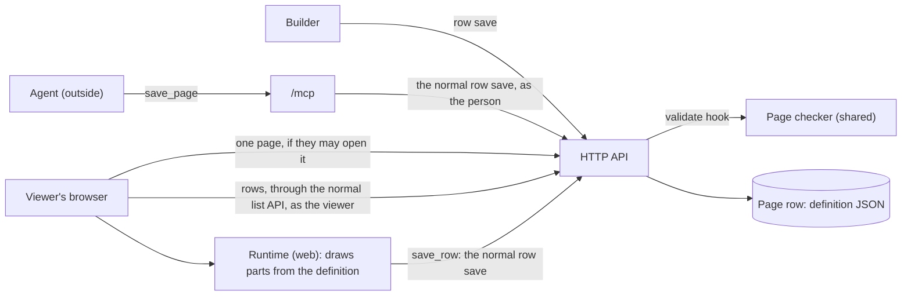

## Context

Issue #1410. The options weighed for each product decision, the A2UI research and the worked example are in `docs/plans/runtime-pages-design.md`. This file holds only the engineering decisions that would be costly to get wrong. Decisions 1 and 2 of that document were agreed by the owner; the decisions below were taken from the worker's recommendation while the owner was away and are his to overrule.

## Decisions

### D1. The page body is A2UI v1.0's shape; Featherbase checks and draws it itself

A page's parts are written in the grammar of the A2UI v1.0 specification: a flat list of parts with ids, children by id or repeated over an array, `{"@path"}` to read a value, `{"@call"}` for a named function, and `action.event` for what a control does. The checker and the renderer are Featherbase's own. See ADR 0028.

Rejected: **A2UI's own packages.** A throwaway proof showed they work with `shop-floor`, but they need zod 3 beside this repo's zod 4, add about 400 kB to the page, wrap every part in a custom element, cannot draw on the server, and break about every two weeks. **A grammar of our own.** It would have to be designed, documented and taught, for no gain over one that is written down and declared stable.

### D2. A page is a row of a platform Table, checked by a save hook

`Page` is a platform Table whose `definition` column holds the JSON. Its check runs in the Table's `validate` hook, inside the save's transaction, so every way of saving a row (the form, the HTTP API, the MCP, a future install) meets the same check and a wrong page is never stored.

Rejected: **a store of its own with its own routes.** It would need its own history, audit trail, grants and MCP plumbing, all of which a row already has.

### D3. A page's rows are fetched by the viewer's browser through the normal list API

The runtime asks for each data source with the list API, as the signed-in person. The server never assembles a page's data on a person's behalf.

Rejected: **one server call that returns the page with its data.** It is one round trip fewer, but it would be a second read path that has to re-implement grants, Data Scope and sensitive columns, and a mistake there shows rows to the wrong person. With the browser asking, a badly written page can show nothing its viewer could not already open in the list view.

### D4. Who may open a page is decided by one read route, not by grants on the Page Table

`Page` keeps a platform Table's default: only System Managers read or write its rows. Everyone else reaches a page through one route that answers a Published page to anyone signed in and a Draft only to someone who may build; to anyone else a Draft answers as a page that is not there.

Rejected: **granting read on `Page` to everyone.** A grant cannot say "published rows only" without a row-level rule, and a draft's definition would then be readable through the generic API by anyone who guessed its name.

### D5. What a person types is kept apart from the rows the page read

Everything a page shows (a column's value, a group's total, a link's label) reads the rows as the server last gave them. What a person types into an `Input` is held in an overlay of its own, which only a bound setting and an action's context read. A button's `save_row` sends the values it names; after any save attempt, refused or not, the sources are read again and a saved row's typed value is cleared.

Rejected: **one copy of the rows that inputs write into**, which is A2UI's two-way binding read literally and what was first built. The UI verifier showed its cost: a typed or refused value fed the group's total, and a row could not be saved again after a refusal because the page still held the old version. **One draft value per control in page state**: every row of a table would share one draft.

## Risks / Trade-offs

- **We own a renderer.** About 300 lines that must follow the A2UI v1.0 rules for paths and scopes. Mitigation: the subset is written down in the design document, and unsupported settings are refused, so a page cannot rely on something that is not drawn.
- **The catalog is small.** A screen that needs a part outside the ten waits for that part. This is the intended pressure: a part is added when a real screen needs it.
- **Editing a published page is live.** A staged draft of a published page is left for a later change.
