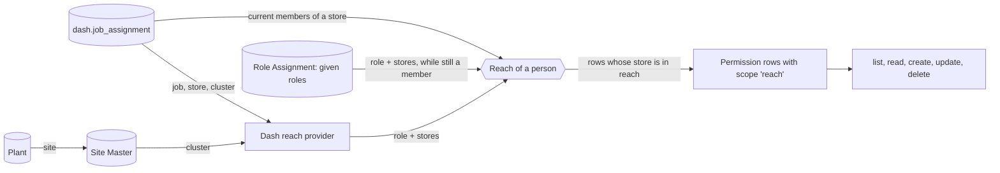

# Design

Piece B of #683 (#919): scopes, memberships and delegation, ported onto the
per-operation permissions of #917 (migration 0150). Built from main, not from
#683's branch. The HR data model (employee, employment stints, designation,
time shares) is #928's and is only read here.

## 1. Reach comes from an app's own provider, enforced by the platform

The app's server module exports a reach provider. Called fresh on every
protected request, it answers which of the app's *job roles* the person holds
and over which stores (a list, or every store). The platform validates the
answer (only roles the manifest lists under `administration.jobRoles`, stores
as non-empty text) and fails closed on any error, as it does for the scope
provider (#559): the provider reads as the platform, only the Tables it
declared, each marked `decides_scope`, one read at a time.

- Dash's provider maps each current job assignment: Store Manager to its
  `store`; Cluster Manager to the plants whose site's cluster is the
  assignment's `cluster` (Plant.site → Site Master.cluster, as the issue
  settled: never typed per person); Chief Operating Officer and Director to
  every store (open question 1).
- *Rejected:* computing reach in platform SQL from a declared membership path
  (#683's `jobs.capabilities`). The cluster path runs through the
  instance's organisation masters (Plant, Site Master), which are not the app's
  Tables, and each new level would be a platform change. The provider keeps the
  org chart's rules in the app, beside the scope provider that already reads
  the same rows.
- *Rejected:* materialising derived roles as Has Role rows. They go stale the
  day an assignment ends, and a stale row is access nobody granted.

## 2. A third row scope on a Permission row: `reach`

Permission's `scope_mode` gains `reach` ("Rows within the holder's reach")
beside `all` and `creator`. A reach grant counts only for a role the person
holds *through reach* (a job role from the provider, or a given role, §3);
holding the same role through Has Role or an App Role Binding gives no
stores, so it gives nothing. Reach grants must be top-level (no line-item
parent, no prerequisite) and must be the app's own grants on Tables the app
declares under `administration.targets`; an install refuses anything else.

Where a row's store comes from is the target's declaration:

- `{ "column": "store" }`: the row's own column.
- `{ "person": "person" }` or `{ "person": "employee.person" }` (one
  Reference hop): the row's person currently works in a store in reach, by the
  app's declared memberships (a current row of the membership Table at that
  store). Employees and stints are read this way.
- `protect`: rows whose named column holds one of the listed values (Dash:
  the jobs that give reach) are never created, changed or deleted through a
  reach grant, before or after the change. Reading them is not protected.

Enforcement is fail-closed by construction: `permissionScope` and
`hasPermission` keep ignoring reach grants, so every path that is not taught
about reach refuses a holder whose only grant is reach. The paths taught
about it are the list query (`scopedWhere`, which also serves count, group
count, search and related filters), opening a row, inserting, updating
(both the stored row and the row as it will be saved must be in reach) and
deleting. Column reach of a reach grant applies only on rows in reach: in a
list, a column readable only through reach reads as empty on other rows, as a
creator-only column does today.

- *Rejected:* returning a new value from `permissionScope`. Its two dozen
  callers compare against `all` and `own_rows`; any one that treated the new
  value as "some rows" without the predicate would widen access. Ignoring
  reach there means a forgotten path refuses instead of leaking.
- *Rejected:* Data Scope rows. Data Scope narrows by a Reference to a
  restricted Table and is per person, typed by an admin; Dash's store is a
  plant code, and reach must follow the job, not a hand-kept list.

## 3. Given roles: bounded delegation in a platform Table

`Role Assignment` (system, written only by the platform) records each given
role: app, person, role, stores, starts on, ends on, who gave it and under
which job role, and when and by whom it was taken back. Rows are never
deleted, so the history stays. The manifest's `administration.delegation`
lists, per job role, the roles it may give.

Giving is refused unless all hold, checked in one transaction:

1. the giver holds, through the provider, a job role allowed to give this role,
   with every requested store in that job role's reach;
2. the role is one the app allows that job role to give, and is not itself a
   job role (no further delegation);
3. the person is not the giver, and currently works in every requested store;
4. the stores are a non-empty list, and an end date is after the start date.

A given role reaches, on each request, the stores it names that its holder
still works in. Taking it back is open to anyone who could give it over all
its stores today (the original giver, or a successor), and to a System
Manager.

- *Rejected:* ending a given role when the giver loses their job. The owner
  settled that the authority is the office's, not the person's (#683, V-cases
  on successors): a new Store Manager inherits the store's given roles and can
  take any of them back.
- *Rejected:* a generic CRUD Table that Store Managers write through grants.
  The checks above span rows and the provider's answer; a system-written Table
  with two checked operations keeps them in one place.

## 4. System Managers keep their bypass

A System Manager still reads and writes every Dash row, as on every Table.
#683's handoff proposed taking the bypass away for app data; that is a
platform-wide change with its own owner decision, not part of this piece.

## 5. Dash roles and grants

- `Dash Store Administrator` (job role): reach grants to read, create,
  change and delete the store layout (floors, departments, sections, section
  subcategories, display locations, section and floor aliases) and job
  assignments (appointments that give reach protected), and to read employees
  and stints of people who work in reach.
- `Dash Store Editor` (given by a Store Administrator): reach grants to read
  the layout and to create and change section subcategories and display
  locations.
- `Dash HR`: every row of employees and stints, to read, create and change.
  Held through Has Role, given by an admin.

Plant and Site Master are the instance's masters, not Dash's Tables, so the
instance setup marks them `decides_scope`
(`instances/dash/instance-setup/mark-reach-tables.mjs`); until it runs, a
Cluster Manager reaches nothing, while a Store Manager, COO and Director are
unaffected (the provider reads the masters only for a Cluster Manager).

The existing Dash roles keep their grants.

## Open questions for the owner

1. **Director and COO reach** (asked in the thread, 07-Nov-2026). Proposed:
   every store. Alternative: the stores whose plant belongs to a legal company
   they hold a current stint with. Built as every store; the alternative is one
   entry in Dash's job table.
2. **Rolling Dash 0.12.0 out to staging.** An upgrade refuses grants added on
   Tables the app already had (#437), and this version adds them. Either
   staging reinstalls Dash fresh, or the upgrade rule admits grants of roles
   the new version introduces (they have no holders until a job or a giver
   gives them). Neither is built here.
