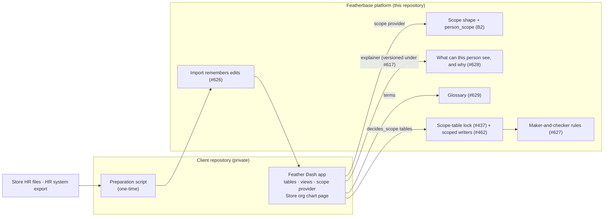

## Context

Feather Dash (a client app, ADR 0013) shows each manager the sales and targets of what
they are responsible for. B2 (#559, merged in #616) gave the platform a fixed **scope
shape**, a `person_scope` policy and an **app-declared scope provider**. The provider
fills the shape; the platform enforces it. What the provider reads today is nine tables
loaded one-for-one from store workbooks and an HR export (#449). This design replaces
those inputs. It does not change the platform's shape or policy.

The instance owner settled every decision below on 27-Oct-2026, in a walkthrough
recorded in the client's private repository. Examples here are synthetic.

## Goals / Non-Goals

**Goals**
- One clean, dated model of how each store is laid out and who runs what.
- Coverage that can be rebuilt for any past date, so a re-run report credits the
  people who held the job then.
- Corrections made in one place (the row), by the people closest to the work, with a
  second pair of eyes.
- A move off the old sheets that cleans the data first, store by store, inside
  Featherbase.

**Non-Goals**
- Section cost allocation, daily staff-to-section tags, sales per staff-day and KRAs.
  The business owner has raised these; they are outside this design.
- Store assortment (which subcategories a store is meant to carry). It is noted as a
  later entity.
- Share-of-credit placement (a subcategory split across sections by percentage). One
  owning section is the share model with every share at 100%, so shares can be added
  later through display locations without a redesign.
- Versioning the merchandise hierarchy.

## Containers (C4, level 2)

## Decisions

### D1. Three separate structures, joined in one place
The **merchandise hierarchy** (division → subdivision → category → subcategory) is how
the business buys, and it is the same in every store. The **store layout** (store →
floor → section) is how one store sells, and each store's is its own. **Placement**
(`section_subcategory`) is the only link between them. The org chart meets the layout
only where a Team Leader or Staff member holds a section.

### D2. Section name unique per store; floor is a field of the section
- *Why:* an import cannot quietly create a second "Women Tops", and moving a section is
  a one-field edit that keeps its history.
- *Cost:* two real areas that share a label on different floors need different names.
- *Rejected:* a floor on the placement row. It makes conflicting data look valid.
- A section's floor is a plain edit, not dated. A past month's Floor Manager coverage is
  worked out with today's floors. This is accepted, because floor moves are rare and a
  floor decides only who can see a section, never who gets the money.

### D3. One owning section per subcategory per store, dated
- Anything that moves money is dated. The key is (store, subcategory, starts_on), and
  periods may not overlap.
- Display locations are a many-to-many list. That is acceptable because they carry no
  credit and no coverage, so a wrong row cannot distort any number.
- *Rejected:* share-% placement. The shares don't exist in any system. Every report would
  have to split credit identically. Coverage would become fractional. Shares need
  rebalancing at every rearrangement. And they are easier to game.

### D4. `job_assignment`: one table, one row per person × job × place × period
- Floor only for Floor Managers, section only for Team Leaders and Staff. Above them,
  coverage is worked out (D6).
- *Rejected:* a DM row per section (it duplicates what the reporting lines say), a link
  table, and a named "department" or "cluster" entity (pays off only if those are stable
  named groups).
- `store` is carried on the row although the section implies it (a deliberate departure
  from 3NF). A (store, section) reference guarantees the section is in that store, and
  every job filters by store the same way, with no join.
- "Position" was rejected as a name: in HR a position exists without a person. "Role" is
  reserved for Featherbase permissions.

### D5. Dating, acting and one store at a time
- **Handover:** close and open on the same date, `ends_on` exclusive, so there is never a
  gap or an overlap. *Rejected:* editing in place, which is what lost history in the old
  sheets.
- **Acting** is a flagged dated row; the absent person's row stays open. *Rejected:* a
  separate cover table (two places for coverage to read) and treating acting as a
  handover (it loses "still holds their own job").
- **One store at a time,** except Cluster Manager. Cover in another store and seasonal
  redeployment are handovers both ways. *Rejected:* an acting row in the other store
  (two stores at once) and a secondment flag.

### D6. Coverage: one rule per job, worked out, never stored
| job | rule |
|---|---|
| Store Manager | the whole store |
| Floor Manager | their floors only |
| Department Manager | the sections of the TLs reporting to them |
| Team Leader, Staff | their section |
| Cluster Manager | their stores |

- *Why the Store Manager sees the whole store:* a section with no Team Leader, or a TL
  with no reporting line, must still be seen by the person accountable for the store.
- *Why a Floor Manager sees only their floors:* the floors are what they are assigned
  to, and the reporting lines from the HR system are unreliable. A mismatch is raised as
  a conflict instead of widening anyone's coverage.
- Feather Dash's scope provider (B2) returns this in the platform's shape. The
  `confirmation` field marks a place as `assumed` while its store is "not live yet".

### D7. Allow and flag, then enforce
- The one-owner rules (one Team Leader per section, one section per Team Leader) are
  listed as conflicts while the data is being cleaned. The database enforces them once a
  store's list is empty and the instance owner switches the rule on.
- The one-store-at-a-time rule, the job-to-floor/section shape and non-overlapping
  placement are enforced from the start, because clean rows can always satisfy them.

### D8. One alias table per entity
- This follows the warehouse's existing pattern of (source, alias) → real key. Each alias
  is a reference to a real row, so the database refuses an alias for something that does
  not exist. One "needs matching" view lists every unmatched value across the tables.
- *Rejected:* one free-text `value_mapping` table, which cannot guarantee its targets
  exist, and per-table "xref" sheets.
- Override tables are retired. A correction is an edit to the row, and #626 keeps it
  through the next import.

### D9. Who may write
- **Store tables:** the Store Manager, or their delegate, makes changes. The Store Manager
  approves others' changes. The Store Manager's own changes go to a second approver,
  always for job assignments. Nobody approves their own change.
- **Central tables:** `job_alias` and Cluster Manager rows. An Org Chart Admin and
  System Managers keep them, because a designation must mean the same thing in every
  store.
- These are approval rules under #627. The tables decide scope, so they are marked
  `decides_scope` and locked to System Managers by #437. Letting a scoped Store Manager
  write them at all is #462. This design depends on #462 but does not decide its
  questions.
- *Rejected:* central-only editing, because every festive rearrangement and handover
  would wait on a central team.

### D10. Clean first, inside Featherbase
1. A one-time script in the client's repository builds clean rows. It reads the store HR
   team's corrected files first, the HR system only for gaps, and the existing store
   workbook for the one store that has one. Missing values stay missing.
2. The rows load marked "not live yet" per store. Reports keep reading the old sheets for
   that store.
3. Each store's conflict and needs-matching lists are its cleaning to-do list. Stores fix
   rows through the same maker-and-checker flow they will use afterwards.
4. A store switches live when both lists are empty and its old-versus-new coverage
   comparison is accepted. Stores switch one at a time.

*Rejected:* load the old sheets as-is and clean afterwards. That moves the breaches into
the new tables, where they look legitimate.

### D11. Where the tables live
The Feather Dash client app owns the tables (ADR 0013): they carry retail terms, and no
second app needs them. "A feature joins the platform only when a second app needs it."
The four generic features are platform work, because any app with imported data,
approvals, access or vocabulary needs them. *(This follows ADR 0013. The instance owner
has not ruled on it separately.)*

## Risks / Trade-offs

- **Coverage changes at cut-over.** Today's coverage is derived from inconsistent sheets,
  so the new rules will differ, for example a Floor Manager who now sees only their
  floors. → The per-store comparison lists every difference with its reason, and the
  store switches only when the list is accepted.
- **The cleaning stalls in one store.** → Stores switch independently, and a stalled
  store keeps the old sheets.
- **#462 is not ready at go-live.** → Until it is, a System Manager applies approved
  changes, and the maker-and-checker rules still record the maker and approver.
- **A wrong reporting line from the HR system.** → The HR system only seeds lines. People
  correct them, and #626 keeps the correction.
- **Floor history is not kept.** → Accepted (D2). Revisit if floor moves turn out to be
  common.

## Migration Plan

Per store, as D10 describes. The platform needs no migration for this change. Any that
the build needs are claimed on #566 first, must be converging, and must work on a fresh
database, because go-live is a fresh install. Rollback is per store: switch the store
back to the old sheets, which stay read-only until every store is live.

## Open Questions (pending the business owner)

1. Further jobs for cashiers, billing staff and assistant titles, and whether the
   customer-service family is all Staff.
2. How each store's Floor Managers map to its floors, and whether a floor can be shared
   or split.
3. Seasonal redeployment: who moves, who decides, how long, and whose target they work
   against.
4. Who approves a Store Manager's placement change: the Category Head, the Cluster
   Manager, or parallel store-side and category-side approvals.
