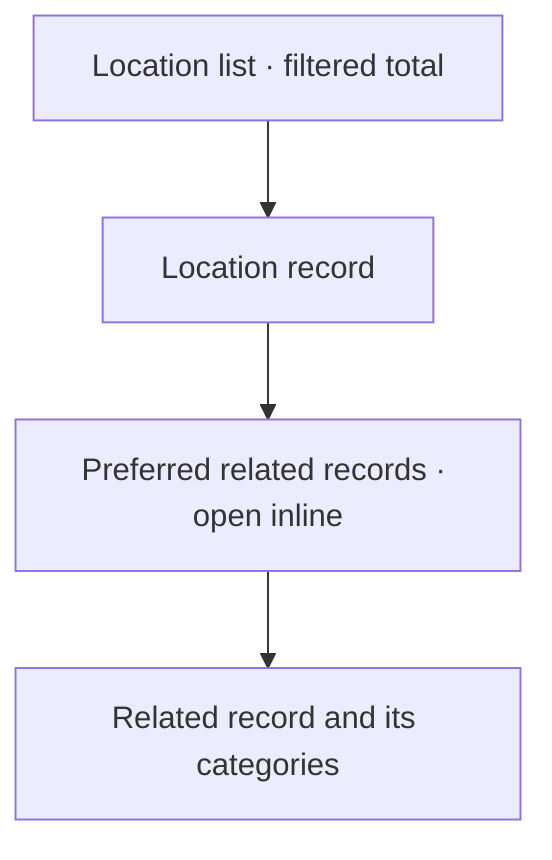

## Decisions
The metadata contract is `browse_presentation: { default_filters?, preferred_related?: {table,column} }`. Definitions validate direct reverse references and local filter columns. Omitting settings preserves them; explicit null clears them. Queries still pass through existing permission checks. URL absence uses defaults, while explicit `[]` is an intentional all-rows view.

Display labels are optional existing metadata; they do not change URLs or relationship identity. No customer records or names are part of this change.

## Desktop flow

## Deployment
Rehearse the nullable-column migration on a restored snapshot before applying to a live instance. Runtime configuration is a separate private, owner-approved operation. No deployment is included in this branch.
