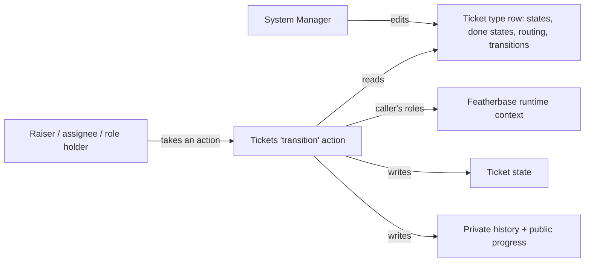

# Design: ticket type transitions

## Decisions

### 1. Transitions are a JSON list on the ticket type row

The type row gains one `transitions` column holding a list of `{state, action, next_state, allowed, fields}`. Its
keys are the platform Workflow transition's, plus `fields`. Routing already lives on the same row as JSON, so one
type is still one row, and the upgrade is one added column.

Rejected: a child Table of transition rows, like the platform Workflow. It gives each row a form, but costs a new
Table, its permissions and its own validation across rows, for a list a System Manager writes once per type.

`condition` (the platform Workflow's row expression) is refused for now rather than silently ignored.

### 2. A role is a platform role, told to the app by the runtime

`allowed` names `assignee`, `requester`, `any`, or otherwise a role. The runtime tells an action and a read the
caller's own roles; it never says anything about another person.

Rejected: a Tickets setting listing the people in each named group (as `support_users` does). It works without a
platform change, but it is a second place to grant a role, which drifts from the first.

### 3. `any` means anyone involved in the ticket

`any` is the raiser, the assignee or a Tickets support user. A colleague who can see a ticket's summary is not
involved: shared visibility never grants a change (stage one's rule).

### 4. Action fields are type fields

A transition names type fields. Those fields are asked at that action and left off the new-ticket form; at the
action they are required whatever their own required flag says. Their values are kept with the request's details
(the latest value shows on the ticket) and every value is kept in history.

Rejected: values only in history. The page would have to replay history to show the current fix plan.

### 5. Types without transitions are untouched

Only a type with at least one transition changes behaviour, so existing types and their tickets keep working.
