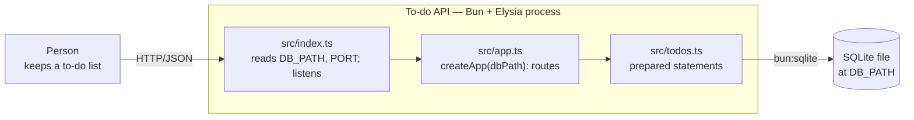
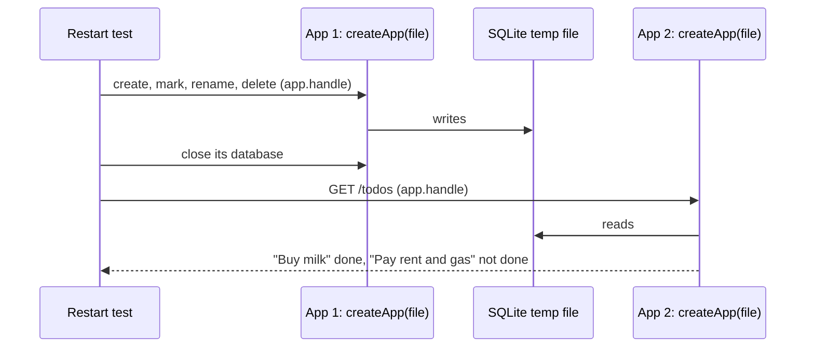

## Context

First code on this branch. See `proposal.md` for why and `specs/todos/spec.md` for the seven
scenarios. No ADRs exist yet (`adr/` does not exist), so no prior decisions constrain this
design. Happy path only: invalid input, unknown ids and missing config are unspecified here and
belong to `todo-list-validation`.

Diagrams are plain Mermaid, lightweight C4: a container view and one dynamic view.

### Container view

The boxes inside the process are modules, not containers; they are shown only to name where
each responsibility lives.

### Dynamic view — the restart scenario

App #2 is a new object with its own connection, so nothing in memory carries over: whatever it
lists came from the file.

## Goals / Non-Goals

**Goals:**
- The seven scenarios in `specs/todos/spec.md` pass, through the API below.
- To-dos survive a restart: a new app on the same file lists what an earlier one wrote.
- 100% line and function coverage with **nothing excluded**, `src/index.ts` included.

**Non-Goals:**
- Request validation, error responses, unknown ids, missing config (→ `todo-list-validation`).
- Migrations, an ORM, a UI, users or authentication.

## Decisions

### API shape

| Operation | Request | Response |
|---|---|---|
| Create | `POST /todos` `{ "title": "Buy milk" }` | `201` + `{ id, title, done: false }` |
| List | `GET /todos` | `200` + `[{ id, title, done }, …]` in creation order |
| Mark done / not done | `PATCH /todos/:id` `{ "done": true }` | `200` + the updated to-do |
| Rename | `PATCH /todos/:id` `{ "title": "Buy oat milk" }` | `200` + the updated to-do |
| Delete | `DELETE /todos/:id` | `204`, no body |

- **One `PATCH` for mark and rename** — the handler updates whichever field is present.
  Alternatives: separate routes (`POST /todos/:id/done`, `PUT /todos/:id/title`) — more routes to
  learn for the same behaviour; `PUT` — forces sending the whole to-do to tick one box.
- **`id` is an integer assigned by SQLite** (`INTEGER PRIMARY KEY`); ordering by `id` gives
  creation order, so no `created_at` column. Ids are not contiguous after deletes; order still
  holds. Alternative: UUIDs — would need a separate sort column.
- **`done` is a JSON boolean**, stored as `0/1`; `todos.ts` converts on read.
- **No request schema** (`t.Object`) in this change: declaring one switches on Elysia's
  validation with no test asking for it. It arrives with `todo-list-validation`.

### Structure

- **`src/app.ts` — `createApp(dbPath)`** opens the database, ensures the table, and returns an
  Elysia app with the five routes. It reads no environment variables.
- **`src/todos.ts`** — raw `bun:sqlite`: `create`, `list`, `update`, `remove` over prepared
  statements, plus the `0/1 → boolean` conversion. Table:
  `todos(id INTEGER PRIMARY KEY, title TEXT NOT NULL, done INTEGER NOT NULL DEFAULT 0)`,
  created with `CREATE TABLE IF NOT EXISTS` — which is also why app #2 finds it after a restart.
  Alternatives: Drizzle — a dependency, CLI and config to learn alongside Elysia, not earned by
  one unchanging table; all SQL inline in the handlers — mixes SQL, conversion and HTTP, and the
  store is testable only through HTTP.
- **`src/index.ts`** — reads `DB_PATH` and `PORT` (**no defaults**), calls `createApp(...)`,
  `.listen(...)`, and exports the server so a test can stop it. Run locally through a
  `package.json` `start` script that sets both. No defaults means no untested default branches
  or surviving Stryker mutants.

### Testing

- **Scenario and route tests call `app.handle(new Request(...))`** — in-process, real Elysia
  routing, no port or network. Alternative: a real server per test — slower, needs ports.
- **A restart is a new `createApp` on the same file** (see the dynamic view). Alternative:
  kill and restart a subprocess — slower and flakier, and proves nothing more.
- **`src/index.ts` has its own smoke test**: set `DB_PATH` to a temp file and `PORT=0` (Bun picks
  a free port), dynamically import it, create and list one to-do with a real `fetch`, stop the
  server. This covers every line of `index.ts` and the socket layer.
- **Each test gets its own database** — `:memory:`, or a fresh temp file (deleted afterwards)
  where a file is needed — so parallel Stryker workers never share state.

## Risks / Trade-offs

- [Bun's coverage report lists only files some test imports — an untested file is invisible,
  not 0%] -> every `src/` file is imported by a test (the `index.ts` smoke test exists for this),
  and `knip` at reconcile flags any file nothing imports.
- [`CREATE TABLE IF NOT EXISTS` is not a migration] -> fine for one table; adopt a migration tool
  with the first schema change.
- [Missing `DB_PATH` or `PORT` is unspecified] -> the `start` script sets both;
  `todo-list-validation` specifies the behaviour.
- [`PATCH` with neither field, or both, is unspecified] -> deferred to `todo-list-validation`.
- [The `index.ts` smoke test sets `process.env` and imports a module once per process] -> it
  lives in its own test file and restores the variables afterwards.

## Migration Plan

None — nothing exists yet. Rollback is reverting the change's commits.

## Open Questions

None. No in-force ADRs to revisit.
