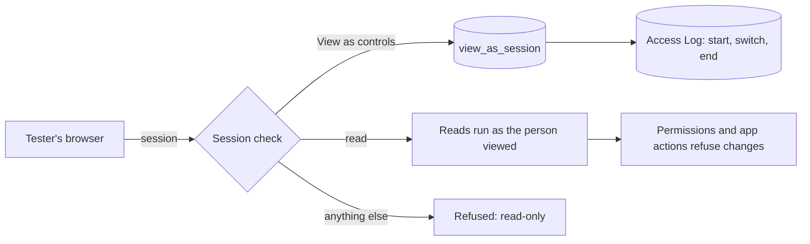

## Context

Dash's reads never look at a session: the platform hands each one the person, their roles and their places. So the platform is the one place that can make a read run as someone else, and the one place that can refuse every write.

## Decisions (proposed; the owner settles them, #1222)

### D1. The swap happens where a request learns who it is
Every request already passes one session check. While viewing, that check hands the rest of the request the viewed person, so every read in Dash and Featherbase follows that person's access with no page-by-page code.
*Rejected:* passing a "view as" person into each Dash read. Featherbase pages would not follow, and each new read would have to remember it.

### D2. Read-only by default-deny, with guards behind it
While viewing, only reads pass the session check (GET requests and app reads). Every other request is refused before it is routed, so a write endpoint added later is covered too. Behind that, permission checks answer "no" to every change and app actions refuse, so a write reached from inside a read is still stopped.
*Rejected:* an allow-list of write endpoints to block. It fails open for any endpoint added later.

### D3. The state is kept on the server, per session
One row per signed-in session (the token's id), with an end time. Exit, sign-out, session end, expiry or losing the role end it; nothing travels in a link or another browser.
*Rejected:* a new token carrying the viewed person. The browser would have to swap tokens, and an issued token can't be withdrawn before it expires.

### D4. The role is the app's, declared to the platform
Dash declares View As Tester and the read that finds people (`viewAs`). The platform checks the role and runs the read as the tester. The role must be one of the app's own roles; an app upgrade may add it and its read grant, as #1169's rule allows for an app's own roles.
*Rejected:* a built-in platform role. An app may grant its read only to its own roles, so the people read would need a platform exception.

### D5. Who can't be viewed
Yourself, a built-in account, someone turned off, and anyone who holds System Manager or Administrator. Read-only as a System Manager would still read the whole instance.
*Rejected:* allowing it read-only. It turns a tester role into a read-everything role.

### D6. "A job at a store" finds a real person
Typing a job and a store finds the people holding that job there today. Their view is real: reach comes from their jobs, sections, buyer assignments and grants.
*Rejected:* simulating a reach for a job. It can differ from what any real person sees, and that difference is what testing is for.

### D7. The logs tell the truth
Start, switch and end are Access Log rows under the tester naming the person. A report view recorded while viewing goes under the tester, marked "viewing as". The browser's recent-pages trail is not recorded. Recent and Frequently used are read from the Access Log, so they follow the tester across devices and need no store of their own.

